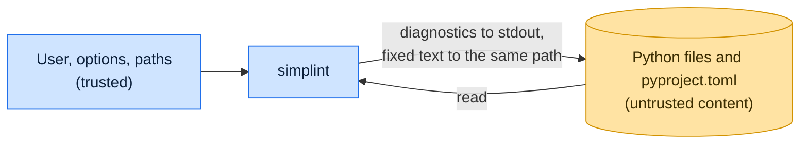

# Threat model

This model says what simplint trusts, where untrusted input enters, and which guarantees hold at each boundary, so a
report can be classified as a vulnerability or a bug. [SECURITY.md](SECURITY.md) covers reporting; if the two disagree,
SECURITY.md wins and we fix this file.

## How simplint works

simplint walks the paths named on the command line, honoring `.gitignore`, and parses every Python file it finds with
Ruff's parser crates. It reads the nearest `pyproject.toml` for settings. It reports diagnostics on standard output and,
with `--fix`, writes the fixed source back to the same file; `--diff` prints the changes instead. It runs no code from
the files, makes no network requests, and writes only files in the run. It typically runs as a pre-commit hook or in CI
against content from pull requests.

## Compared with similar tools

We drew the boundary where comparable projects draw theirs. The shared rule, stated by the
[Node.js threat model](https://github.com/nodejs/node/blob/main/SECURITY.md#the-nodejs-threat-model), is that a report
which first needs a trusted element compromised is out of scope; the first triage question, as
[DOMPurify](https://github.com/cure53/DOMPurify/blob/main/SECURITY.md#what-we-consider-a-vulnerability) puts it, is what
the attacker controls.

| Project                                                                      | Language | Where it draws the line                                                                      |
| ---------------------------------------------------------------------------- | -------- | -------------------------------------------------------------------------------------------- |
| [Ruff](https://github.com/astral-sh/.github/blob/main/SECURITY.md)           | Rust     | Takes reports by email and discloses critical ones through GitHub advisories; no bug bounty. |
| [Flake8](https://github.com/PyCQA/flake8/blob/main/.github/SECURITY.md)      | Python   | Routes reports through the Tidelift security contact, which coordinates fix and disclosure.  |
| [Pylint](https://github.com/pylint-dev/pylint/blob/main/.github/SECURITY.md) | Python   | Points to the Tidelift coordinated disclosure plan; the policy defines no further scope.     |

## Trusted

An attacker who controls any of these already has what simplint could give them:

- The user, the command-line options and the paths to lint.
- The machine and environment simplint runs in.

## Untrusted inputs

| Input                                     | Comes from                         | What simplint guarantees                                                                             |
| ----------------------------------------- | ---------------------------------- | ---------------------------------------------------------------------------------------------------- |
| Contents of each Python file              | Anyone who can open a pull request | Treated as data: parsed and printed, never evaluated or used to choose another path.                 |
| `[tool.simplint]` and `[tool.ruff]`       | The repository being linted        | Choose rules, exclusions and the target version only; they never select a path to write or run code. |
| `[project]` dependencies and entry points | The repository being linted        | Read as names only.                                                                                  |

## Threats and controls

| STRIDE                 | Threat                                             | Control                                                                                 |
| ---------------------- | -------------------------------------------------- | --------------------------------------------------------------------------------------- |
| Tampering              | A crafted file makes `--fix` write somewhere else. | The output path is the input path; content never selects a path.                        |
| Tampering              | A fix produces broken code that gets written.      | Every fix is reparsed before writing; a fix that does not parse aborts the file.        |
| Information disclosure | Linting pulls in another file's content.           | Other files are read only to index imported names, and only inside the run.             |
| Denial of service      | A short input triggers a hang or a fix loop in CI. | Fixes stop after a fixed number of rounds; a small input that hangs is a vulnerability. |

## Release chain

Releases run on the shared [tox-dev/github-workflows](https://github.com/tox-dev/github-workflows) pipeline. A release
App, not a person, pushes the release commit and tag; the build installs its tools from a hash-checked `pylock.toml`
resolved with a seven-day upload cooldown by default; PyPI receives the files through
[trusted publishing](https://docs.pypi.org/trusted-publishers/) with attestations, and the GitHub Release is immutable.
Every workflow pins third-party actions to a commit SHA.

## Vulnerability or bug

| Report                                                | Verdict             | Why                                                  |
| ----------------------------------------------------- | ------------------- | ---------------------------------------------------- |
| A crafted `.py` file makes `--fix` write another file | Vulnerability       | Content must never choose an output path.            |
| A 1 KB file makes the fixer loop forever              | Vulnerability       | Small-input hang in CI.                              |
| A safe fix changes what the program does              | Bug                 | Changes meaning; fix it in the open.                 |
| `--unsafe-fixes` breaks callers of a dataclass        | Not a vulnerability | Unsafe fixes may change behavior; the user opted in. |

## Severity

- **High:** linting an untrusted file executes code, reads or writes a file outside the run, or makes a network request.
- **Medium:** a small input hangs simplint or exhausts memory.
- **Low:** a panic or crash on malformed input instead of a clean error.

## Accepted risks

- `--fix` follows a symlink at a path in the run.
- Linting is not a safety review: valid but malicious code is reported on its style, not removed.

## Keeping this current

Revisit this model when simplint gains a new input source, network access, a new way to run code, or a new place it
writes to, and whenever an advisory is published.
