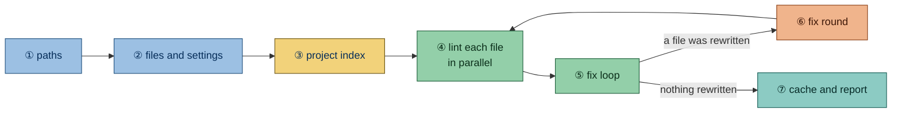
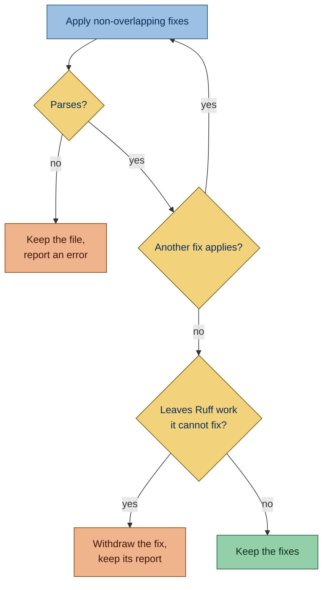

# Contributing to simplint

simplint is a [Rust](https://www.rust-lang.org/) binary packaged in a Python wheel with
[maturin](https://www.maturin.rs/). Its rules run on the parser and linter crates from
[Ruff](https://docs.astral.sh/ruff/).

## Repository layout

- `src/` holds the linter, one directory per layer. Each rule family has a directory of its own, with one source file
  per rule and a Markdown page of the same name next to it, compiled into the binary.
- `tests/` covers the CLI, rule families, installed wheels and maintenance tasks. Each rule's fixtures and expected
  diagnostics live together under `tests/fixtures/`.
- `docs/` is the [Sphinx](https://www.sphinx-doc.org/) site published on [Read the Docs](https://readthedocs.org/).

## How a run works

A run resolves settings for each file. Rules that need information about other files share a project index.

| Concept           | What it is                                                                                        |
| ----------------- | ------------------------------------------------------------------------------------------------- |
| **Settings**      | Each file's simplint and `Ruff` configuration, found from its location, as `Ruff` finds it.       |
| **Project index** | What each file imports from the others, built for the whole run before any file is linted.        |
| **Checker**       | One file's parse, semantic view and diagnostics. Every rule of the file shares the one parse.     |
| **Rule**          | A function that reads the checker, or reacts to nodes during the walk, and may report a fix.      |
| **Fix loop**      | Applies a file's fixes until none apply, then checks the result against `Ruff`.                   |
| **Fix round**     | Re-indexes the files a fix rewrote, and lints again the files whose index answers changed.        |
| **Cache**         | Stores import facts and lint results per package, including diagnostics for checks without fixes. |



### Example

Consider two files where `cli.py` imports `LIMIT` but `config.py` leaves it out of `__all__`.

```python
# config.py
LIMIT = 3
__all__ = []

# cli.py
from config import LIMIT
```

1. **Paths**: `simplint check --select SMP401 --fix .` checks the current directory for missing exports.
1. **Files and settings**: discovery finds `config.py` and `cli.py` and resolves the settings of each. simplint stops
   with an error here when a simplint rule and a `Ruff` rule that contradict each other both apply to a file.
1. **Project index**: the index records that `cli.py` imports `LIMIT` from `config.py`.
1. **Lint**: in `config.py`, SMP401 (`missing-from-all`) asks the index who imports `LIMIT`, finds `cli.py`, and reports
   that `__all__` is missing it, with a fix that adds it.
1. **Fix loop**: the fix rewrites `__all__` and the file is parsed again. The fix leaves `Ruff` nothing new to fix, so
   it stands.
1. **Fix round**: `config.py` was rewritten, so its facts are collected again, and any file whose answers from the index
   changed is linted again. A round that rewrites nothing ends the loop.
1. The cache stores import facts and clean results for reuse. The run prints how many reports it fixed.

### Project index

`Project` records:

- which names of each file the others import
- which names other code reaches by a dotted string, such as a `mock.patch` target
- the names `.pyi` stubs declare
- every attribute name assigned anywhere
- every base class name

Module names resolve to files with [ty](https://docs.astral.sh/ty/)'s module resolver, through the same
[Salsa](https://github.com/salsa-rs/salsa) database as `ruff analyze graph`. Rules ask the index before renaming or
moving a name.

### Checker and rules

A checker holds one file's parse, a lazily built semantic view of module-level bindings and references, and the
diagnostics. The view follows `Ruff`'s semantic model, which simplint fills the way `Ruff`'s own checker does.

A rule takes one of two shapes:

- **Module rule**: reads the module whole, as a function that takes the checker.
- **Node rule**: reacts to statements, expressions and other nodes, as functions named after those nodes that take the
  walker. One walk over the module hands each node to the functions of the enabled rules and tells them where the node
  sits, as `Ruff`'s checker does.

A file's reports stay grouped by rule in table order, so reports at the same position keep that order. They then pass
through the `noqa` filter before the fix loop.

### Fix loop

The fix loop applies non-overlapping edits, reparses the file and repeats until no more fixes apply. It compares the
result with the original file using the project's enabled Ruff rules. Cleanup can apply either a safe or an unsafe Ruff
fix for a newly introduced finding. If a new finding remains, simplint can withdraw individual fixes or all fixes from
the responsible rule. The original reports remain available.

simplint estimates formatted line lengths before `ruff format` runs. A fix that breaks syntax, or a fix loop that
exceeds its iteration limit, leaves that file unchanged and reports an error. Checks continue on the other files.



## Development commands

Use Cargo for `Rust` changes:

```bash
cargo fmt
cargo clippy --all-targets --locked -- -D warnings
cargo test
```

Test the built wheel and the repository tooling through [tox](https://tox.wiki/):

```bash
tox run -e 3.15
tox run -e tasks
tox run -e type
tox run -e fix
```

Choose an installed Python version if 3.15 is unavailable. `tox` skips missing interpreters.

## Adding a rule

1. Add a line to the `rules!` table in the rule registry: variant, code, kebab-case name, one-line summary, fix
   availability, the rule's module, and its hooks: `module` for a rule that reads the whole module, or the node kinds it
   reacts to, such as `statement` and `expression`. The rule set holds at most 1024 rules, which a compile-time
   assertion checks.
1. Write the rule in its own file in the family's directory, named after the rule:
   - A `module` rule is a function of that name, re-exported from the family's module.
   - A node rule's module is public in the family and holds a function for each hook. Prefer a node rule to walking the
     module again.
   - Report through the checker. Mark the fix unsafe if it can change program behavior.
1. Put the Markdown page beside the rule. Start with a summary, explain why the pattern matters and show a reported
   example alongside the preferred code. Under What it does, document cases the rule reports or skips and when it can
   fix them. Use Configuration for settings and document any overlap or conflict with Ruff.
1. Add a fixture under the rule's family directory and a `test_case` row to the family's rule tests. Generate a pending
   snapshot with [insta](https://insta.rs/)'s `cargo insta test`, then inspect and accept it with `cargo insta review`.
1. Add a `feature` fragment to `changelog.d/`.

## Tests

Write behavior tests through the public entry points. Keep one assertion target per test, parameterize repeated cases,
and use fixtures for shared setup.

Rule tests run the binary on a copy of the fixtures and render the diagnostics and the fully fixed file into an `insta`
snapshot in the rule's fixture folder. The copy merges every rule folder into one project root, so:

- a `test_case` names its fixture by its path below the rule folder
- a fixture can import, or be tested by, another rule

Use `cargo insta test` to generate pending snapshots and `cargo insta review` to inspect and accept them.

```bash
cargo insta test
cargo insta review
```

The crate enforces 100% line coverage, with only the fix error reports excluded:

```bash
cargo llvm-cov --ignore-filename-regex 'fix/errors\.rs' --fail-uncovered-lines 0 --show-missing-lines
```

### Real-world projects

The `ecosystem` environment downloads pinned [PyPI](https://pypi.org) source distributions into a cache under `.tox`.
For each project it compares a Ruff-only copy with one also fixed by simplint, with unsafe fixes enabled. It checks for
tool errors, newly invalid Python files, increases in enabled Ruff findings and new undefined or redefined names. A
second pass checks whether more fixes or formatting changes appear, allowing for changes that Ruff makes on its own.

```bash
tox run -e ecosystem
tox run -e ecosystem -- requests click
```

CI runs this check for changes to the linter, tests, docs, tasks and build configuration. Run an affected project's own
tests when you need to check runtime behavior.

Pass `--target-version 3.10` to run simplint's checks for Python 3.10 and verify that files that compiled before fixing
still compile with that interpreter. The task locates the interpreter with [uv](https://docs.astral.sh/uv/). Without the
flag, it uses the project's declared target for simplint and the running Python to parse files.

```bash
tox run -e ecosystem -- --target-version 3.10 requests
```

Refresh the pins in the ecosystem task from [top-pypi-packages](https://hugovk.github.io/top-pypi-packages/) when the
list drifts.

## Documentation

Edit the files under `docs/`. `PyPI` shows `README.md`, so keep its links absolute.

The documentation build reads the rule registry and its Markdown pages, so `Read the Docs` can build the site without
compiling Rust. `cargo test` compares the resulting rule list against `simplint rules --output-format json`. This check
needs Python 3.10 or later on `PATH` as `python3` or `python`.

The CLI reference uses a checked-in schema. When a flag changes, `cargo test` rewrites the stale file and fails so you
can review and commit the update.

Build the documentation with `tox run -e docs`. Run `tox run -e docs_links` after adding external links. The scheduled
link check runs daily.

## Configuration schema

`simplint.schema.json` is the JSON Schema of `[tool.simplint]`, printed by the hidden `simplint config-schema`
subcommand. [schemars](https://graham.cool/schemars/) derives it from the option structs in the settings module, so
their doc comments become its descriptions, and rule selectors take their values from the rule registry. When an option
or a rule changes, `cargo test` fails once and rewrites the file; commit it. The tasks tests check the documented
examples against it, so run `tox run -e tasks`.

[SchemaStore's pyproject schema](https://www.schemastore.org/pyproject.json) references the simplint partial. A release
tag starts the update workflow. Pull requests that change the schema or its registration files also stage and validate
the changes against SchemaStore.

The staging job runs SchemaStore's formatter and checks, then passes a patch to a separate job. Only the push job
receives `SCHEMASTORE_TOKEN` from the `schemastore` environment. The token needs read and write access to contents and
workflows on the maintainer's fork so it can sync the fork and update the submission branch.

The workflow updates an open SchemaStore pull request by pushing to its branch. If none is open, the run summary
contains a link to open one. To retry a release, start the workflow manually with its tag.

## Changelog

Add one nonempty fragment to `changelog.d/` for each user-facing change:

- Use a descriptive filename such as `+narrow-patch-matching.bugfix.md`; release preparation links it to the
  squash-merged pull request. A numeric PR filename also works.
- Put separate changes in separate files, including changes in different categories.
- The fragment text may use Markdown links.
- Do not write credits in it: release preparation credits the pull request's commit authors and runs
  `release-creator contributors` to add a New Contributors subsection.

Choose the suffix for the effect on users:

| Suffix                                                           | Use for                               |
| ---------------------------------------------------------------- | ------------------------------------- |
| `feature`                                                        | a new rule or option                  |
| `change`                                                         | changed behavior                      |
| `bugfix`                                                         | a correction                          |
| `doc`                                                            | documentation                         |
| `breaking`                                                       | an incompatible change                |
| `security`, `performance`, `deprecation`, `removal`, `packaging` | those changes, when they affect users |

Apply `skip news` when the change has no user-facing effect. Bot pull requests without a fragment receive it
automatically. Documentation builds show pending fragments under Draft on the changelog page.

Release preparation folds the fragments into [CHANGELOG.md](CHANGELOG.md), formats it with
[prek](https://github.com/j178/prek), commits the new version, and pushes the tag. The tag starts the build and publish
workflow, which creates a [GitHub](https://github.com) Release after `PyPI` succeeds and then starts the
[simplint-pre-commit](https://github.com/gaborbernat/simplint-pre-commit) mirror, which tags the same version. The
mirror job mints its token from the release App, which needs access to the mirror repository. If a release ran before
that access existed, run the mirror's workflow by hand.

## Generated files

The table that SMP303 reads for the standard library submodules a dependency guard can import is generated. A workflow
rewrites it weekly from `CPython`'s `Lib/` trees and opens a PR when it changes. Regenerate it by hand when `CPython`
adds a minor version to the refs list that the stdlib submodules task keeps:

```bash
git clone --filter=blob:none https://github.com/python/cpython ~/cpython
uv run tasks/stdlib_submodules.py ~/cpython
```

The task reads Git trees with `git ls-tree`. The filtered clone can fetch file contents on demand.

The rules that compare exception classes read a generated table of the standard exception classes and their bases.
Regenerate it when a supported Python version is added or dropped, passing the oldest and the newest interpreter; a
class whose bases differ between them is left out:

```bash
uv run tasks/exception_hierarchy.py python3.10 python3.15
```

## Before committing

Run the checks for each changed layer:

| Change        | Checks                                                      |
| ------------- | ----------------------------------------------------------- |
| rule          | its snapshots reviewed, coverage, and the rule page updated |
| documentation | docs build, plus link checking for new external links       |
| `tasks/`      | `tox run -e tasks`                                          |

Keep commits limited to one concern.
