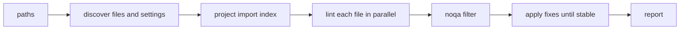

# Contributing to simplint

## Repository layout

simplint is one Rust crate that builds the `simplint` binary. maturin packages that binary into a Python wheel, the way
Ruff ships, so the Python side holds only packaging, documentation and maintenance scripts:

- `src/` holds the linter, one directory per layer. `src/rules/` has one directory per rule family with one file per
  rule, and next to it a Markdown page of the same name, compiled into the binary.
- `tests/fixtures/` mirrors `src/rules/`: `tests/fixtures/<family>/<rule_name>/` holds the Python files a rule's tests
  lint, each named after the rule, next to the rule's snapshots.
- `tests/` drives the binary end to end: `tests/rules/` holds the rule tests, one module per rule family, and
  `tests/*.rs` the command line, one file per concern, with shared helpers in `tests/common/`. `tests/wheel/` runs the
  installed wheel under each Python; `tests/tasks/` covers the maintenance scripts in `tasks/`.
- `docs/` is the Sphinx site published on Read the Docs, and the source of the PyPI README.

## Development commands

Add one nonempty fragment to `changelog.d/` for each user-facing change. Use a descriptive filename such as
`+narrow-patch-matching.bugfix.md`; release preparation links it to the squash-merged pull request. A numeric PR
filename also works. Put separate changes in separate files, including changes in different categories.

Choose the suffix for the effect on users: `feature` for a new rule or option, `change` for changed behavior, `bugfix`
for a correction, and `doc` for documentation. `security`, `performance`, `deprecation`, `removal`, and `packaging` are
available when those changes affect users. Use `breaking` for an incompatible change. The fragment text may use Markdown
links. Do not write credits in it: release preparation credits the pull request's commit authors and runs
`release-creator contributors` to add a New Contributors subsection. Documentation builds show pending fragments under
Draft on the changelog page.

Apply `skip news` when the change has no user-facing effect. Bot pull requests without a fragment receive it
automatically. Release preparation folds the fragments into [CHANGELOG.md](CHANGELOG.md), formats it with prek, commits
the new version, and pushes the tag. The tag starts the build and publish workflow, which creates a GitHub Release after
PyPI succeeds.

Use Cargo for Rust changes:

```bash
cargo fmt
cargo clippy --all-targets --locked -- -D warnings
cargo test
```

Test the built wheel and the repository tooling through tox:

```bash
tox run -e 3.15
tox run -e tasks
tox run -e type
tox run -e fix
```

Choose an installed Python version if 3.15 is unavailable. Tox skips missing interpreters.

## How a run works

`src/cli/check.rs` walks the paths, finds each file's settings, and builds one import index for the whole run before
linting any file. Each file is parsed once; the rules then share that parse.



- `Project` records which names of each file the others import, which names other code reaches by a dotted string such
  as a `mock.patch` target, the names `.pyi` stubs declare, every attribute name assigned anywhere, and every base class
  name. Module names resolve to files with `ty_module_resolver`, through the same Salsa database `ruff_graph` uses.
  Rules ask it before renaming or moving a name.
- `Checker` holds one file's parse, its lazily built `Semantic` view of module-level bindings and references, and the
  diagnostics. The view is derived from Ruff's `SemanticModel`, which `src/semantic/builder.rs` fills the way Ruff's own
  `Checker` does. A rule reads the module whole, as a function that takes the `Checker`, or reacts to statements,
  expressions and other nodes, as functions named after those nodes that take the `Walker`. One walk over the module
  hands each node to the functions of the enabled rules and tells them where the node sits, as Ruff's `Checker` does. A
  file's reports stay grouped by rule in table order, so reports at the same position keep that order.
- The fix loop in `src/fix/` applies non-overlapping fixes, reparses, and repeats until no fix applies. It then compares
  Ruff's findings before and after: Ruff fixes what the fixes gave it to do, and a rule whose fixes leave Ruff work it
  cannot fix is withdrawn, keeping its reports. Ruff's findings come from `fix/ruff.rs` and line lengths from the token
  model in `fix/layout.rs`, since `ruff format` runs after simplint. A fix that does not parse, or a loop that does not
  settle, leaves the file unchanged and reports an error; the other files are still checked.

## Adding a rule

1. Add a line to the `rules!` table in `src/lint/registry.rs`: variant, code, kebab-case name, one-line summary, fix
   availability, the rule's module, and its hooks: `module` for a rule that reads the whole module, or the node kinds it
   reacts to, such as `statement` and `expression`. A `RuleSet` holds at most 64 rules, which a compile-time assertion
   checks.
1. Write the rule in its own file in the family's `src/rules/<family>/` directory, named after the rule. A `module` rule
   is a function of that name, re-exported from the family's `mod.rs`; a node rule's module is public in the family and
   holds a function for each hook. Prefer a node rule to walking the module again. Report through `checker.report`, with
   a `Fix` marked safe only when no program can observe the change.
1. Add the rule's Markdown page next to its file, `src/rules/<family>/<rule_name>.md`, with the What it does, Why is
   this bad?, Example and Fix safety sections, an Options section listing the settings the rule reads, and a Conflicts
   with Ruff section when a Ruff rule contradicts it.
1. Add a fixture named after the rule under `tests/fixtures/<family>/<rule_name>/` and a `test_case` row in the matching
   `tests/rules/<family>.rs`, then accept the snapshot with `cargo insta test --accept` and review it.
1. Add a `feature` fragment to `changelog.d/`.

## Tests

Write behavior tests through the public entry points. Keep one assertion target per test, parameterize repeated cases,
and use fixtures for shared setup.

Rule tests run the binary on a copy of the fixtures and render the diagnostics and the fully fixed file into an `insta`
snapshot in the rule's fixture folder. The copy merges every rule folder into one project root, so a `test_case` names
its fixture by the path below the rule folder, such as `tests/test_class.py`, and a fixture can import, or be tested by,
another rule. Populate and review them with:

```bash
cargo insta test --accept
cargo insta review
```

The crate enforces 100% line coverage, with only the fix error reports excluded:

```bash
cargo llvm-cov --ignore-filename-regex 'fix/errors\.rs' --fail-uncovered-lines 0 --show-missing-lines
```

### Real-world projects

Snapshots cover the cases a rule's author thought of; real code finds the rest. The `ecosystem` environment downloads
pinned source distributions of the 25 most downloaded PyPI projects into a cache under `.tox`, lints and fixes each one,
and fails when simplint reports an error, a fix leaves a file that no longer parses, a second fix pass still changes
code, or Ruff finds a new undefined or redefined name:

```bash
tox run -e ecosystem
tox run -e ecosystem -- requests click
```

Run it after changing a rule or a fix. It does not check that the projects' own test suites still pass; for a fix that
can change behavior, run the suite of an affected project by hand. Refresh the pins in `tasks/ecosystem.py` from
[top-pypi-packages](https://hugovk.github.io/top-pypi-packages/) when the list drifts.

## Documentation

Edit the files under `docs/`. Generate the published README from those sources:

```bash
tox run -e readme
```

Build and check links with the documentation environment:

```bash
tox run -e docs
```

## Before committing

Run the checks for each changed layer. A rule change needs its snapshots reviewed, coverage, and the rule page updated.
A documentation change needs README generation and the docs build. A change to `tasks/` needs `tox run -e tasks`. Keep
commits limited to one concern.
