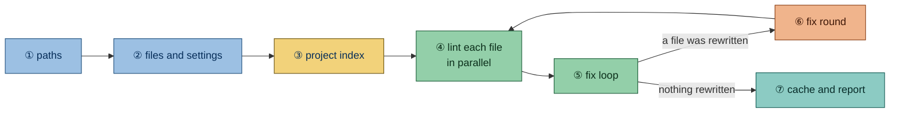
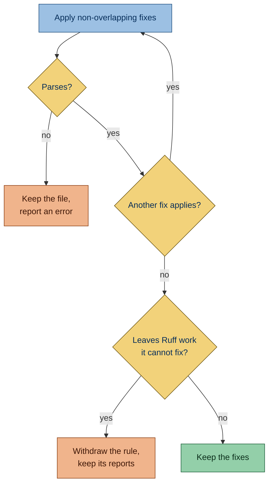

# Contributing to simplint

simplint is one Rust crate that builds the `simplint` binary. maturin packages that binary into a Python wheel, the way
Ruff ships, so the Python side holds only packaging, documentation and maintenance scripts.

## Repository layout

- `src/` holds the linter, one directory per layer. `src/rules/` has one directory per rule family with one file per
  rule, and next to it a Markdown page of the same name, compiled into the binary.
- `tests/` drives the binary end to end:
  - `tests/rules/` holds the rule tests, one module per rule family.
  - `tests/fixtures/` mirrors `src/rules/`: `tests/fixtures/<family>/<rule_name>/` holds the Python files a rule's tests
    lint, each named after the rule, next to the rule's snapshots.
  - `tests/*.rs` cover the command line, one file per concern, with shared helpers in `tests/common/`.
  - `tests/wheel/` runs the installed wheel under each Python; `tests/tasks/` covers the maintenance scripts in
    `tasks/`.
- `docs/` is the Sphinx site published on Read the Docs, and the source of the PyPI README.

## How a run works

A run lints every file it discovers against one shared view of the whole project. These are the pieces:

| Concept           | What it is                                                                                                 |
| ----------------- | ---------------------------------------------------------------------------------------------------------- |
| **Settings**      | Each file's simplint and Ruff configuration, found from its location, as Ruff finds it.                    |
| **Project index** | `Project`: what each file imports from the others, built for the whole run before any file is linted.      |
| **Checker**       | One file's parse, its semantic view and its diagnostics. Every rule of the file shares the one parse.      |
| **Rule**          | A function that reads the `Checker`, or reacts to nodes during the walk, and reports with an optional fix. |
| **Fix loop**      | Applies a file's fixes until none apply, then checks the result against Ruff.                              |
| **Fix round**     | Re-indexes the files a fix rewrote and lints again the files whose answers from the index changed.         |
| **Cache**         | Ruff's cache, adapted, one per package: keeps each file's import facts and remembers clean files.          |



### Example

Take a project with two files, where `cli.py` imports `LIMIT` but `config.py` leaves it out of `__all__`. The steps
follow one rule through the run:

```python
# config.py
LIMIT = 3
__all__ = []

# cli.py
from config import LIMIT
```

1. **Paths**: `simplint check --fix .` starts from the current directory.
1. **Files and settings**: discovery finds `config.py` and `cli.py` and resolves the settings of each. simplint stops
   with an error here when a simplint rule and a Ruff rule that contradict each other both apply to a file.
1. **Project index**: the index records that `cli.py` imports `LIMIT` from `config.py`.
1. **Lint**: in `config.py`, SMP401 (`missing-from-all`) asks the index who imports `LIMIT`, finds `cli.py`, and reports
   that `__all__` is missing it, with a fix that adds it.
1. **Fix loop**: the fix rewrites `__all__` and the file is parsed again. The fix leaves Ruff nothing new to fix, so it
   stands.
1. **Fix round**: `config.py` was rewritten, so its facts are collected again, and any file whose answers from the index
   changed is linted again. A round that rewrites nothing ends the loop.
1. **Cache and report**: the cache stores each file's import facts and remembers the files with nothing to report, so a
   later run skips them. The run prints what it fixed.

### Project index

`Project` records:

- which names of each file the others import
- which names other code reaches by a dotted string, such as a `mock.patch` target
- the names `.pyi` stubs declare
- every attribute name assigned anywhere
- every base class name

Module names resolve to files with `ty_module_resolver`, through the same Salsa database `ruff_graph` uses. Rules ask
the index before renaming or moving a name.

### Checker and rules

`Checker` holds one file's parse, its lazily built `Semantic` view of module-level bindings and references, and the
diagnostics. The view is derived from Ruff's `SemanticModel`, which simplint fills the way Ruff's own `Checker` does.

A rule takes one of two shapes:

- **Module rule**: reads the module whole, as a function that takes the `Checker`.
- **Node rule**: reacts to statements, expressions and other nodes, as functions named after those nodes that take the
  `Walker`. One walk over the module hands each node to the functions of the enabled rules and tells them where the node
  sits, as Ruff's `Checker` does.

A file's reports stay grouped by rule in table order, so reports at the same position keep that order. They then pass
through the `noqa` filter before the fix loop.

### Fix loop

The fix loop applies non-overlapping fixes, reparses, and repeats until no fix applies. It then compares Ruff's findings
before and after:

- Ruff fixes what the fixes gave it to do.
- A rule whose fixes leave Ruff work it cannot fix is withdrawn, keeping its reports.

simplint gets Ruff's findings by running Ruff's linter, and line lengths from a token model, since `ruff format` runs
after simplint. A fix that does not parse, or a loop that does not settle, leaves the file unchanged and reports an
error; the other files are still checked.



## Development commands

Use Cargo for Rust changes:

```bash
cargo fmt
cargo clippy --all-targets --locked -- -D warnings
cargo test
```

Test the built wheel and the repository tooling through tox:

```bash
tox run -e 3.15
tox run -e tasks
tox run -e type
tox run -e fix
```

Choose an installed Python version if 3.15 is unavailable. Tox skips missing interpreters.

## Adding a rule

1. Add a line to the `rules!` table in `src/lint/registry.rs`: variant, code, kebab-case name, one-line summary, fix
   availability, the rule's module, and its hooks: `module` for a rule that reads the whole module, or the node kinds it
   reacts to, such as `statement` and `expression`. A `RuleSet` holds at most 64 rules, which a compile-time assertion
   checks.
1. Write the rule in its own file in the family's `src/rules/<family>/` directory, named after the rule:
   - A `module` rule is a function of that name, re-exported from the family's `mod.rs`.
   - A node rule's module is public in the family and holds a function for each hook. Prefer a node rule to walking the
     module again.
   - Report through `checker.report`, with a `Fix` marked safe only when no program can observe the change.
1. Add the rule's Markdown page next to its file, `src/rules/<family>/<rule_name>.md`, with these sections:
   - What it does, Why is this bad?, Example and Fix safety
   - Options, listing the settings the rule reads
   - Conflicts with Ruff, when a Ruff rule contradicts it
1. Add a fixture named after the rule under `tests/fixtures/<family>/<rule_name>/` and a `test_case` row in the matching
   `tests/rules/<family>.rs`, then accept the snapshot with `cargo insta test --accept` and review it.
1. Add a `feature` fragment to `changelog.d/`.

## Tests

Write behavior tests through the public entry points. Keep one assertion target per test, parameterize repeated cases,
and use fixtures for shared setup.

Rule tests run the binary on a copy of the fixtures and render the diagnostics and the fully fixed file into an `insta`
snapshot in the rule's fixture folder. The copy merges every rule folder into one project root, so:

- a `test_case` names its fixture by the path below the rule folder, such as `tests/test_class.py`
- a fixture can import, or be tested by, another rule

Populate and review the snapshots with:

```bash
cargo insta test --accept
cargo insta review
```

The crate enforces 100% line coverage, with only the fix error reports excluded:

```bash
cargo llvm-cov --ignore-filename-regex 'fix/errors\.rs' --fail-uncovered-lines 0 --show-missing-lines
```

### Real-world projects

Snapshots cover the cases a rule's author thought of; real code finds the rest. The `ecosystem` environment downloads
pinned source distributions of the 25 most downloaded PyPI projects into a cache under `.tox`, then lints and fixes each
one. It fails when:

- simplint reports an error
- a fix leaves a file that no longer parses
- a second fix pass still changes code
- Ruff finds a new undefined or redefined name

```bash
tox run -e ecosystem
tox run -e ecosystem -- requests click
```

Run it after changing a rule or a fix. It does not check that the projects' own test suites still pass; for a fix that
can change behavior, run the suite of an affected project by hand.

Pass `--target-version 3.10` to check a release other than the running one. simplint then follows that release's rules,
and each fixed file must compile under a CPython of that version, which `uv python find` locates. The running
interpreter's parser accepts syntax from newer releases, so it misses a fix that breaks an older target.

```bash
tox run -e ecosystem -- --target-version 3.10 requests
```

Refresh the pins in `tasks/ecosystem.py` from [top-pypi-packages](https://hugovk.github.io/top-pypi-packages/) when the
list drifts.

## Documentation

Edit the files under `docs/`. PyPI shows `README.md`, so keep its links absolute.

The rule pages and the command line reference come from `docs/_data/`, the binary's `rules --output-format json` and
`cli-schema` output, committed so Read the Docs builds without compiling Rust. When a rule, its Markdown page or a flag
changes, `cargo test` fails once and rewrites those files; commit them.

Build and check links with the documentation environment:

```bash
tox run -e docs
```

## Configuration schema

`simplint.schema.json` is the JSON Schema of `[tool.simplint]`, printed by the hidden `simplint config-schema`
subcommand. `schemars` derives it from the option structs in `src/settings/`, so their doc comments become its
descriptions, and rule selectors take their values from the rule table in `src/lint/registry.rs`. When an option or a
rule changes, `cargo test` fails once and rewrites the file; commit it. `tests/tasks/test_config_schema.py` checks the
documented examples against it, so run `tox run -e tasks`.

On a release tag, `update-schemastore.yaml` copies the file to SchemaStore as `partial-simplint.json`. While SchemaStore
has no such file, the first tag opens the registration PR: `tasks/register_schemastore.py` writes the partial, adds its
`tool.simplint` reference to SchemaStore's `pyproject.json` and lists it in `schema-validation.jsonc`, and
`tasks/schemastore_options.json` becomes the partial's positive test. Each later tag updates the partial in a PR on the
same branch. SchemaStore's install, formatter and checks run in a job without secrets, which hands its changes on as a
patch; only the job that applies it, pushes and opens the PR sees the token, so code from SchemaStore's dependencies
cannot read it. That job runs in the `schemastore` environment and needs a `SCHEMASTORE_TOKEN` secret there: a token
that can fork `SchemaStore/schemastore`, push to the fork and open pull requests against upstream, such as a classic
token with the `public_repo` scope. To submit a release whose tag ran before the token existed, run the workflow by hand
with that tag. Pull requests run the same staging against a fresh SchemaStore clone, so a schema change that would break
the submission fails there.

## Changelog

Add one nonempty fragment to `changelog.d/` for each user-facing change:

- Use a descriptive filename such as `+narrow-patch-matching.bugfix.md`; release preparation links it to the
  squash-merged pull request. A numeric PR filename also works.
- Put separate changes in separate files, including changes in different categories.
- The fragment text may use Markdown links.
- Do not write credits in it: release preparation credits the pull request's commit authors and runs
  `release-creator contributors` to add a New Contributors subsection.

Choose the suffix for the effect on users:

| Suffix                                                           | Use for                               |
| ---------------------------------------------------------------- | ------------------------------------- |
| `feature`                                                        | a new rule or option                  |
| `change`                                                         | changed behavior                      |
| `bugfix`                                                         | a correction                          |
| `doc`                                                            | documentation                         |
| `breaking`                                                       | an incompatible change                |
| `security`, `performance`, `deprecation`, `removal`, `packaging` | those changes, when they affect users |

Apply `skip news` when the change has no user-facing effect. Bot pull requests without a fragment receive it
automatically. Documentation builds show pending fragments under Draft on the changelog page.

Release preparation folds the fragments into [CHANGELOG.md](CHANGELOG.md), formats it with prek, commits the new
version, and pushes the tag. The tag starts the build and publish workflow, which creates a GitHub Release after PyPI
succeeds.

## Generated files

`src/rules/imports/stdlib_submodules.rs` is the table SMP303 reads for the standard library submodules a dependency
guard can import. `.github/workflows/stdlib_submodules.yaml` rewrites it weekly from CPython's `Lib/` trees and opens a
PR when it changes. Regenerate it by hand when CPython adds a minor version to `_REFS` in `tasks/stdlib_submodules.py`:

```bash
git clone --filter=blob:none https://github.com/python/cpython ~/cpython
uv run tasks/stdlib_submodules.py ~/cpython
```

The blobless clone keeps every tag and branch, which the script reads through `git ls-tree`, without the sources.

## Before committing

Run the checks for each changed layer:

| Change        | Checks                                                      |
| ------------- | ----------------------------------------------------------- |
| rule          | its snapshots reviewed, coverage, and the rule page updated |
| documentation | README generation and the docs build                        |
| `tasks/`      | `tox run -e tasks`                                          |

Keep commits limited to one concern.
