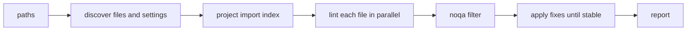

# Contributing to simplint

## Repository layout

simplint is one Rust crate that builds the `simplint` binary. maturin packages that binary into a Python wheel, the way
Ruff ships, so the Python side holds only packaging, documentation and maintenance scripts:

- `src/` holds the linter. `src/rules/` has one module per rule family, and `src/rules/docs/` has one Markdown page per
  rule, compiled into the binary.
- `resources/test/fixtures/` holds the Python files the rule tests lint.
- `tests/cli.rs` drives the binary end to end; `tests/wheel/` runs the installed wheel under each Python; `tests/tasks/`
  covers the maintenance scripts in `tasks/`.
- `docs/` is the Sphinx site published on Read the Docs, and the source of the PyPI README.

## Development commands

Add one nonempty fragment to `changelog.d/` for each user-facing change. Use a descriptive filename such as
`+narrow-patch-matching.bugfix.md`; release preparation links it to the squash-merged pull request. A numeric PR
filename also works. Put separate changes in separate files, including changes in different categories.

Choose the suffix for the effect on users: `feature` for a new rule or option, `change` for changed behavior, `bugfix`
for a correction, and `doc` for documentation. `security`, `performance`, `deprecation`, `removal`, and `packaging` are
available when those changes affect users. Use `breaking` for an incompatible change. The fragment text may use Markdown
links. Do not write credits in it: release preparation credits the pull request's commit authors and runs
`release-creator contributors` to add a New Contributors subsection. Documentation builds show pending fragments under
Draft on the changelog page.

Apply `skip news` when the change has no user-facing effect. Bot pull requests without a fragment receive it
automatically. Release preparation folds the fragments into [CHANGELOG.md](CHANGELOG.md), formats it with prek, commits
the new version, and pushes the tag. The tag starts the build and publish workflow, which creates a GitHub Release after
PyPI succeeds.

Use Cargo for Rust changes:

```bash
cargo fmt
cargo clippy --all-targets --locked -- -D warnings
cargo test
```

Test the built wheel and the repository tooling through tox:

```bash
tox run -e 3.15
tox run -e type
tox run -e fix
```

Choose an installed Python version if 3.15 is unavailable. Tox skips missing interpreters.

## How a run works

`main.rs` walks the paths, finds each file's settings, and builds one import index for the whole run before linting any
file. Each file is parsed once; the rules then share that parse.



- `Project` records which names each module imports from the others, every attribute name assigned anywhere, and every
  base class name. Rules ask it before renaming or moving a name.
- `Checker` holds one file's parse, its lazily built `Semantic` model of module-level bindings and references, and the
  diagnostics. A rule is a function that takes the `Checker` and reports.
- `Linter::fix` applies non-overlapping fixes, reparses, and repeats until no fix applies. A fix that does not parse, or
  a loop that does not settle, aborts the file instead of writing it.

## Adding a rule

1. Add a line to the `rules!` table in `src/registry.rs`: variant, code, kebab-case name, one-line summary, fix
   availability, and the checking function.
1. Write the function in the matching `src/rules/` module. Report through `checker.report`, with a `Fix` marked safe
   only when no program can observe the change.
1. Add `src/rules/docs/<CODE>.md` with the What it does, Why is this bad?, Example and Fix safety sections.
1. Add a fixture under `resources/test/fixtures/` and a `test_case` row in the module's tests.

## Tests

Write behavior tests through the public entry points. Keep one assertion target per test, parameterize repeated cases,
and use fixtures for shared setup.

Rule tests render the diagnostics and the fully fixed file into an `insta` snapshot. Populate and review them with:

```bash
cargo insta test --accept
cargo insta review
```

The crate enforces 100% line coverage, with only the fix guards excluded:

```bash
cargo llvm-cov --ignore-filename-regex 'guards\.rs' --fail-uncovered-lines 0 --show-missing-lines
```

## Documentation

Edit the files under `docs/`. Generate the published README from those sources:

```bash
tox run -e readme
```

Build and check links with the documentation environment:

```bash
tox run -e docs
```

## Before committing

Run the checks for each changed layer. A rule change needs its snapshots reviewed, coverage, and the rule page updated.
A documentation change needs README generation and the docs build. Keep commits limited to one concern.
