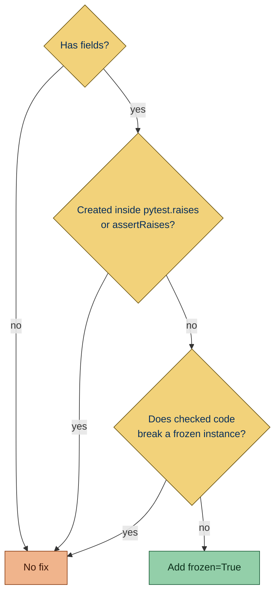

Flags dataclasses declared without `frozen=True`.

The public dataclasses of a library are not reported: users construct and subclass them, so `frozen=True` is their
choice to make.

## Why is this bad?

Any code holding a reference to a mutable dataclass can change it, so a reader cannot trust a value they saw at
construction time. A [frozen](https://docs.python.org/3/library/dataclasses.html#frozen-instances) instance raises on
attribute assignment. With the default `eq=True` it gets a `__hash__`, so it can go in a set or serve as a dict key when
its fields are hashable.

## Example

```python report
from dataclasses import dataclass


@dataclass
class Release:
    version: str
```

Use instead:

```python ok
from dataclasses import dataclass


@dataclass(frozen=True)
class Release:
    version: str
```

## What it does

### Active on

- **[Dataclass](https://docs.python.org/3/library/dataclasses.html#dataclasses.dataclass) decorators**: a decorator
  spelled `@dataclass` or `@dataclasses.dataclass` without `frozen=True`. Any value other than a literal `True`, such as
  `frozen=False`, is reported too, since only a literal `True` shows that the option is on.

  - `@dataclass`: `frozen` is not set.

    ```python report
    from dataclasses import dataclass


    @dataclass
    class Release:
        version: str
    ```

  - `@dataclasses.dataclass(slots=True)`: the dotted spelling, with `frozen` missing.

    ```python report
    import dataclasses


    @dataclasses.dataclass(slots=True)
    class Release:
        version: str
    ```

  - `@dataclass(frozen=False)`: a value other than a literal `True`.

    ```python report
    from dataclasses import dataclass


    @dataclass(frozen=False)
    class Release:
        version: str
    ```

  - `@dataclass(frozen=True, slots=True)`: `frozen` is a literal `True`, so it is accepted.

    ```python ok
    from dataclasses import dataclass


    @dataclass(frozen=True, slots=True)
    class Release:
        version: str
    ```

  - `@dataclass(**DC_KW)`: a `**` splat of a module-level dict literal, or of a `dict(...)` call with keyword arguments,
    counts the options its keys set. Here `frozen` is set, so the class is accepted.

    ```python ok
    from dataclasses import dataclass

    DC_KW = {"frozen": True, "slots": True}


    @dataclass(**DC_KW)
    class Release:
        version: str
    ```

  - `@dataclass(**SLOTS_KW)` with `SLOTS_KW = {"slots": True}`: `frozen` is not set, so it is reported and the fix
    appends `frozen=True` after the splat.

  - A `**` splat simplint cannot read, such as `**get_kw()`, a name bound more than once or changed in place, or a dict
    literal with a `**` entry or a repeated key, leaves the class unreported, since the options may be set.

### Exceptions

A class whose instances are written after construction, as the Instances of the class section describes, is not reported
when the plain class that `frozen=True` would push it towards is one Ruff rejects, since that plain class is the only
other form of the code. Writes through an object of unknown class do not count, and stubs are always reported, since
Ruff's rules skip them:

- **Ruff's B903 runs**: `class-as-data-structure` flags a plain class with no base classes or class keywords, no
  decorator besides the dataclass's, and no method but private ones, such as `_bump`. A public method, such as `bump`,
  keeps the class reported. Its fields must be plain parameters: a factory default or `field(init=False)` does not
  qualify, and neither does a hand-written `__init__`. B903 is a preview rule, so the config turns preview on.

  ```toml config
  [tool.ruff]
  preview = true

  [tool.ruff.lint]
  select = ["B903"]
  ```

  ```python ok
  from dataclasses import dataclass


  @dataclass
  class Counter:
      count: int

      def _bump(self) -> None:
          self.count += 1
  ```

- **Ruff's PLR0913 runs**: `too-many-arguments` flags a plain class whose `__init__` takes more parameters than
  `max-args`, 5 by default. The count leaves out `field(init=False)` fields and the `KW_ONLY` marker, takes in `InitVar`
  fields, and leaves out `ClassVar`s. A class with at most `max-args` fields stays reported. Ruff does not count a
  parameter named like a dummy, such as `_a`, and this rule does, so a class with one can be left unreported where Ruff
  would not flag it.

  ```toml config
  [tool.ruff.lint]
  select = ["PLR0913"]
  ```

  ```python ok
  from dataclasses import dataclass


  @dataclass
  class Hold:
      a: int
      b: int
      c: int
      d: int
      e: int
      f: int

      def _bump(self) -> None:
          self.a += 1
  ```

### Fix

The fix sets `frozen=True` on the decorator. No fix is offered for:

- a class without fields, such as a test fixture standing for a dataclass with the default options

  ```python report
  from dataclasses import dataclass


  @dataclass
  class Empty:
      pass
  ```

- a decorator whose `**` splat sets `frozen` to a value other than `True`, such as `FROZEN_OFF = {"frozen": False}`: the
  fix cannot take the key out of the dict, and adding `frozen=True` would repeat it

  ```python report
  from dataclasses import dataclass

  FROZEN_OFF = {"frozen": False}


  @dataclass(**FROZEN_OFF)
  class Release:
      version: str
  ```

- a class the module creates inside `with pytest.raises(...)` or `with self.assertRaises(...)`: the test expects code
  using the instance to fail, such as `{Key("a"): True}` raising because the class is unhashable, and freezing can
  change that

  ```python report
  from dataclasses import dataclass

  import pytest


  def test_key() -> None:
      with pytest.raises(TypeError):

          @dataclass
          class Key:
              name: str
  ```

Otherwise the fix leaves out `frozen` when checked code shows that a frozen instance breaks it.



A fix that adds `frozen`:

```python report
from dataclasses import dataclass


@dataclass
class Release:
    version: str
```

```python fixed
from dataclasses import dataclass


@dataclass(frozen=True)
class Release:
    version: str
```

### When `frozen=True` is left out

- the class has a base class other than `Generic[...]`: its methods may set attributes, and a frozen dataclass cannot
  inherit from it unless it is frozen too

  ```python report
  from dataclasses import dataclass


  class Base:
      pass


  @dataclass
  class Release(Base):
      version: str
  ```

- any class in the checked files inherits from a class with its name

  ```python report file=app/models.py
  from dataclasses import dataclass


  @dataclass
  class Release:
      version: str
  ```

  ```python context file=app/extra.py
  from app.models import Release


  class Release(Release):
      pass
  ```

- any class in the checked files inherits from a class under its name in another module, whatever the import calls it,
  such as `from app.models import Release as Base`

  ```python report file=app/models.py
  from dataclasses import dataclass


  @dataclass
  class Release:
      version: str
  ```

  ```python context file=app/extra.py
  from app.models import Release as Base


  class Tagged(Base):
      pass
  ```

- the class defines `__setattr__` or `__delattr__`

  ```python report
  from dataclasses import dataclass


  @dataclass
  class Release:
      version: str

      def __setattr__(self, name: str, value: object) -> None:
          object.__setattr__(self, name, value)
  ```

- one of its methods sets or deletes an attribute on `self`

  ```python report
  from dataclasses import dataclass


  @dataclass
  class Counter:
      count: int = 0

      def bump(self) -> None:
          self.count += 1
  ```

- other code sets or deletes an attribute on an instance known to be of the class, such as `result.status = "done"`
  after `result = Result(...)`, in this file or another checked file

  ```python report
  from dataclasses import dataclass


  @dataclass
  class Result:
      status: str


  def run() -> None:
      result = Result("ok")
      result.status = "done"
  ```

  ```python report file=app/models.py
  from dataclasses import dataclass


  @dataclass
  class Result:
      status: str
  ```

  ```python context file=app/run.py
  import app.models


  def run() -> None:
      result = app.models.Result("ok")
      result.status = "done"
  ```

- other code sets or deletes an attribute of an instance known to be of the class under a name computed at run time,
  such as the `setattr(self, key, value)` of a method that updates its fields from a dict, or
  `setattr(release, key, value)` on an annotated parameter

  ```python report
  from dataclasses import dataclass


  @dataclass
  class Release:
      version: str

      def update(self, **changes: str) -> None:
          for key, value in changes.items():
              setattr(self, key, value)
  ```

  ```python report
  from dataclasses import dataclass


  @dataclass
  class Release:
      version: str


  def apply(release: Release, key: str, value: str) -> None:
      setattr(release, key, value)
  ```

  ```python fixed
  from dataclasses import dataclass


  @dataclass
  class Release:
      version: str


  def apply(release: Release, key: str, value: str) -> None:
      setattr(release, key, value)
  ```

- other code sets or deletes an attribute of an instance known to be of the class through `monkeypatch.setattr`,
  `mock.patch.object`, `obj.__setattr__(...)` or `obj.__delattr__(...)`

  ```python report
  from dataclasses import dataclass
  from unittest import mock


  @dataclass
  class Release:
      version: str


  def test_release(monkeypatch) -> None:
      release = Release("1")
      monkeypatch.setattr(release, "version", "2")
      with mock.patch.object(release, "version", "3"):
          release.__setattr__("version", "4")
          release.__delattr__("version")
  ```

  ```python fixed
  from dataclasses import dataclass
  from unittest import mock


  @dataclass
  class Release:
      version: str


  def test_release(monkeypatch) -> None:
      release = Release("1")
      monkeypatch.setattr(release, "version", "2")
      with mock.patch.object(release, "version", "3"):
          release.__setattr__("version", "4")
          release.__delattr__("version")
  ```

- other code sets or deletes an attribute named like one of the fields or `ClassVar` attributes on an object of unknown
  class, such as `envs[name].active = True`, directly or through `setattr`. `mock.patch.object(Env, "active")` and the
  dotted string `monkeypatch.setattr("app.models.Env.active", True)` name the field on a class, an object of unknown
  class to the rule, so they count too

  ```python report file=app/models.py
  from dataclasses import dataclass


  @dataclass
  class Env:
      active: bool = False
  ```

  ```python fixed file=app/models.py
  from dataclasses import dataclass


  @dataclass
  class Env:
      active: bool = False
  ```

  ```python context file=app/toggle.py
  def toggle(envs: dict[str, object], name: str) -> None:
      envs[name].active = True
  ```

  ```python context file=app/test_env.py
  from unittest import mock

  from app.models import Env


  def test_active(monkeypatch) -> None:
      monkeypatch.setattr("app.models.Env.active", True)
      with mock.patch.object(Env, "active"):
          pass
  ```

### Instances of the class

An object is **known to be of the class** when it is:

- `self` in a method of the class
- a name bound to a call of the class, through its module as `models.Release(...)` too
- a name annotated with the class, `Optional[...]` and `... | None` included
- an attribute of `self` the class body annotates with it, such as `self.config` after `config: Config`

An object known to be a mock never counts, nor does anything reached from one. Mocks are names bound to `Mock()`,
`MagicMock()`, `create_autospec(...)`, `mocker.Mock()` or `mocker.patch(...)`, and `with patch(...) as name` targets.

Any other object is unknown, so a write through it counts only when it names a field or a `ClassVar` attribute. An
unannotated parameter such as `result` below is unknown: its write to `log` is not tied to `Result`, so `frozen=True` is
still offered, and that write fails at runtime once the fix is applied.

```python report file=app/models.py
from dataclasses import dataclass


@dataclass
class Result:
    status: str
```

```python fixed file=app/models.py
from dataclasses import dataclass


@dataclass(frozen=True)
class Result:
    status: str
```

```python context file=app/record.py
from app.models import Result


def record(result) -> None:
    result.log = "x"


record(Result("ok"))
```

A call of a class with a private name, such as `_Result(...)`, or with an all-caps name of three or more letters, such
as `URL(...)`, makes its result known to be of that class. A one- or two-letter capital such as `T` does not, since it
is more likely a type variable:

```python report
from dataclasses import dataclass


@dataclass
class _Result:
    status: str


result = _Result("ok")
result.cached = True
```

```python fixed
from dataclasses import dataclass


@dataclass
class _Result:
    status: str


result = _Result("ok")
result.cached = True
```

```python report
from dataclasses import dataclass


@dataclass
class URL:
    value: str


url = URL("https://example.com")
url.cached = True
```

```python fixed
from dataclasses import dataclass


@dataclass
class URL:
    value: str


url = URL("https://example.com")
url.cached = True
```

### Unsafe fix

The fix is safe only when nothing else in the checked files might notice the change. It is unsafe when:

- the decorator already sets `frozen` or `slots` to something other than `True`;

  ```python report
  from dataclasses import dataclass


  @dataclass(frozen=False)
  class Release:
      version: str
  ```

  ```python fixed
  from dataclasses import dataclass


  @dataclass(frozen=True)
  class Release:
      version: str
  ```

- the class has a `Generic[...]` base class;

  ```python report
  from dataclasses import dataclass
  from typing import Generic, TypeVar

  T = TypeVar("T")


  @dataclass
  class Box(Generic[T]):
      value: T
  ```

  ```python fixed
  from dataclasses import dataclass
  from typing import Generic, TypeVar

  T = TypeVar("T")


  @dataclass(frozen=True)
  class Box(Generic[T]):
      value: T
  ```

- another class with the same name, defined in another module, gets attributes written on its instances or has a
  subclass that a slotted base breaks, as an import simplint cannot follow, such as through a re-export, may name this
  class;

  ```python report file=app/models.py
  from dataclasses import dataclass


  @dataclass
  class Release:
      version: str
  ```

  ```python fixed file=app/models.py
  from dataclasses import dataclass


  @dataclass(frozen=True)
  class Release:
      version: str
  ```

  ```python context file=app/other.py
  class Release:
      pass


  release = Release()
  release.label = "x"
  ```

- the class body assigns or deletes an attribute on anything other than `self`, or mentions `super`, `__dict__`,
  `__weakref__`, `__setattr__` or `__delattr__`.

  ```python report
  from dataclasses import dataclass

  settings = object()


  @dataclass
  class Release:
      version: str
      settings.flag = True
  ```

  ```python fixed
  from dataclasses import dataclass

  settings = object()


  @dataclass(frozen=True)
  class Release:
      version: str
      settings.flag = True
  ```

  `object.__setattr__(self, ...)` and `super().__setattr__(...)` are how a frozen class writes its own fields, so they
  do not count as writes and keep the fix offered, but naming `__setattr__` or `super` still makes it unsafe:

  ```python report
  from dataclasses import dataclass


  @dataclass
  class Release:
      version: str

      def rename(self, version: str) -> None:
          object.__setattr__(self, "version", version)

      def relabel(self, version: str) -> None:
          super().__setattr__("version", version)
  ```

  ```python fixed
  from dataclasses import dataclass


  @dataclass(frozen=True)
  class Release:
      version: str

      def rename(self, version: str) -> None:
          object.__setattr__(self, "version", version)

      def relabel(self, version: str) -> None:
          super().__setattr__("version", version)
  ```

Code outside the checked files, and code that adds an attribute that is not a field to an object simplint cannot tie to
the class, is not detected, and breaks once the fix is applied.

### Related rules

[dataclass-slots](SMP702.html) asks for `slots=True` on the same decorator. [dataclass-kw-only](SMP703.html) asks for
`kw_only=True`.

A class that writes an attribute other than its fields gets no `slots=True` fix from [dataclass-slots](SMP702.html), so
the plain class is then the only way to satisfy it. The exceptions above only cover `frozen`, so `dataclass-slots` still
reports such a class.

## Other tools

- **[Ruff](https://github.com/astral-sh/ruff):** open issue [#8981](https://github.com/astral-sh/ruff/issues/8981).
