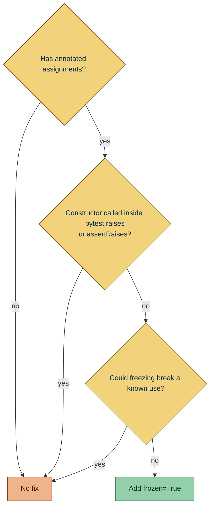

Flags dataclasses whose decorator does not set `frozen=True`. Simplint skips public dataclasses in libraries because
callers may rely on assigning to their fields.

## Why is this bad?

A [frozen dataclass](https://docs.python.org/3/library/dataclasses.html#frozen-instances) rejects assignments to
instance attributes. Its fields can still refer to mutable objects. Use
[`dataclasses.replace()`](https://docs.python.org/3/library/dataclasses.html#dataclasses.replace) to construct a copy
with different field values. With the default `eq=True` and no explicit `__hash__`, freezing also generates a hash
method. Such an instance can serve as a dictionary key when the fields used in the hash are hashable and their hashes
stay stable.

## Example

```python report
from dataclasses import dataclass


@dataclass
class Release:
    version: str
```

Use instead:

```python ok
from dataclasses import dataclass


@dataclass(frozen=True)
class Release:
    version: str
```

## What it does

### Active on

- **Dataclass decorators** include aliases that resolve to
  [`dataclasses.dataclass`](https://docs.python.org/3/library/dataclasses.html#dataclasses.dataclass). Simplint checks
  whether the decorator sets `frozen` to the literal `True`.

  - `@dataclass`: `frozen` is not set.

    ```python report
    from dataclasses import dataclass


    @dataclass
    class Release:
        version: str
    ```

  - `@dataclasses.dataclass(slots=True)`: the dotted spelling, with `frozen` missing.

    ```python report
    import dataclasses


    @dataclasses.dataclass(slots=True)
    class Release:
        version: str
    ```

  - `@dataclass(frozen=False)`: a value other than a literal `True`.

    ```python report
    from dataclasses import dataclass


    @dataclass(frozen=False)
    class Release:
        version: str
    ```

  - `@dataclass(frozen=True, slots=True)`: `frozen` is a literal `True`, so it is accepted.

    ```python ok
    from dataclasses import dataclass


    @dataclass(frozen=True, slots=True)
    class Release:
        version: str
    ```

  - Simplint reads the options in `**` arguments from a dictionary literal or a `dict(...)` call with named arguments,
    directly or through a name bound to that dictionary. Here `DC_KW` supplies `frozen=True`.

    ```python ok
    from dataclasses import dataclass

    DC_KW = {"frozen": True, "slots": True}


    @dataclass(**DC_KW)
    class Release:
        version: str
    ```

  - `@dataclass(**SLOTS_KW)` with `SLOTS_KW = {"slots": True}`: `frozen` is not set, so it is reported and the fix
    appends `frozen=True` after the splat.

  - A `**` splat simplint cannot read, such as `**get_kw()`, a name bound more than once or changed in place, or a dict
    literal with a `**` entry or a repeated key, leaves the class unreported, since the options may be set.

### Exceptions

If simplint finds a write to a known instance, it checks whether replacing the dataclass with an ordinary class would
trigger an enabled Ruff rule. Either condition below suppresses the report. Writes through an unknown object and classes
in `.pyi` files do not qualify for this exemption.

- **Ruff's preview rule [B903](https://docs.astral.sh/ruff/rules/class-as-data-structure/) is enabled.** Simplint checks
  for a class without bases, class keywords or additional decorators. Its methods must be private, its body must contain
  only methods, assignments or expressions, and its fields must omit `default_factory` and explicit `init` arguments to
  `field()`. A public method or a hand-written `__init__` rules out this exemption.

  ```toml config
  [tool.ruff]
  preview = true

  [tool.ruff.lint]
  select = ["B903"]
  ```

  ```python ok
  from dataclasses import dataclass


  @dataclass
  class Counter:
      count: int

      def _bump(self) -> None:
          self.count += 1
  ```

- **Ruff's [PLR0913](https://docs.astral.sh/ruff/rules/too-many-arguments/) is enabled.** Simplint counts the class's
  own constructor fields, including `InitVar`, and compares the count with Ruff's `max-args` (default 5). It excludes
  `ClassVar`, `KW_ONLY` and `field(init=False)`. Unlike Ruff's parameter count, it includes names that match Ruff's
  dummy-variable pattern, so it can exempt extra classes.

  ```toml config
  [tool.ruff.lint]
  select = ["PLR0913"]
  ```

  ```python ok
  from dataclasses import dataclass


  @dataclass
  class Hold:
      a: int
      b: int
      c: int
      d: int
      e: int
      f: int

      def _bump(self) -> None:
          self.a += 1
  ```

### Fix

The fix sets `frozen=True` unless it would remove a comment inside the decorator. Simplint also withholds the fix in the
following cases.

- The class body has no annotated assignments.

  ```python report
  from dataclasses import dataclass


  @dataclass
  class Empty:
      pass
  ```

- A `**` argument supplies `frozen` with a value other than `True`. Adding `frozen=True` would repeat the keyword.

  ```python report
  from dataclasses import dataclass

  FROZEN_OFF = {"frozen": False}


  @dataclass(**FROZEN_OFF)
  class Release:
      version: str
  ```

- The module calls the class by name inside `with pytest.raises(...)` or `with self.assertRaises(...)`. Freezing can
  change the behavior under test. Here it would make `Key` hashable.

  ```python report
  from dataclasses import dataclass

  import pytest


  @dataclass
  class Key:
      name: str


  def test_key() -> None:
      with pytest.raises(TypeError):
          hash(Key("a"))
  ```

`Meta.mark` writes to a `Meta` instance. `Release.reset` writes a class attribute. Neither assignment changes a
`Release` instance.

```python report
from dataclasses import dataclass


@dataclass
class Release:
    version: str

    class Meta:
        def mark(self) -> None:
            self.flag = True

    @classmethod
    def reset(cls) -> None:
        cls.total = 0
```

```python fixed
from dataclasses import dataclass


@dataclass(frozen=True)
class Release:
    version: str

    class Meta:
        def mark(self) -> None:
            self.flag = True

    @classmethod
    def reset(cls) -> None:
        cls.total = 0
```

Once the decorator can be edited, simplint checks the class and its uses before offering the fix.



With no conflicting use, the fix adds the decorator option.

```python report
from dataclasses import dataclass


@dataclass
class Release:
    version: str
```

```python fixed
from dataclasses import dataclass


@dataclass(frozen=True)
class Release:
    version: str
```

### When `frozen=True` is left out

- The class has a base other than `Generic` or `Generic[...]`. An inherited method might assign attributes. When a base
  is itself a dataclass, Python also requires the two dataclasses to agree on `frozen`.

  ```python report
  from dataclasses import dataclass


  class Base:
      pass


  @dataclass
  class Release(Base):
      version: str
  ```

- A class in the checked files uses this class name as a base.

  ```python report file=app/models.py
  from dataclasses import dataclass


  @dataclass
  class Release:
      version: str
  ```

  ```python context file=app/extra.py
  from app.models import Release


  class Release(Release):
      pass
  ```

- A subclass uses an import alias such as `from app.models import Release as Base` or a module-level assignment such as
  `Base = Release`.

  ```python report file=app/models.py
  from dataclasses import dataclass


  @dataclass
  class Release:
      version: str
  ```

  ```python context file=app/extra.py
  from app.models import Release as Base


  class Tagged(Base):
      pass
  ```

  ```python context file=app/later.py
  from app.models import Release


  Alias = Release


  class Tagged(Alias):
      pass
  ```

- the class defines `__setattr__` or `__delattr__`

  ```python report
  from dataclasses import dataclass


  @dataclass
  class Release:
      version: str

      def __setattr__(self, name: str, value: object) -> None:
          object.__setattr__(self, name, value)
  ```

- one of its methods sets or deletes an attribute on `self`

  ```python report
  from dataclasses import dataclass


  @dataclass
  class Counter:
      count: int = 0

      def bump(self) -> None:
          self.count += 1
  ```

- A checked file assigns or deletes an attribute on a known instance, for example `result.status = "done"` after
  `result = Result(...)`.

  ```python report
  from dataclasses import dataclass


  @dataclass
  class Result:
      status: str


  def run() -> None:
      result = Result("ok")
      result.status = "done"
  ```

  ```python report file=app/models.py
  from dataclasses import dataclass


  @dataclass
  class Result:
      status: str
  ```

  ```python context file=app/run.py
  import app.models


  def run() -> None:
      result = app.models.Result("ok")
      result.status = "done"
  ```

- Code calls `setattr` or `delattr` on a known instance with a name computed at runtime, for example
  [`setattr(release, key, value)`](https://docs.python.org/3/builtins/functions.html#setattr) on an annotated parameter.

  ```python report
  from dataclasses import dataclass


  @dataclass
  class Release:
      version: str

      def update(self, **changes: str) -> None:
          for key, value in changes.items():
              setattr(self, key, value)
  ```

  ```python report
  from dataclasses import dataclass


  @dataclass
  class Release:
      version: str


  def apply(release: Release, key: str, value: str) -> None:
      setattr(release, key, value)
  ```

  ```python fixed
  from dataclasses import dataclass


  @dataclass
  class Release:
      version: str


  def apply(release: Release, key: str, value: str) -> None:
      setattr(release, key, value)
  ```

- Code writes to a known instance through `monkeypatch.setattr`, `mock.patch.object`, `obj.__setattr__` or
  `obj.__delattr__`.

  ```python report
  from dataclasses import dataclass
  from unittest import mock


  @dataclass
  class Release:
      version: str


  def test_release(monkeypatch) -> None:
      release = Release("1")
      monkeypatch.setattr(release, "version", "2")
      with mock.patch.object(release, "version", "3"):
          release.__setattr__("version", "4")
          release.__delattr__("version")
  ```

  ```python fixed
  from dataclasses import dataclass
  from unittest import mock


  @dataclass
  class Release:
      version: str


  def test_release(monkeypatch) -> None:
      release = Release("1")
      monkeypatch.setattr(release, "version", "2")
      with mock.patch.object(release, "version", "3"):
          release.__setattr__("version", "4")
          release.__delattr__("version")
  ```

- An assignment or deletion on an object of unknown type names a field, `ClassVar` or `InitVar` declared by the class.
  In the example, `envs[name].active = True` could change an `Env`. Simplint also counts
  `mock.patch.object(Env, "active")` and `monkeypatch.setattr("app.models.Env.active", True)` as writes to `active`.

  ```python report file=app/models.py
  from dataclasses import dataclass


  @dataclass
  class Env:
      active: bool = False
  ```

  ```python fixed file=app/models.py
  from dataclasses import dataclass


  @dataclass
  class Env:
      active: bool = False
  ```

  ```python context file=app/toggle.py
  def toggle(envs: dict[str, object], name: str) -> None:
      envs[name].active = True
  ```

  ```python context file=app/test_env.py
  from unittest import mock

  from app.models import Env


  def test_active(monkeypatch) -> None:
      monkeypatch.setattr("app.models.Env.active", True)
      with mock.patch.object(Env, "active"):
          pass
  ```

### Instances of the class

Simplint recognizes instances through these expressions.

- The first parameter of an instance method.
- A name assigned a constructor call, including a qualified call such as `models.Release(...)`.
- A name annotated with a recognized project class, including `Optional[Release]` and `Release | None`.
- An attribute of `self` annotated in the class body, such as `self.config` after `config: Config`.

An object known to be a mock never counts, nor does anything reached from one. Mocks are names bound to `Mock()`,
`MagicMock()`, `create_autospec(...)`, `mocker.Mock()` or `mocker.patch(...)`, and `with patch(...) as name` targets.

For an object of unknown type, simplint withholds the fix when the assigned name matches a field or `ClassVar`. In the
example below, `Result` has no `log` field and `result` has no annotation. The fix is still offered, though
`record(Result("ok"))` will fail after freezing.

```python report file=app/models.py
from dataclasses import dataclass


@dataclass
class Result:
    status: str
```

```python fixed file=app/models.py
from dataclasses import dataclass


@dataclass(frozen=True)
class Result:
    status: str
```

```python context file=app/record.py
from app.models import Result


def record(result) -> None:
    result.log = "x"


record(Result("ok"))
```

Annotations such as `Any`, `object`, a protocol, a type alias or a type variable can leave the receiver unknown. The
assignment to `item.version` below prevents the fix because `Release` declares `version`.

```python report
from dataclasses import dataclass
from typing import Any


@dataclass
class Release:
    version: str


def bump(item: Any) -> None:
    item.version = "2"
```

```python fixed
from dataclasses import dataclass
from typing import Any


@dataclass
class Release:
    version: str


def bump(item: Any) -> None:
    item.version = "2"
```

Simplint recognizes constructor calls such as `_Result(...)` and `URL(...)`. It ignores leading underscores when
checking capitalization and treats short all-capital names such as `T` and `KT` as possible type variables.

```python report
from dataclasses import dataclass


@dataclass
class _Result:
    status: str


result = _Result("ok")
result.cached = True
```

```python fixed
from dataclasses import dataclass


@dataclass
class _Result:
    status: str


result = _Result("ok")
result.cached = True
```

```python report
from dataclasses import dataclass


@dataclass
class URL:
    value: str


url = URL("https://example.com")
url.cached = True
```

```python fixed
from dataclasses import dataclass


@dataclass
class URL:
    value: str


url = URL("https://example.com")
url.cached = True
```

### Unsafe fix

The fix is marked unsafe in the following cases.

- The decorator sets `frozen` or `slots` to a value other than the literal `True`.

  ```python report
  from dataclasses import dataclass


  @dataclass(frozen=False)
  class Release:
      version: str
  ```

  ```python fixed
  from dataclasses import dataclass


  @dataclass(frozen=True)
  class Release:
      version: str
  ```

- The class inherits from `Generic` or `Generic[...]`.

  ```python report
  from dataclasses import dataclass
  from typing import Generic, TypeVar

  T = TypeVar("T")


  @dataclass
  class Box(Generic[T]):
      value: T
  ```

  ```python fixed
  from dataclasses import dataclass
  from typing import Generic, TypeVar

  T = TypeVar("T")


  @dataclass(frozen=True)
  class Box(Generic[T]):
      value: T
  ```

- A different module defines a class with the same name, and that class has a recorded instance write or a subclass
  incompatible with slots. An unresolved import could refer to either class.

  ```python report file=app/models.py
  from dataclasses import dataclass


  @dataclass
  class Release:
      version: str
  ```

  ```python fixed file=app/models.py
  from dataclasses import dataclass


  @dataclass(frozen=True)
  class Release:
      version: str
  ```

  ```python context file=app/other.py
  class Release:
      pass


  release = Release()
  release.label = "x"
  ```

- Code assigns an attribute on an object of unknown type, and no checked class declares that attribute.

  ```python report
  from dataclasses import dataclass


  @dataclass
  class Release:
      version: str


  def tag(item):
      item.label = "x"
  ```

  ```python fixed
  from dataclasses import dataclass


  @dataclass(frozen=True)
  class Release:
      version: str


  def tag(item):
      item.label = "x"
  ```

- The class assigns or deletes an attribute on an object other than its method receiver, or refers to `super`,
  `__dict__`, `__weakref__`, `__setattr__` or `__delattr__`. Writes through a nested class's own method receiver are
  exempt.

  ```python report
  from dataclasses import dataclass

  settings = object()


  @dataclass
  class Release:
      version: str
      settings.flag = True
  ```

  ```python fixed
  from dataclasses import dataclass

  settings = object()


  @dataclass(frozen=True)
  class Release:
      version: str
      settings.flag = True
  ```

  The nested `Marker` method below writes through `outer`, a captured reference to the `Release` instance. Simplint
  marks the fix unsafe. Calling `helper` after the change can fail at `outer.flag = True`.

  ```python report
  from dataclasses import dataclass


  @dataclass
  class Release:
      version: str

      def helper(self) -> None:
          outer = self

          class Marker:
              def mark(self) -> None:
                  outer.flag = True

          Marker().mark()
  ```

  ```python fixed
  from dataclasses import dataclass


  @dataclass(frozen=True)
  class Release:
      version: str

      def helper(self) -> None:
          outer = self

          class Marker:
              def mark(self) -> None:
                  outer.flag = True

          Marker().mark()
  ```

  Simplint marks calls to
  [`object.__setattr__(self, ...)`](https://docs.python.org/3/reference/datamodel.html#object.__setattr__) and
  `super().__setattr__(...)` as unsafe. The presence of these calls alone does not prevent the fix.

  ```python report
  from dataclasses import dataclass


  @dataclass
  class Release:
      version: str

      def rename(self, version: str) -> None:
          object.__setattr__(self, "version", version)

      def relabel(self, version: str) -> None:
          super().__setattr__("version", version)
  ```

  ```python fixed
  from dataclasses import dataclass


  @dataclass(frozen=True)
  class Release:
      version: str

      def rename(self, version: str) -> None:
          object.__setattr__(self, "version", version)

      def relabel(self, version: str) -> None:
          super().__setattr__("version", version)
  ```

A write can escape detection if it happens outside the checked files, or if it uses an unknown receiver and an attribute
declared by another class. Freezing an instance can make such writes fail.

### Related rules

[dataclass-slots](SMP702.html) asks for `slots=True` on the same decorator. [dataclass-kw-only](SMP703.html) asks for
`kw_only=True`.

`dataclass-slots` checks the class independently. A write to an undeclared instance attribute can prevent its fix even
when simplint exempts the class from `dataclass-frozen`.

## Other tools

- Ruff's open [#8981](https://github.com/astral-sh/ruff/issues/8981) proposes requiring dataclasses to set `frozen` and
  `slots` explicitly.
