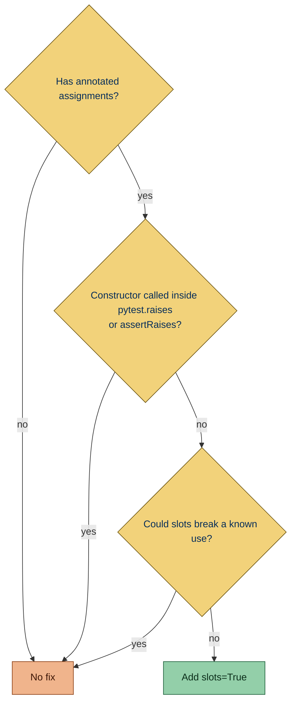

Flags dataclasses whose decorator does not set `slots=True`. Simplint skips public dataclasses in libraries because
callers may depend on their storage layout or subclass them.

## Why is this bad?

[Slots](https://docs.python.org/3/reference/datamodel.html#slots) reserve storage for the declared attributes. When no
base supplies an instance `__dict__`, this can reduce memory use and makes an assignment to a misspelled field raise
[`AttributeError`](https://docs.python.org/3/builtins/exceptions.html#AttributeError).

## Example

```python report
from dataclasses import dataclass


@dataclass
class Release:
    version: str
```

Use instead:

```python ok
from dataclasses import dataclass


@dataclass(slots=True)
class Release:
    version: str
```

## What it does

### Active on

- **Dataclass decorators** include aliases that resolve to
  [`dataclasses.dataclass`](https://docs.python.org/3/library/dataclasses.html#dataclasses.dataclass). Simplint checks
  whether the decorator sets `slots` to the literal `True`.

  - `@dataclass`: `slots` is not set.

    ```python report
    from dataclasses import dataclass


    @dataclass
    class Release:
        version: str
    ```

  - `@dataclasses.dataclass(frozen=True)`: the dotted spelling, with `slots` missing.

    ```python report
    import dataclasses


    @dataclasses.dataclass(frozen=True)
    class Release:
        version: str
    ```

  - `@dataclass(slots=False)`: a value other than a literal `True`.

    ```python report
    from dataclasses import dataclass


    @dataclass(slots=False)
    class Release:
        version: str
    ```

  - Simplint reads the options in `**` arguments from a dictionary literal or a `dict(...)` call with named arguments,
    directly or through a name bound to that dictionary. Here `DC_KW` supplies `slots=True`.

    ```python ok
    from dataclasses import dataclass

    DC_KW = {"frozen": True, "slots": True}


    @dataclass(**DC_KW)
    class Release:
        version: str
    ```

  - A `**` splat simplint cannot read, such as `**get_kw()`, a name bound more than once or changed in place, or a dict
    literal with a `**` entry or a repeated key, leaves the class unreported, since the options may be set.

  - `@dataclass(frozen=True, slots=True)`: `slots` is a literal `True`, so it is accepted.

    ```python ok
    from dataclasses import dataclass


    @dataclass(frozen=True, slots=True)
    class Release:
        version: str
    ```

### Exceptions

- **Target versions before 3.10**: nothing is reported, as `slots=` needs Python 3.10 or later.

  ```toml config
  [tool.ruff]
  target-version = "py39"
  ```

  ```python ok
  from dataclasses import dataclass


  @dataclass
  class Release:
      version: str
  ```

- **Targets before Python 3.14 when the class body uses `super()` or `__class__`.** `slots=True` creates a replacement
  class. On affected versions, methods retain a reference to the original class, and zero-argument `super()` can raise
  [`TypeError`](https://docs.python.org/3/builtins/exceptions.html#TypeError). CPython fixed this in 3.14 and backported
  the fix to 3.13.14. A `py313` target still includes earlier 3.13 releases.
  [CPython issue 90562](https://github.com/python/cpython/issues/90562)

  ```toml config
  [tool.ruff]
  target-version = "py313"
  ```

  ```python ok
  from dataclasses import dataclass


  @dataclass
  class Release:
      version: str

      def label(self) -> str:
          return super().__repr__()
  ```

- **Classes that use [`cached_property`](https://docs.python.org/3/library/functools.html#functools.cached_property).**
  A cached property stores its value in the instance `__dict__`, which `slots=True` removes, so the first read raises
  [`TypeError`](https://docs.python.org/3/builtins/exceptions.html#TypeError). A subclass without slots keeps its own
  `__dict__`, so a cached property there does not stop the fix.

  ```python ok
  from dataclasses import dataclass
  from functools import cached_property


  @dataclass(frozen=True)
  class Release:
      version: str

      @cached_property
      def label(self) -> str:
          return self.version.upper()
  ```

### Fix

The fix sets `slots=True` unless it would remove a comment inside the decorator. Simplint also withholds the fix in the
following cases.

- A `**` argument supplies `slots` with a value other than `True`. Adding `slots=True` would repeat the keyword.

- The class body has no annotated assignments.

  ```python report
  from dataclasses import dataclass


  @dataclass
  class Empty:
      pass
  ```

- The module calls the class by name inside `with pytest.raises(...)` or `with self.assertRaises(...)`. Slots can change
  which operations raise. Here `vars(Key("a"))` depends on the instance having a dictionary.

  ```python report
  from dataclasses import dataclass

  import pytest


  @dataclass
  class Key:
      name: str


  def test_key() -> None:
      with pytest.raises(KeyError):
          vars(Key("a"))["missing"]
  ```

`Meta.mark` writes to a `Meta` instance. `Release.reset` writes a class attribute. Neither assignment changes a
`Release` instance.

```python report
from dataclasses import dataclass


@dataclass
class Release:
    version: str

    class Meta:
        def mark(self) -> None:
            self.flag = True

    @classmethod
    def reset(cls) -> None:
        cls.total = 0
```

```python fixed
from dataclasses import dataclass


@dataclass(slots=True)
class Release:
    version: str

    class Meta:
        def mark(self) -> None:
            self.flag = True

    @classmethod
    def reset(cls) -> None:
        cls.total = 0
```

Once the decorator can be edited, simplint checks the class and its uses before offering the fix.



With no conflicting use, the fix adds the decorator option.

```python report
from dataclasses import dataclass


@dataclass
class Release:
    version: str
```

```python fixed
from dataclasses import dataclass


@dataclass(slots=True)
class Release:
    version: str
```

### When `slots=True` is left out

- the class declares `__slots__`

  ```python report
  from dataclasses import dataclass


  @dataclass(frozen=True)
  class Release:
      __slots__ = ("version",)
      version: str
  ```

- The class has a subclass with multiple bases. Giving one of those bases slots can cause an instance layout conflict.

  ```python report
  from dataclasses import dataclass


  import threading


  @dataclass(frozen=True)
  class FileContext:
      path: str


  class Context(FileContext, threading.local):
      pass
  ```

- Code assigns an undeclared instance attribute. A `ClassVar` or `InitVar` also lacks an instance slot, so a slotted
  instance may reject assignments to it.

  ```python report
  from dataclasses import dataclass


  @dataclass(frozen=True)
  class Release:
      version: str

      def mark(self) -> None:
          self.marked = True
  ```

- A patch helper or a call to `obj.__setattr__` or `obj.__delattr__` writes an attribute without an instance slot, or
  uses a computed attribute name.

  ```python report
  from dataclasses import dataclass
  from unittest import mock


  @dataclass(frozen=True)
  class Release:
      version: str

      def send(self) -> str:
          return self.version


  def stub() -> None:
      release = Release("1")
      with mock.patch.object(release, "send", return_value="x"):
          print(release.send())
  ```

  ```python report
  from dataclasses import dataclass


  @dataclass(frozen=True)
  class Release:
      version: str


  def stub(monkeypatch) -> None:
      release = Release("1")
      monkeypatch.setattr(release, "marked", True)
      release.__setattr__("marked", False)
      release.__delattr__("marked")
  ```

  ```python fixed
  from dataclasses import dataclass


  @dataclass(frozen=True)
  class Release:
      version: str


  def stub(monkeypatch) -> None:
      release = Release("1")
      monkeypatch.setattr(release, "marked", True)
      release.__setattr__("marked", False)
      release.__delattr__("marked")
  ```

- code sets an attribute under a name computed at run time through `setattr`, such as
  [`setattr(self, key, value)`](https://docs.python.org/3/builtins/functions.html#setattr) or
  `setattr(release, key, value)` on an annotated parameter, which may name any attribute

  ```python report
  from dataclasses import dataclass


  @dataclass
  class Release:
      version: str

      def update(self, **changes: str) -> None:
          for key, value in changes.items():
              setattr(self, key, value)


  def apply(release: Release, key: str, value: str) -> None:
      setattr(release, key, value)
  ```

  ```python fixed
  from dataclasses import dataclass


  @dataclass
  class Release:
      version: str

      def update(self, **changes: str) -> None:
          for key, value in changes.items():
              setattr(self, key, value)


  def apply(release: Release, key: str, value: str) -> None:
      setattr(release, key, value)
  ```

- Checked code creates a weak reference to an instance with
  [`weakref.ref`, `proxy` or `finalize`](https://docs.python.org/3/library/weakref.html), stores it in a `WeakSet`, uses
  it as a `WeakKeyDictionary` key or `WeakValueDictionary` value, or creates a `WeakMethod` for one of its methods.
  Adding slots can remove support for weak references.

  ```python report
  import weakref
  from dataclasses import dataclass


  @dataclass(frozen=True)
  class Release:
      version: str


  release = Release("1")
  reference = weakref.ref(release)
  proxy = weakref.proxy(release)
  finalizer = weakref.finalize(release, print, "released")
  ```

  ```python fixed
  import weakref
  from dataclasses import dataclass


  @dataclass(frozen=True)
  class Release:
      version: str


  release = Release("1")
  reference = weakref.ref(release)
  proxy = weakref.proxy(release)
  finalizer = weakref.finalize(release, print, "released")
  ```

  ```python report
  import weakref
  from dataclasses import dataclass


  @dataclass(frozen=True)
  class Release:
      version: str


  LIVE = weakref.WeakSet()
  LIVE.add(Release("1"))
  ```

  ```python fixed
  import weakref
  from dataclasses import dataclass


  @dataclass(frozen=True)
  class Release:
      version: str


  LIVE = weakref.WeakSet()
  LIVE.add(Release("1"))
  ```

  ```python report file=app/models.py
  from dataclasses import dataclass


  @dataclass(frozen=True)
  class Release:
      version: str
  ```

  ```python context file=app/cache.py
  import weakref

  from app.models import Release


  LIVE = weakref.WeakSet()
  LIVE.add(Release("1"))
  ```

- Code reads or assigns a field default through the class, for example `Config.timeout` or `cls.timeout` in a
  classmethod. Adding slots replaces the default with a descriptor. Simplint follows class aliases and subclasses. If it
  cannot identify the class, as in `type(obj).timeout`, `obj.__class__.timeout` or
  [`getattr(obj, "timeout")`](https://docs.python.org/3/builtins/functions.html#getattr), it withholds the fix for every
  checked dataclass with a `timeout` default.

  ```python report
  from dataclasses import dataclass


  @dataclass
  class Config:
      timeout: int = 30


  def default_timeout() -> int:
      return Config.timeout
  ```

  ```python fixed
  from dataclasses import dataclass


  @dataclass
  class Config:
      timeout: int = 30


  def default_timeout() -> int:
      return Config.timeout
  ```

  ```python report
  from dataclasses import dataclass


  @dataclass
  class Config:
      timeout: int = 30


  class Sub(Config):
      pass


  def default_timeout() -> int:
      return Sub.timeout
  ```

  ```python fixed
  from dataclasses import dataclass


  @dataclass
  class Config:
      timeout: int = 30


  class Sub(Config):
      pass


  def default_timeout() -> int:
      return Sub.timeout
  ```

- a decorator listed below `@dataclass`, which runs first: `slots=True` makes the dataclass return a new class, which
  the decorator never saw

  ```python report
  from dataclasses import dataclass


  def register(cls: type) -> type:
      return cls


  @dataclass(frozen=True)
  @register
  class Release:
      version: str
  ```

- code reaches the instance `__dict__`, as `self.__dict__.update(...)` or
  [`vars(config)`](https://docs.python.org/3/builtins/functions.html#vars) do

  ```python report
  from dataclasses import dataclass


  @dataclass(frozen=True)
  class Release:
      version: str

      def load(self, values: dict[str, object]) -> None:
          self.__dict__.update(values)
  ```

- Simplint has ruled out freezing the class and a checked file uses pickle protocol 0, 1 or a protocol whose value is
  unknown. Those protocols can reject slotted objects without a custom `__getstate__`. In the example, `bump` assigns to
  a field, so simplint treats `Release` as mutable.

  ```python report
  import pickle
  from dataclasses import dataclass


  @dataclass
  class Release:
      version: str
      count: int = 0

      def bump(self) -> None:
          self.count += 1


  def dump(release: Release) -> None:
      for protocol in range(2):
          pickle.dumps(release, protocol)
  ```

- The class is frozen or eligible for freezing, and a subclass stores additional instance attributes. The `__getstate__`
  generated for a frozen slotted dataclass serializes only dataclass fields, so pickling can lose the subclass's extra
  attributes.

  ```python report file=app/models.py
  from dataclasses import dataclass


  @dataclass(frozen=True)
  class Release:
      version: str
  ```

  ```python context file=app/cache.py
  from app.models import Release


  class CachedRelease(Release):
      def store(self) -> None:
          self.value = 1
  ```

### Instances of the class

Simplint uses the same [instance and mock checks as dataclass-frozen](SMP701.html). In the example below, `result` has
no annotation and `Result` has no `log` field. Simplint still offers `slots=True`, though `record(Result("ok"))` will
fail after the fix.

```python report file=app/models.py
from dataclasses import dataclass


@dataclass
class Result:
    status: str
```

```python fixed file=app/models.py
from dataclasses import dataclass


@dataclass(slots=True)
class Result:
    status: str
```

```python context file=app/record.py
from app.models import Result


def record(result) -> None:
    result.log = "x"


record(Result("ok"))
```

Simplint recognizes constructor calls such as `_Result(...)` and `URL(...)`. It ignores leading underscores when
checking capitalization and treats short all-capital names such as `T` and `KT` as possible type variables.

```python report
from dataclasses import dataclass


@dataclass
class _Result:
    status: str


result = _Result("ok")
result.cached = True
```

```python fixed
from dataclasses import dataclass


@dataclass
class _Result:
    status: str


result = _Result("ok")
result.cached = True
```

```python report
from dataclasses import dataclass


@dataclass
class URL:
    value: str


url = URL("https://example.com")
url.cached = True
```

```python fixed
from dataclasses import dataclass


@dataclass
class URL:
    value: str


url = URL("https://example.com")
url.cached = True
```

### Unsafe fix

The fix is marked unsafe in the following cases.

- The decorator sets `frozen` or `slots` to a value other than the literal `True`.

  ```python report
  from dataclasses import dataclass


  @dataclass(frozen=False)
  class Release:
      version: str
  ```

  ```python fixed
  from dataclasses import dataclass


  @dataclass(frozen=False, slots=True)
  class Release:
      version: str
  ```

- The class declaration passes a keyword such as `metaclass=`, since `slots=True` constructs a replacement class.

  ```python report
  from abc import ABCMeta
  from dataclasses import dataclass


  @dataclass
  class Release(metaclass=ABCMeta):
      version: str
  ```

  ```python fixed
  from abc import ABCMeta
  from dataclasses import dataclass


  @dataclass(slots=True)
  class Release(metaclass=ABCMeta):
      version: str
  ```

- The class has a base class.

  ```python report
  from dataclasses import dataclass


  class Base:
      pass


  @dataclass
  class Release(Base):
      version: str
  ```

  ```python fixed
  from dataclasses import dataclass


  class Base:
      pass


  @dataclass(slots=True)
  class Release(Base):
      version: str
  ```

- A different module defines a class with the same name, and that class has a recorded instance write or a subclass
  incompatible with slots. An unresolved import could refer to either class.

  ```python report file=app/models.py
  from dataclasses import dataclass


  @dataclass
  class Release:
      version: str
  ```

  ```python fixed file=app/models.py
  from dataclasses import dataclass


  @dataclass(slots=True)
  class Release:
      version: str
  ```

  ```python context file=app/other.py
  class Release:
      pass


  release = Release()
  release.label = "x"
  ```

- Code writes an attribute no checked class declares on an object of unknown type, or accesses that object's `__dict__`
  or weak-reference storage.

  ```python report
  from dataclasses import dataclass


  @dataclass
  class Release:
      version: str


  def dump(item: object) -> dict[str, object]:
      return vars(item)
  ```

  ```python fixed
  from dataclasses import dataclass


  @dataclass(slots=True)
  class Release:
      version: str


  def dump(item: object) -> dict[str, object]:
      return vars(item)
  ```

- The class assigns or deletes an attribute on an object other than its method receiver, or refers to `super`,
  `__dict__`, `__weakref__`, `__setattr__` or `__delattr__`. Writes through a nested class's own method receiver are
  exempt.

  ```python report
  from dataclasses import dataclass


  settings = object()


  @dataclass
  class Release:
      version: str
      settings.flag = True
  ```

  ```python fixed
  from dataclasses import dataclass


  settings = object()


  @dataclass(slots=True)
  class Release:
      version: str
      settings.flag = True
  ```

  The nested `Marker` method below writes through `outer`, a captured reference to the `Release` instance. Simplint
  marks the fix unsafe. Calling `helper` after the change can fail at `outer.flag = True`.

  ```python report
  from dataclasses import dataclass


  @dataclass
  class Release:
      version: str

      def helper(self) -> None:
          outer = self

          class Marker:
              def mark(self) -> None:
                  outer.flag = True

          Marker().mark()
  ```

  ```python fixed
  from dataclasses import dataclass


  @dataclass(slots=True)
  class Release:
      version: str

      def helper(self) -> None:
          outer = self

          class Marker:
              def mark(self) -> None:
                  outer.flag = True

          Marker().mark()
  ```

  Calls to [`object.__setattr__(self, ...)`](https://docs.python.org/3/reference/datamodel.html#object.__setattr__) and
  `super().__setattr__(...)` make the fix unsafe. The example uses a target on which a slotted class can call
  zero-argument `super()`.

  ```toml config
  [tool.ruff]
  target-version = "py314"
  ```

  ```python report
  from dataclasses import dataclass


  @dataclass
  class Release:
      version: str

      def rename(self, version: str) -> None:
          object.__setattr__(self, "version", version)

      def relabel(self, version: str) -> None:
          super().__setattr__("version", version)
  ```

  ```python fixed
  from dataclasses import dataclass


  @dataclass(slots=True)
  class Release:
      version: str

      def rename(self, version: str) -> None:
          object.__setattr__(self, "version", version)

      def relabel(self, version: str) -> None:
          super().__setattr__("version", version)
  ```

Simplint can miss writes outside the checked files or through an object of unknown type. Adding slots can make those
writes fail when they set an attribute outside the class's slots.

### Related rules

[dataclass-frozen](SMP701.html) asks for `frozen=True` and [dataclass-kw-only](SMP703.html) asks for `kw_only=True` on
the same decorator.

## Other tools

- Ruff's open [#8981](https://github.com/astral-sh/ruff/issues/8981) proposes requiring dataclasses to set `frozen` and
  `slots` explicitly.
