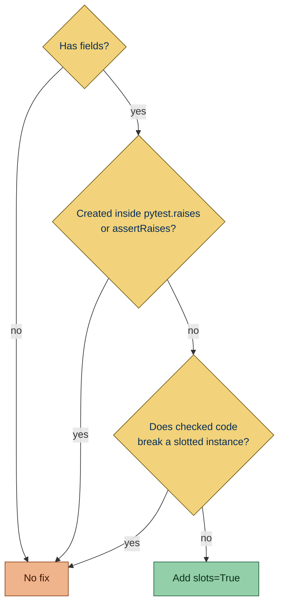

Flags dataclasses declared without `slots=True`.

The public dataclasses of a library are not reported: users construct and subclass them, so `slots=True` is their choice
to make.

## Why is this bad?

[Slots](https://docs.python.org/3/reference/datamodel.html#slots) reject writes to misspelled attributes, as an instance
has no `__dict__` to take a new name, and make each instance smaller.

## Example

```python report
from dataclasses import dataclass


@dataclass
class Release:
    version: str
```

Use instead:

```python ok
from dataclasses import dataclass


@dataclass(slots=True)
class Release:
    version: str
```

## What it does

### Active on

- **[Dataclass](https://docs.python.org/3/library/dataclasses.html#dataclasses.dataclass) decorators**: a decorator
  spelled `@dataclass` or `@dataclasses.dataclass` without `slots=True`. Any value other than a literal `True`, such as
  `slots=False`, is reported too, since only a literal `True` shows that the option is on.

  - `@dataclass`: `slots` is not set.

    ```python report
    from dataclasses import dataclass


    @dataclass
    class Release:
        version: str
    ```

  - `@dataclasses.dataclass(frozen=True)`: the dotted spelling, with `slots` missing.

    ```python report
    import dataclasses


    @dataclasses.dataclass(frozen=True)
    class Release:
        version: str
    ```

  - `@dataclass(slots=False)`: a value other than a literal `True`.

    ```python report
    from dataclasses import dataclass


    @dataclass(slots=False)
    class Release:
        version: str
    ```

  - `@dataclass(**DC_KW)`: a `**` splat of a module-level dict literal, or of a `dict(...)` call with keyword arguments,
    counts the options its keys set. Here `slots` is set, so the class is accepted.

    ```python ok
    from dataclasses import dataclass

    DC_KW = {"frozen": True, "slots": True}


    @dataclass(**DC_KW)
    class Release:
        version: str
    ```

  - A `**` splat simplint cannot read, such as `**get_kw()`, a name bound more than once or changed in place, or a dict
    literal with a `**` entry or a repeated key, leaves the class unreported, since the options may be set.

  - `@dataclass(frozen=True, slots=True)`: `slots` is a literal `True`, so it is accepted.

    ```python ok
    from dataclasses import dataclass


    @dataclass(frozen=True, slots=True)
    class Release:
        version: str
    ```

### Exceptions

- **Target versions before 3.10**: nothing is reported, as `slots=` needs Python 3.10 or later.

  ```toml config
  [tool.ruff]
  target-version = "py39"
  ```

  ```python ok
  from dataclasses import dataclass


  @dataclass
  class Release:
      version: str
  ```

### Fix

The fix sets `slots=True` on the decorator. No fix is offered for:

- a decorator whose `**` splat sets `slots` to a value other than `True`: the fix cannot take the key out of the dict,
  and adding `slots=True` would repeat it

- a class without fields, such as a test fixture standing for a dataclass with the default options

  ```python report
  from dataclasses import dataclass


  @dataclass
  class Empty:
      pass
  ```

- a class the module creates inside `with pytest.raises(...)` or `with self.assertRaises(...)`: the test expects code
  using the instance to fail, such as `{Key("a"): True}` raising because the class is unhashable, and slotting can
  change that

  ```python report
  from dataclasses import dataclass


  import pytest


  def test_key() -> None:
      with pytest.raises(TypeError):

          @dataclass
          class Key:
              name: str
  ```

A class nested in the dataclass has instances of its own, and a classmethod that sets an attribute which is no field
sets the class, not an instance, so neither keeps the fix off:

```python report
from dataclasses import dataclass


@dataclass
class Release:
    version: str

    class Meta:
        def mark(self) -> None:
            self.flag = True

    @classmethod
    def reset(cls) -> None:
        cls.total = 0
```

```python fixed
from dataclasses import dataclass


@dataclass(slots=True)
class Release:
    version: str

    class Meta:
        def mark(self) -> None:
            self.flag = True

    @classmethod
    def reset(cls) -> None:
        cls.total = 0
```

Otherwise the fix leaves out `slots` when checked code shows that a slotted instance breaks the class.



A fix that adds `slots`:

```python report
from dataclasses import dataclass


@dataclass
class Release:
    version: str
```

```python fixed
from dataclasses import dataclass


@dataclass(slots=True)
class Release:
    version: str
```

### When `slots=True` is left out

- the class declares `__slots__`

  ```python report
  from dataclasses import dataclass


  @dataclass(frozen=True)
  class Release:
      __slots__ = ("version",)
      version: str
  ```

- the class uses [`cached_property`](https://docs.python.org/3/library/functools.html#functools.cached_property), or has
  a subclass that does

  ```python report
  from dataclasses import dataclass


  from functools import cached_property


  @dataclass(frozen=True)
  class Release:
      version: str

      @cached_property
      def label(self) -> str:
          return self.version.upper()
  ```

- the class has a subclass with several bases, such as `class Context(FileContext, threading.local)`, whose layouts
  conflict with a slotted one

  ```python report
  from dataclasses import dataclass


  import threading


  @dataclass(frozen=True)
  class FileContext:
      path: str


  class Context(FileContext, threading.local):
      pass
  ```

- code sets an attribute that is not a field on `self` or on an instance known to be of the class, a `ClassVar` or
  `InitVar` attribute included, as a slotted instance has no `__dict__` to shadow it in

  ```python report
  from dataclasses import dataclass


  @dataclass(frozen=True)
  class Release:
      version: str

      def mark(self) -> None:
          self.marked = True
  ```

- code sets an attribute of an instance known to be of the class through `monkeypatch.setattr`, `mock.patch.object`,
  `obj.__setattr__(...)` or `obj.__delattr__(...)`, which may name any attribute

  ```python report
  from dataclasses import dataclass
  from unittest import mock


  @dataclass(frozen=True)
  class Release:
      version: str

      def send(self) -> str:
          return self.version


  def stub() -> None:
      release = Release("1")
      with mock.patch.object(release, "send", return_value="x"):
          print(release.send())
  ```

  ```python report
  from dataclasses import dataclass


  @dataclass(frozen=True)
  class Release:
      version: str


  def stub(monkeypatch) -> None:
      release = Release("1")
      monkeypatch.setattr(release, "marked", True)
      release.__setattr__("marked", False)
      release.__delattr__("marked")
  ```

  ```python fixed
  from dataclasses import dataclass


  @dataclass(frozen=True)
  class Release:
      version: str


  def stub(monkeypatch) -> None:
      release = Release("1")
      monkeypatch.setattr(release, "marked", True)
      release.__setattr__("marked", False)
      release.__delattr__("marked")
  ```

- code sets an attribute under a name computed at run time through `setattr`, such as `setattr(self, key, value)` or
  `setattr(release, key, value)` on an annotated parameter, which may name any attribute

  ```python report
  from dataclasses import dataclass


  @dataclass
  class Release:
      version: str

      def update(self, **changes: str) -> None:
          for key, value in changes.items():
              setattr(self, key, value)


  def apply(release: Release, key: str, value: str) -> None:
      setattr(release, key, value)
  ```

  ```python fixed
  from dataclasses import dataclass


  @dataclass
  class Release:
      version: str

      def update(self, **changes: str) -> None:
          for key, value in changes.items():
              setattr(self, key, value)


  def apply(release: Release, key: str, value: str) -> None:
      setattr(release, key, value)
  ```

- a weak reference to an instance, from `weakref.ref`, `weakref.proxy` or `weakref.finalize`, or a module that uses a
  weak container such as `weakref.WeakSet`, which needs a `__weakref__` slot the class does not have

  ```python report
  import weakref
  from dataclasses import dataclass


  @dataclass(frozen=True)
  class Release:
      version: str


  release = Release("1")
  reference = weakref.ref(release)
  proxy = weakref.proxy(release)
  finalizer = weakref.finalize(release, print, "released")
  ```

  ```python fixed
  import weakref
  from dataclasses import dataclass


  @dataclass(frozen=True)
  class Release:
      version: str


  release = Release("1")
  reference = weakref.ref(release)
  proxy = weakref.proxy(release)
  finalizer = weakref.finalize(release, print, "released")
  ```

  ```python report
  import weakref
  from dataclasses import dataclass


  @dataclass(frozen=True)
  class Release:
      version: str


  LIVE = weakref.WeakSet()
  LIVE.add(Release("1"))
  ```

  ```python fixed
  import weakref
  from dataclasses import dataclass


  @dataclass(frozen=True)
  class Release:
      version: str


  LIVE = weakref.WeakSet()
  LIVE.add(Release("1"))
  ```

- the class has a field with a default that code reads or assigns through the class name, such as `Config.timeout`, or
  through `cls` in a classmethod: a slotted class replaces that class attribute with a descriptor

  ```python report
  from dataclasses import dataclass


  @dataclass
  class Config:
      timeout: int = 30


  def default_timeout() -> int:
      return Config.timeout
  ```

  ```python fixed
  from dataclasses import dataclass


  @dataclass
  class Config:
      timeout: int = 30


  def default_timeout() -> int:
      return Config.timeout
  ```

- a decorator listed below `@dataclass`, which runs first: `slots=True` makes the dataclass return a new class, which
  the decorator never saw

  ```python report
  from dataclasses import dataclass


  def register(cls: type) -> type:
      return cls


  @dataclass(frozen=True)
  @register
  class Release:
      version: str
  ```

- code reaches the instance `__dict__`, as `self.__dict__.update(...)` or `vars(config)` do

  ```python report
  from dataclasses import dataclass


  @dataclass(frozen=True)
  class Release:
      version: str

      def load(self, values: dict[str, object]) -> None:
          self.__dict__.update(values)
  ```

- the class stays mutable and any checked file pickles with a protocol that may be 0 or 1, such as
  `pickle.dumps(obj, protocol)` in a loop over every protocol: those protocols refuse a slotted class without
  `__getstate__`, which a dataclass gets only when frozen. Here a method writes `self`, so `frozen` is left out too, and
  no fix is offered.

  ```python report
  import pickle
  from dataclasses import dataclass


  @dataclass
  class Release:
      version: str
      count: int = 0

      def bump(self) -> None:
          self.count += 1


  def dump(release: Release) -> None:
      for protocol in range(2):
          pickle.dumps(release, protocol)
  ```

- the class is frozen and has a subclass whose methods store attributes on `self`: the `__getstate__` a frozen slotted
  dataclass gets pickles only the fields and drops them

  ```python report file=app/models.py
  from dataclasses import dataclass


  @dataclass(frozen=True)
  class Release:
      version: str
  ```

  ```python context file=app/cache.py
  from app.models import Release


  class CachedRelease(Release):
      def store(self) -> None:
          self.value = 1
  ```

### Instances of the class

An object is **known to be of the class** when it is:

- `self` in a method of the class
- a name bound to a call of the class, through its module as `models.Release(...)` too
- a name annotated with a class the run defines, `Optional[...]` and `... | None` included
- an attribute of `self` the class body annotates with it, such as `self.config` after `config: Config`

An object known to be a mock never counts, nor does anything reached from one. Mocks are names bound to `Mock()`,
`MagicMock()`, `create_autospec(...)`, `mocker.Mock()` or `mocker.patch(...)`, and `with patch(...) as name` targets.

Any other object is unknown, so a write through it counts only when it names a field or a `ClassVar` attribute. An
unannotated parameter such as `result` below is unknown: its write to `log` is not tied to `Result`, so `slots=True` is
still offered, and that write fails at runtime once the fix is applied.

```python report file=app/models.py
from dataclasses import dataclass


@dataclass
class Result:
    status: str
```

```python fixed file=app/models.py
from dataclasses import dataclass


@dataclass(slots=True)
class Result:
    status: str
```

```python context file=app/record.py
from app.models import Result


def record(result) -> None:
    result.log = "x"


record(Result("ok"))
```

A call of a class with a private name, such as `_Result(...)`, or with an all-caps name of three or more letters, such
as `URL(...)`, makes its result known to be of that class. A one- or two-letter capital such as `T` does not, since it
is more likely a type variable:

```python report
from dataclasses import dataclass


@dataclass
class _Result:
    status: str


result = _Result("ok")
result.cached = True
```

```python fixed
from dataclasses import dataclass


@dataclass
class _Result:
    status: str


result = _Result("ok")
result.cached = True
```

```python report
from dataclasses import dataclass


@dataclass
class URL:
    value: str


url = URL("https://example.com")
url.cached = True
```

```python fixed
from dataclasses import dataclass


@dataclass
class URL:
    value: str


url = URL("https://example.com")
url.cached = True
```

### Unsafe fix

The fix is safe only when nothing else in the checked files might notice the change. It is unsafe when:

- the decorator already sets `frozen` or `slots` to something other than `True`;

  ```python report
  from dataclasses import dataclass


  @dataclass(frozen=False)
  class Release:
      version: str
  ```

  ```python fixed
  from dataclasses import dataclass


  @dataclass(frozen=False, slots=True)
  class Release:
      version: str
  ```

- the class has a keyword, such as `metaclass=`, which runs again when `slots` builds the class a second time

  ```python report
  from abc import ABCMeta
  from dataclasses import dataclass


  @dataclass
  class Release(metaclass=ABCMeta):
      version: str
  ```

  ```python fixed
  from abc import ABCMeta
  from dataclasses import dataclass


  @dataclass(slots=True)
  class Release(metaclass=ABCMeta):
      version: str
  ```

- the class has base classes;

  ```python report
  from dataclasses import dataclass


  class Base:
      pass


  @dataclass
  class Release(Base):
      version: str
  ```

  ```python fixed
  from dataclasses import dataclass


  class Base:
      pass


  @dataclass(slots=True)
  class Release(Base):
      version: str
  ```

- another class with the same name, defined in another module, gets attributes written on its instances or has a
  subclass that a slotted base breaks, as an import simplint cannot follow, such as through a re-export, may name this
  class;

  ```python report file=app/models.py
  from dataclasses import dataclass


  @dataclass
  class Release:
      version: str
  ```

  ```python fixed file=app/models.py
  from dataclasses import dataclass


  @dataclass(slots=True)
  class Release:
      version: str
  ```

  ```python context file=app/other.py
  class Release:
      pass


  release = Release()
  release.label = "x"
  ```

- the class body, outside any class nested in it, assigns or deletes an attribute on anything other than `self`, or
  mentions `super`, `__dict__`, `__weakref__`, `__setattr__` or `__delattr__`.

  ```python report
  from dataclasses import dataclass


  settings = object()


  @dataclass
  class Release:
      version: str
      settings.flag = True
  ```

  ```python fixed
  from dataclasses import dataclass


  settings = object()


  @dataclass(slots=True)
  class Release:
      version: str
      settings.flag = True
  ```

  `object.__setattr__(self, ...)` and `super().__setattr__(...)` are how a class writes its own fields, so they do not
  count as writes and keep the fix offered, but naming `__setattr__` or `super` still makes it unsafe:

  ```python report
  from dataclasses import dataclass


  @dataclass
  class Release:
      version: str

      def rename(self, version: str) -> None:
          object.__setattr__(self, "version", version)

      def relabel(self, version: str) -> None:
          super().__setattr__("version", version)
  ```

  ```python fixed
  from dataclasses import dataclass


  @dataclass(slots=True)
  class Release:
      version: str

      def rename(self, version: str) -> None:
          object.__setattr__(self, "version", version)

      def relabel(self, version: str) -> None:
          super().__setattr__("version", version)
  ```

Code outside the checked files, and code that adds an attribute that is not a field to an object simplint cannot tie to
the class, is not detected, and breaks once the fix is applied.

### Related rules

[dataclass-frozen](SMP701.html) asks for `frozen=True` and [dataclass-kw-only](SMP703.html) asks for `kw_only=True` on
the same decorator.

## Other tools

- **[Ruff](https://github.com/astral-sh/ruff):** open issue [#8981](https://github.com/astral-sh/ruff/issues/8981).
