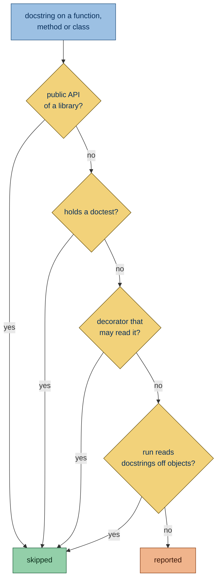

Flags docstrings on internal functions, methods and classes. Their readers have the source open, where a docstring
restates the name and signature and nothing checks that it stays accurate.

## Why is this bad?

[PEP 8](https://peps.python.org/pep-0008/#documentation-strings) asks for docstrings on public modules, functions,
classes and methods, and for a comment after the `def` line of the rest; the fix writes that comment. Many projects
document internal code with docstrings anyway, so this rule is a choice of style rather than common practice.

A docstring restates what the name, signature and type annotations already say, and nothing checks that it stays
accurate when the code changes. When the reason behind a piece of code is not obvious, a short comment next to that code
explains it better.

A longer docstring may state a contract the code does not show, such as a tie-break rule, so the fix keeps its text as a
comment.

## Example

```python report
def load_config(path: Path) -> Config:
    """Load the config file."""
    return Config.from_toml(path.read_text())
```

Use instead:

```python ok
def load_config(path: Path) -> Config:
    return Config.from_toml(path.read_text())
```

## Conflicts with Ruff

Ruff's pydocstyle rules ask for the docstrings this rule removes:

- [undocumented-public-class](https://docs.astral.sh/ruff/rules/undocumented-public-class/)
- [undocumented-public-method](https://docs.astral.sh/ruff/rules/undocumented-public-method/)
- [undocumented-public-function](https://docs.astral.sh/ruff/rules/undocumented-public-function/)
- [undocumented-magic-method](https://docs.astral.sh/ruff/rules/undocumented-magic-method/)
- [undocumented-public-nested-class](https://docs.astral.sh/ruff/rules/undocumented-public-nested-class/)
- [undocumented-public-init](https://docs.astral.sh/ruff/rules/undocumented-public-init/)

simplint stops with an error before linting while any of them applies to a file this rule checks. Turn them off and let
[undocumented-public-api](SMP903.html) ask for documentation on the public API, or turn this rule off.

Use [undocumented-public-api](SMP903.html) in place of Ruff's
[pydocstyle rules](https://docs.astral.sh/ruff/rules/#pydocstyle-d) that ask for docstrings, such as
[undocumented-public-function](https://docs.astral.sh/ruff/rules/undocumented-public-function/) and
[undocumented-public-class](https://docs.astral.sh/ruff/rules/undocumented-public-class/): they treat every name without
a leading `_` as public, while [undocumented-public-api](SMP903.html) follows `__all__`.

When the comment the fix writes gives a Ruff rule a new report, such as
[commented-out-code](https://docs.astral.sh/ruff/rules/commented-out-code/) for code in the docstring, simplint
withdraws the fix and keeps the report.

## What it does

Checks for [docstrings](https://docs.python.org/3/glossary.html#term-docstring) on internal functions, methods and
classes, at any nesting depth. What counts as internal depends on the project.

### Active on

- **All code of an application**: an application has no public API, so every function, method and class in it is
  internal.

  ```python report
  def run() -> None:
      """Run the job."""
      print()
  ```

- **A library's code outside its public API**: whatever [undocumented-public-api](SMP903.html) does not count as public
  API, at any nesting depth. [undocumented-public-api](SMP903.html) describes how the public API is found.

  ```toml config
  [project]
  name = "demo"

  [build-system]
  requires = []
  ```

  ```python ok file=demo/api.py
  def fetch() -> None:
      """Fetch the page."""
  ```

  ```python report file=demo/_core.py
  def step() -> None:
      """Run one step of the job."""
  ```

- **Functions in the `case` bodies of a `match` at module or class level**: a `match` that picks an implementation by
  platform or version is read the way an `if` is, so the functions in each case are checked like the module's others.

  ```python report file=demo/platform.py
  import sys

  match sys.platform:
      case "win32":

          def _open() -> None:
              """Open the file."""

  ```

- **Functions in a private module that other modules import**: a function in a module such as `package/_helpers.py` is
  still internal when another module imports it, as long as the public modules do not re-export it.

  ```toml config
  [project]
  name = "demo"

  [build-system]
  requires = []
  ```

  ```python report file=demo/_helpers.py
  def load() -> None:
      """Load the settings."""
  ```

  ```python context file=demo/cli.py
  from demo._helpers import load

  load()
  ```

### Exceptions

- **A library's public API**: [undocumented-public-api](SMP903.html) requires it to be documented. That covers what its
  public modules offer and re-export, and the methods of a public class whose names do not start with `_`.

  ```toml config
  [project]
  name = "demo"

  [build-system]
  requires = []
  ```

  ```python ok file=demo/api.py
  def fetch() -> None:
      """Fetch the page."""
  ```

- **Dunder methods, overrides and property setters of a public class**: methods such as `__init__` keep their
  docstrings, since documentation tools show them.

  ```toml config
  [project]
  name = "demo"

  [build-system]
  requires = []
  ```

  ```python ok file=demo/api.py
  class Client:
      """Talk to the service."""

      def __init__(self) -> None:
          """Set up the client."""
  ```

- **Names in a module that builds `__all__` dynamically**: every name without a leading `_` is treated as possibly
  public and skipped, since the module's exports cannot be read.

  ```python ok
  __all__ = list(["fetch"])


  def fetch() -> None:
      """Fetch the page."""
  ```

- **Docstrings holding a [doctest](https://docs.python.org/3/library/doctest.html) example**: a line starting with `>>>`
  is a test that `pytest --doctest-modules` runs, so the docstring is data rather than documentation.

  ```python ok
  def add(a: int, b: int) -> int:
      """Add two numbers.

      >>> add(1, 2)
      3
      """
      return a + b
  ```

- **Decorated functions and classes**: the decorator receives the docstring and may read `__doc__`, as `click.command`
  does for help text or `deprecated` does to build its warning. The decorators in the table below are known to leave the
  docstring unread, so the rule still reports under them.

  ```python ok
  @register
  def run() -> None:
      """Run the job."""
  ```

- **Every docstring of a run in which some file reads docstrings off objects**: through `obj.__doc__`,
  `getattr(obj, "__doc__")` or a `getdoc` call such as `inspect.getdoc`. A test asserting a function's `__doc__`, or a
  framework building a schema from endpoint docstrings, may read any of them. A bare `__doc__`, the module's own
  docstring, does not count.

  ```python ok file=run.py
  def run() -> None:
      """Run the job."""
  ```

  ```python context file=show.py
  import inspect

  from run import run

  print(inspect.getdoc(run))
  ```

  ```python report
  def run() -> None:
      """Run the job."""
      print(__doc__)
  ```

Decorators known to leave the docstring unread still let the rule report:

| Module        | Decorators                                                                         |
| ------------- | ---------------------------------------------------------------------------------- |
| builtins      | `staticmethod`, `classmethod`, `property` and its `setter`, `getter` and `deleter` |
| `abc`         | `abstractmethod`                                                                   |
| `typing`      | `override`, `overload`, `final`, `no_type_check`                                   |
| `functools`   | `cache`, `lru_cache`, `cached_property`, `wraps`, `total_ordering`                 |
| `contextlib`  | `contextmanager`, `asynccontextmanager`                                            |
| `dataclasses` | `dataclass`                                                                        |
| `enum`        | `unique`                                                                           |
| `pytest`      | `fixture` and the `pytest.mark` decorators                                         |



### Fix

**Unsafe fix:** code that reads `__doc__` sees the change. That includes
[`help()`](https://docs.python.org/3/builtins/functions.html#help) and code outside the run: a framework the function is
handed to as a value, such as a Starlette route, or a pydantic model whose docstring becomes its schema description.

The fix depends on the docstring's length:

- A docstring of one line with at most five words, such as `"""Return the value."""` or `"""Helper class."""`, restates
  the name. The fix **deletes** it with the blank lines after it.

  ```python report
  def run() -> None:
      """Run the job."""
      print()
  ```

  ```python fixed
  def run() -> None:
      print()
  ```

- Any longer docstring may state a contract. The fix turns it into a `#` **comment block** in its place.

  ```python report
  def _pick(items: list[int]) -> int:
      """Return the largest item, or the first one on a tie."""
      return max(items)
  ```

  ```python fixed
  def _pick(items: list[int]) -> int:
      # Return the largest item, or the first one on a tie.
      return max(items)
  ```

What the fix does with a reported docstring:

- **One line of at most five words**: the fix deletes it.
- **Anything longer, when the comment is safe to write**: the fix turns it into a `#` comment.
- **Anything longer, when it is not**: no fix is offered.

The conditions under which the comment is not safe to write are listed under "No fix is offered" below.

The comment text is built this way:

- The text is the docstring's source between its quotes, escapes such as `\n` as written, cleaned as
  [`inspect.cleandoc`](https://docs.python.org/3/library/inspect.html#inspect.cleandoc) gives it: without the quotes,
  the common indentation, and the blank lines around it, with each line's trailing whitespace dropped.

- Blank lines between paragraphs become a lone `#`.

  ```python report
  def _fetch(url: str) -> bytes:
      """Download the resource.

      The retry count comes from the settings.
      """
      return _download(url)
  ```

  ```python fixed
  def _fetch(url: str) -> bytes:
      # Download the resource.
      #
      # The retry count comes from the settings.
      return _download(url)
  ```

- Lines made only of heading underline characters, such as the `----------` under a numpydoc `Parameters`, are dropped,
  since as comments they read as section dividers (see [section-comment](SMP001.html)).

- Lines that fit keep their text and relative indentation, so lists and indented blocks keep their shape.

- A longer line wraps at spaces. What wraps over joins the next line when that line goes on with the same sentence: it
  has the same indentation, starts with a lowercase letter, and does not open with a field such as `name:` or
  `name (int):`.

- A URL longer than the room gets a line of its own.

- The room is the shorter of Ruff's line length limit and its
  [`max-doc-length`](https://docs.astral.sh/ruff/settings/#lint_pycodestyle_max-doc-length), at the indentation
  `ruff format` gives the body, so the result does not depend on how the code is laid out now.

Around the docstring, both fixes do the following:

- When the docstring is the whole body, the fix leaves
  [`...`](https://docs.python.org/3/builtins/constants.html#Ellipsis) as the body, after the comment when there is one.

  ```python report
  def _ping() -> None:
      """Send a probe to the server, then wait for the reply."""
  ```

  ```python fixed
  def _ping() -> None:
      # Send a probe to the server, then wait for the reply.
      ...
  ```

- A pragma comment after the docstring, such as `# noqa: E501`, covered the docstring's line only and goes with it.
  Another comment stays, after the `...` or at the end of the last comment line.

  ```python report
  def _run() -> None:
      """Run the job."""  # noqa: E501
      print()
  ```

  ```python fixed
  def _run() -> None:
      print()
  ```

- Like the deletion, the comment takes the blank lines after the docstring.

- A comment cannot share a line with code before it. The comment for a docstring on the `def` line, or sharing its line
  with the next statement, goes on lines of its own, and so do the statements after it, as `ruff format` would put them.

No fix is offered when:

- a comment sits between the docstring and a statement sharing its line;

- a comment line would read as a tool directive, such as one starting with `type:`, `noqa`, `fmt:` or `simplint:`, or
  holding `# noqa` in its text;

  ```python report
  def _level() -> int:
      """type: int, the logging level in use."""
      return 1
  ```

- a word too long for the room, other than a URL ending the line, would leave a comment line Ruff's
  [line-too-long](https://docs.astral.sh/ruff/rules/line-too-long/) reports, which it skips on a docstring line of a
  single word;

- `ruff format` leaves the docstring alone, under `# fmt: off`, with `# fmt: skip` or in an excluded file, and its
  indentation is not a multiple of the indent width, which Ruff's
  [indentation-with-invalid-multiple-comment](https://docs.astral.sh/ruff/rules/indentation-with-invalid-multiple-comment/)
  reports for comments.
