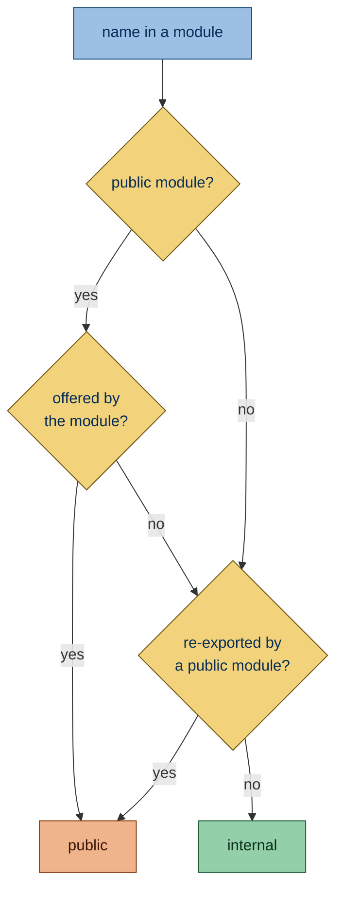

Flags functions, classes, methods and variables of a library's public API that have no documentation. Users read the API
through hover help and the generated reference, where the docstring is all they see.

## Why is this bad?

Users of a library reach its public API through their editor's hover help and the generated reference, not through the
source. A docstring is what they read there: what the function promises, what each parameter means, what it returns and
what it raises. Internal code is the opposite case: its readers have the source open, so
[function-docstring](SMP901.html) asks for no docstring there.

## Example

```toml config
[tool.simplint]
project-kind = "library"
```

```python context file=package/__init__.py
from ._client import fetch

__all__ = ["fetch"]
```

```python report file=package/_client.py
def fetch(url: str) -> bytes:  # package/__init__.py re-exports it
    return _download(url)
```

Use instead:

```python context file=package/__init__.py
from ._client import fetch

__all__ = ["fetch"]
```

```python ok file=package/_client.py
def fetch(url: str) -> bytes:
    """Download the resource at a URL.

    :param url: Address of the resource.
    :returns: The response body.
    """
    return _download(url)
```

## Configuration

- [`project-kind`](https://simplint.readthedocs.io/en/latest/configuration/project.html#library-or-application) in
  `[tool.simplint]`: whether the project is a library or an application

  ```toml config
  [tool.simplint]
  project-kind = "library"
  ```

  ```python report
  def fetch() -> None:
      print()
  ```

- [`api-packages`](https://simplint.readthedocs.io/en/latest/configuration/project.html#api-packages-and-modules) in
  `[tool.simplint]`: the top-level packages whose modules make up the public API

  ```toml config
  [tool.simplint]
  project-kind = "library"
  api-packages = ["demo"]
  ```

  ```python report file=demo/api.py
  def fetch() -> None:
      print()
  ```

  ```python ok file=tools/build.py
  def build() -> None:
      print()
  ```

## What it does

Checks that a library's public API is documented. No fix is offered, since only the author knows what the API promises.

### Active on

- **Public functions and classes**: each needs a [docstring](https://docs.python.org/3/glossary.html#term-docstring).

  ```toml config
  [tool.simplint]
  project-kind = "library"
  ```

  ```python report
  def fetch() -> None:
      print()


  class Client:
      pass
  ```

- **Methods, properties and nested classes of a public class**: those whose names do not start with `_` need a
  docstring.

  ```toml config
  [tool.simplint]
  project-kind = "library"
  ```

  ```python report
  class Client:
      """Talk to the service."""

      def get(self) -> None:
          print()
  ```

- **Public variables**: each needs a docstring on the line below it, or a `#:` comment on the line above it or at the
  end of its line, the forms
  [Sphinx autodoc](https://www.sphinx-doc.org/en/master/usage/extensions/autodoc.html#directive-autoattribute) reads.

  ```toml config
  [tool.simplint]
  project-kind = "library"
  ```

  ```python report file=demo/api.py
  LIMIT = 10
  ```

  ```python ok file=demo/limits.py
  #: The most jobs run at once.
  LIMIT = 10
  RATE = 2
  """The jobs started per second."""
  ```

- **Type aliases from a `type` statement**: a public alias needs a docstring like any public variable.

  ```toml config
  [project]
  requires-python = ">=3.12"

  [tool.simplint]
  project-kind = "library"
  ```

  ```python report file=demo/api.py
  type Pair = tuple[int, int]
  ```

- **Definitions in the `case` bodies of a `match` at module or class level**: a `match` that picks an implementation by
  platform or version is read the way an `if` is, so the public definitions in each case are the module's too.

  ```toml config
  [tool.simplint]
  project-kind = "library"
  ```

  ```python report file=demo/api.py
  import sys

  match sys.platform:
      case "win32":

          def open_thing() -> int:
              return 1

      case _:

          def open_thing() -> int:
              return 2
  ```

- **Names a private module defines and a public module re-exports**: the report names the module that re-exports the
  name, so you can see why it counts.

  ```toml config
  [tool.simplint]
  project-kind = "library"
  ```

  ```python report file=demo/_core.py
  def fetch() -> None:
      print()
  ```

  ```python context file=demo/__init__.py
  from demo._core import fetch

  __all__ = ["fetch"]
  ```

### Exceptions

- **Functions decorated with [`@overload`](https://docs.python.org/3/library/typing.html#typing.overload)**: the
  implementation carries the docstring; [function-docstring](SMP901.html) leaves their docstrings alone too.

  ```toml config
  [tool.simplint]
  project-kind = "library"
  ```

  ```python ok file=demo/api.py
  from typing import overload


  @overload
  def load(path: int) -> int: ...
  ```

- **Dunder methods, such as `__init__`**: the class docstring describes their parameters.

  ```toml config
  [tool.simplint]
  project-kind = "library"
  ```

  ```python ok file=demo/api.py
  class Client:
      """Talk to the service."""

      def __init__(self) -> None: ...
  ```

- **Methods decorated with [`@override`](https://docs.python.org/3/library/typing.html#typing.override)**: documentation
  tools show the base method's docstring.

  ```toml config
  [tool.simplint]
  project-kind = "library"
  ```

  ```python ok file=demo/api.py
  from typing import override


  class Client(Base):
      """Talk to the service."""

      @override
      def get(self) -> None: ...
  ```

- **Property setters and deleters**: they share the property's docstring.

  ```toml config
  [tool.simplint]
  project-kind = "library"
  ```

  ```python ok file=demo/api.py
  class Client:
      """Talk to the service."""

      @name.setter
      def name(self, value: str) -> None: ...
  ```

- **Test modules, as defined in [test-class](SMP801.html)**: users never import tests, so nothing in them is public API.

  ```toml config
  [tool.simplint]
  project-kind = "library"
  ```

  ```python ok file=test_api.py
  def test_fetch() -> None: ...
  ```

- **Every module of an application**: an application has no Python API.

  ```python ok
  def fetch() -> None:
      print()
  ```

- **Modules that build `__all__` dynamically**: a module that builds `__all__` with code such as `list(...)` is checked
  only for the names other modules re-export, because its own exports cannot be read.

  ```toml config
  [tool.simplint]
  project-kind = "library"
  ```

  ```python ok file=demo/api.py
  __all__ = list(["fetch"])


  def fetch() -> None:
      print()
  ```

### The public API

The public API is what users of the library can import, following the
[typing spec](https://typing.python.org/en/latest/spec/distributing.html#library-interface-public-and-private-symbols)
and [PEP 8](https://peps.python.org/pep-0008/#public-and-internal-interfaces):

- a module is public when it belongs to one of the library's API packages and no part of its path starts with `_`, so
  everything under `package/_internal/` or in `package/_core.py` is internal; a dunder module such as `__about__` is
  public, but `__main__`, which runs as a script, is not;

- a public module offers the names its
  [`__all__`](https://docs.python.org/3/tutorial/modules.html#importing-from-a-package) lists, or, without `__all__`,
  every name it defines without a leading `_`, and the names another module imports from it, which
  [missing-from-all](SMP401.html) adds to `__all__`;

- a name a public module re-exports, by listing it in `__all__`, importing it as `from ._core import name as name`, or
  through `from ._core import *`, is public where it is defined, through any chain of re-exports. A plain
  `from ._core import name` in a module without `__all__` keeps the name internal.



## Other tools

- [pydocstyle](https://www.pydocstyle.org/en/stable/error_codes.html) reports public functions and methods without a
  docstring as [D103](https://www.pydocstyle.org/en/stable/error_codes.html) and
  [D102](https://www.pydocstyle.org/en/stable/error_codes.html). It has no check for variables.
