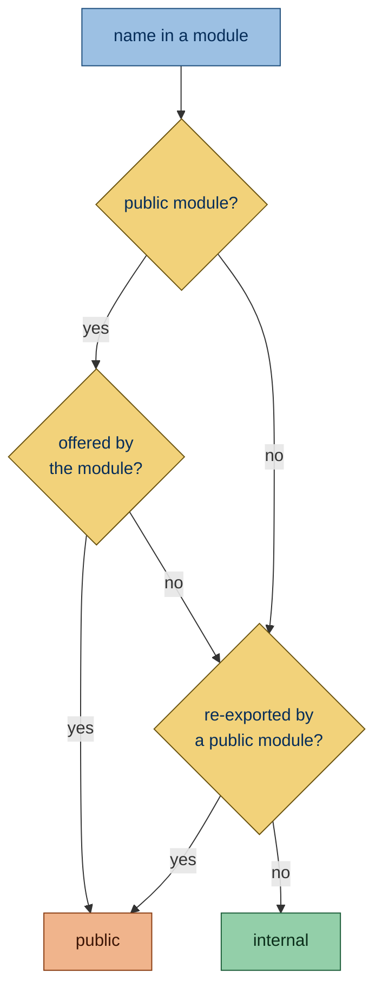

Flags functions, classes, methods and variables of a library's public API that have no documentation.

## Why is this bad?

An exported name tells users what they can import. Its documentation tells them how to use it, including parameter
meanings, return values and failures to handle. [PEP 257](https://peps.python.org/pep-0257/#what-is-a-docstring)
recommends docstrings on exported functions and classes.

## Example

```toml config
[tool.simplint]
project-kind = "library"
```

```python context file=package/__init__.py
from ._client import fetch

__all__ = ["fetch"]
```

```python report file=package/_client.py
def fetch(url: str) -> bytes:  # package/__init__.py re-exports it
    return _download(url)
```

Use instead:

```python context file=package/__init__.py
from ._client import fetch

__all__ = ["fetch"]
```

```python ok file=package/_client.py
def fetch(url: str) -> bytes:
    """Download the resource at a URL.

    :param url: Address of the resource.
    :returns: The response body.
    """
    return _download(url)
```

## Configuration

- [`project-kind`](https://simplint.readthedocs.io/en/latest/configuration/project.html#library-or-application) in
  `[tool.simplint]`: whether the project is a library or an application

  ```toml config
  [tool.simplint]
  project-kind = "library"
  ```

  ```python context file=demo/__init__.py
  from demo._core import fetch as fetch
  ```

  ```python report file=demo/_core.py
  def fetch() -> None:
      print()
  ```

- [`api-packages`](https://simplint.readthedocs.io/en/latest/configuration/project.html#api-packages-and-modules) in
  `[tool.simplint]`: the top-level packages whose modules make up the public API

  ```toml config
  [tool.simplint]
  project-kind = "library"
  api-packages = ["demo"]
  ```

  ```python context file=demo/__init__.py
  from demo._api import fetch as fetch
  ```

  ```python report file=demo/_api.py
  def fetch() -> None:
      print()
  ```

  ```python ok file=tools/build.py
  def build() -> None:
      print()
  ```

## What it does

Checks that a library's public API is documented. No fix is offered, since only the author knows what the API promises.

### Active on

- **Public variables**: each needs a docstring on the line below it, or a `#:` comment on the line above it or at the
  end of its line, the forms
  [Sphinx autodoc](https://www.sphinx-doc.org/en/master/usage/extensions/autodoc.html#directive-autoattribute) reads.

  ```toml config
  [tool.simplint]
  project-kind = "library"
  ```

  ```python report file=demo/api.py
  LIMIT = 10
  ```

  ```python ok file=demo/limits.py
  #: The most jobs run at once.
  LIMIT = 10
  RATE = 2
  """The jobs started per second."""
  ```

- **Type aliases from a `type` statement**: a public alias needs a docstring like any public variable.

  ```toml config
  [project]
  requires-python = ">=3.12"

  [tool.simplint]
  project-kind = "library"
  ```

  ```python report file=demo/api.py
  type Pair = tuple[int, int]
  ```

- **Definitions in the `case` bodies of a `match` at module or class level**: a `match` that picks an implementation by
  platform or version is read the way an `if` is, so the definitions in each case of a re-exported private module are
  the module's too.

  ```toml config
  [tool.simplint]
  project-kind = "library"
  ```

  ```python context file=demo/__init__.py
  from demo._platform import open_thing as open_thing
  ```

  ```python report file=demo/_platform.py
  import sys

  match sys.platform:
      case "win32":

          def open_thing() -> int:
              return 1

      case _:

          def open_thing() -> int:
              return 2
  ```

- **Names a private module defines and a public module re-exports**: the functions, classes and class members of the
  private module that the public one exports. The report names the module that re-exports the name, so you can see why
  it counts.

  ```toml config
  [tool.simplint]
  project-kind = "library"
  ```

  ```python report file=demo/_core.py
  def fetch() -> None:
      print()
  ```

  ```python context file=demo/__init__.py
  from demo._core import fetch

  __all__ = ["fetch"]
  ```

  A re-exported class and its methods are reported the same way:

  ```toml config
  [tool.simplint]
  project-kind = "library"
  ```

  ```python report file=demo/_client.py
  class Client:
      """Talk to the service."""

      def get(self) -> None:
          print()
  ```

  ```python context file=demo/__init__.py
  from demo._client import Client

  __all__ = ["Client"]
  ```

### Exceptions

- **Functions, classes and methods a public module defines**: each needs a
  [docstring](https://docs.python.org/3/glossary.html#term-docstring), which Ruff's pydocstyle rules
  [D101 to D103 and D106](https://github.com/PyCQA/pydocstyle/blob/master/src/pydocstyle/violations.py#L180-L208)
  report. This rule leaves them to Ruff only when the project's Ruff configuration selects the rule for the definition's
  kind.

  ```toml config
  [tool.simplint]
  project-kind = "library"

  [tool.ruff.lint]
  select = ["D101", "D102", "D103", "D106"]
  ```

  ```python ok file=demo/api.py
  def fetch() -> None:
      print()


  class Client:
      pass
  ```

- **Functions decorated with [`@overload`](https://docs.python.org/3/library/typing.html#typing.overload)**: document
  the implementation once. [function-docstring](SMP901.html) also allows docstrings on public overloads.

  ```toml config
  [tool.simplint]
  project-kind = "library"
  ```

  ```python ok file=demo/api.py
  from typing import overload


  @overload
  def load(path: int) -> int: ...
  ```

- **Dunder methods.** The rule makes docstrings optional for methods such as `__init__`. A class docstring can document
  its constructor parameters.

  ```toml config
  [tool.simplint]
  project-kind = "library"
  ```

  ```python ok file=demo/api.py
  class Client:
      """Talk to the service."""

      def __init__(self) -> None: ...
  ```

- **Methods decorated with [`@override`](https://docs.python.org/3/library/typing.html#typing.override)**: documentation
  tools show the base method's docstring.

  ```toml config
  [tool.simplint]
  project-kind = "library"
  ```

  ```python ok file=demo/api.py
  from typing import override


  class Client(Base):
      """Talk to the service."""

      @override
      def get(self) -> None: ...
  ```

- **Property setters and deleters**: they share the property's docstring.

  ```toml config
  [tool.simplint]
  project-kind = "library"
  ```

  ```python ok file=demo/api.py
  class Client:
      """Talk to the service."""

      @name.setter
      def name(self, value: str) -> None: ...
  ```

- **Test modules, as defined in [test-class](SMP801.html)**: simplint excludes test modules from this check.

  ```toml config
  [tool.simplint]
  project-kind = "library"
  ```

  ```python ok file=test_api.py
  def test_fetch() -> None: ...
  ```

- **Every module of an application**: simplint requires documentation for library exports.

  ```python ok
  def fetch() -> None:
      print()
  ```

- **Modules that build `__all__` dynamically**: a module that builds `__all__` with code such as `list(...)` is checked
  only for the names other modules re-export, because its own exports cannot be read.

  ```toml config
  [tool.simplint]
  project-kind = "library"
  ```

  ```python ok file=demo/api.py
  __all__ = list(["fetch"])


  def fetch() -> None:
      print()
  ```

### The public API

simplint uses the following rules to identify a library's public API. The export conventions come from the
[typing specification](https://typing.python.org/en/latest/spec/distributing.html#library-interface-public-and-private-symbols)
and [PEP 8](https://peps.python.org/pep-0008/#public-and-internal-interfaces).

- a module is public when it belongs to one of the library's API packages and no part of its path starts with `_`, so
  everything under `package/_internal/` or in `package/_core.py` is internal; a dunder module such as `__about__` is
  public, but `__main__`, which runs as a script, is not;

- a public module offers the names its
  [`__all__`](https://docs.python.org/3/tutorial/modules.html#importing-from-a-package) lists, or, without `__all__`,
  every name it defines without a leading `_`, and the names another module imports from it. A name another module
  imports but `__all__` leaves out is not offered; [missing-from-all](SMP401.html) adds such a name to `__all__`;

- a name a public module re-exports, by listing it in `__all__`, importing it as `from ._core import name as name`, or
  through `from ._core import *`, is public where it is defined, through any chain of re-exports. A plain
  `from ._core import name` in a module without `__all__` keeps the name internal.

- a class or alias that a listed name's signature refers to, such as a base class of a listed class or an annotation, is
  public where it is defined, though `__all__` does not list it. This rule requires no docstring for it, while the
  methods a listed class inherits from it need one, and [function-docstring](SMP901.html) keeps the docstring it has,
  since the signature makes it library API.

- a module that a `[project.entry-points]` value names without `:attribute`, such as a pytest plugin, is loaded whole by
  its host, which finds its names by convention, so every name it defines or imports without a leading `_` is public
  wherever the module is and whatever its `__all__` lists. A package it names is its `__init__.py`.



## Other tools

- Ruff checks undocumented public [classes](https://docs.astral.sh/ruff/rules/undocumented-public-class/),
  [methods](https://docs.astral.sh/ruff/rules/undocumented-public-method/),
  [functions](https://docs.astral.sh/ruff/rules/undocumented-public-function/) and
  [nested classes](https://docs.astral.sh/ruff/rules/undocumented-public-nested-class/). simplint defers when the
  corresponding Ruff rule is enabled and would report the definition. simplint also checks public variables and
  re-exports from private modules. [Ruff issue #20766](https://github.com/astral-sh/ruff/issues/20766) proposes checks
  for undocumented variables.
- [pydocstyle D102 and D103](https://github.com/PyCQA/pydocstyle/blob/master/src/pydocstyle/violations.py#L180-L208)
  cover public methods and functions.
