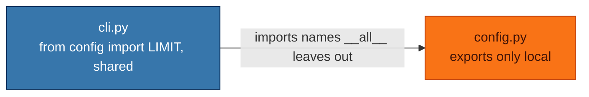

## What it does

Checks for public module-level names that another file in the same run imports but
[`__all__`](https://docs.python.org/3/tutorial/modules.html#importing-from-a-package) does not list. These count as
imports:

- `from module import name`, absolute or relative;
- `module.name` access after `import module`;
- [entry points](https://packaging.python.org/en/latest/specifications/pyproject-toml/#entry-points) declared in
  `pyproject.toml` under `[project.scripts]`, `[project.gui-scripts]` or `[project.entry-points]`;
- declarations in the module's `.pyi` stub, which publish the names it lists.

Module names resolve to files the way Ruff's import graph resolves them, from Ruff's
[`src`](https://docs.astral.sh/ruff/settings/#src) directories and the directory above each package, so a `src` layout
works and `tests/helpers.py` imported as `tests.helpers` matches even when `tests` has no `__init__.py`. Dotted strings
such as `mocker.patch("pkg.mod.name")` and calls such as `patch.object(module, "name")` do not count: they reach into
the module without making the name part of its API. Fixes that rename or move a name still leave names reached this way
alone.

Names starting with `_`, `__init__.py` files, test modules (as defined in [SMP200](SMP200.html)) and modules that import
`__all__` from elsewhere are skipped.

simplint reads `__all__` from module-level `=`, annotated and `+=` assignments of list or tuple literals, and from
`.extend([...])` and `.append("name")` calls, all holding string literals. When any other statement builds it, such as
`list(...)` or `.remove(...)`, or when `__all__` is bound inside a nested block such as an `if`, `try` or function,
nothing is reported.

## Why is this bad?

`__all__` lists the names that make up a module's public interface
([PEP 8](https://peps.python.org/pep-0008/#public-and-internal-interfaces)). A name other modules depend on but
`__all__` omits looks private, so a later change can remove or rename it without anyone noticing the importers.

In the example below, `cli.py` imports `LIMIT` and `shared` from `config.py`, yet `config.py` lists neither, so nothing
in `config.py` tells its next editor that `cli.py` relies on them:



## Example

In `config.py`:

```python
LIMIT = 3


def shared() -> int:
    return LIMIT


def local() -> int:
    return 1


__all__ = ["local"]
```

Use instead:

```python
LIMIT = 3


def shared() -> int:
    return LIMIT


def local() -> int:
    return 1


__all__ = ["local", "LIMIT", "shared"]
```

## Fix safety

The fix adds the missing names to the list or tuple literal of the last `=`, annotated or `+=` assignment to `__all__`.
Each name goes before the first listed name that Ruff's
[unsorted-dunder-all (RUF022)](https://docs.astral.sh/ruff/rules/unsorted-dunder-all/) sorts after it, so a sorted
`__all__` stays sorted. A literal written on one line is rewritten one name per line with a trailing comma, the layout
`ruff format` gives it. Adding names is safe.

A module without `__all__` gets a new one, sorted and one name per line, as its last statement, or above a closing
`if __name__ == "__main__":` block. That fix is unsafe, since it narrows what `from module import *` exports. Importers
outside the run are not seen.
