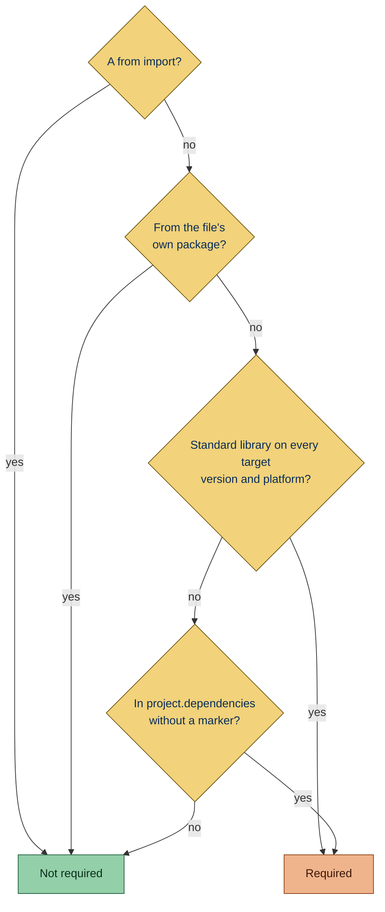

Flags `try`/`except ImportError` guards around imports of modules that are always installed: the standard library and
the project's required dependencies. The fallback never runs in a working environment, and in a broken one the guard
hides the import error.

## Why is this bad?

A required dependency is always installed, so the fallback never runs in a working environment. When the install is
broken, the guard hides the import error until something later fails with a less clear message.

## Example

```toml config
[project]
name = "demo"
dependencies = ["requests"]
```

```python report
try:
    import requests
except ImportError:
    requests = None
```

Use instead:

```python ok
import requests
```

## Configuration

- The Python version the code targets, taken from the first of these that applies; see
  [Python version](https://simplint.readthedocs.io/en/latest/configuration/project.html#python-version):

  1. [`per-file-target-version`](https://docs.astral.sh/ruff/settings/#per-file-target-version) in `[tool.ruff]`: for
     the files a pattern matches

     ```toml config
     [tool.ruff.per-file-target-version]
     "legacy/*.py" = "py38"
     ```

     ```python ok file=legacy/old.py
     try:
         import tomllib
     except ImportError:
         tomllib = None
     ```

     ```python report file=new.py
     try:
         import tomllib
     except ImportError:
         tomllib = None
     ```

  1. [`target-version`](https://docs.astral.sh/ruff/settings/#target-version) in `[tool.ruff]`: for every other file

     ```toml config
     [tool.ruff]
     target-version = "py311"
     ```

     ```python report
     try:
         import tomllib
     except ImportError:
         tomllib = None
     ```

  1. [`project.requires-python`](https://packaging.python.org/en/latest/specifications/pyproject-toml/#requires-python):
     its lowest version, when Ruff sets neither

     ```toml config
     [project]
     name = "demo"
     requires-python = ">=3.11"
     ```

     ```python report
     try:
         import tomllib
     except ImportError:
         tomllib = None
     ```

- [`project.dependencies`](https://packaging.python.org/en/latest/specifications/pyproject-toml/#dependencies); see
  [Settings read from [project]](https://simplint.readthedocs.io/en/latest/configuration/project.html#settings-read-from-project)

  ```toml config
  [project]
  name = "demo"
  dependencies = ["requests"]
  ```

  ```python report
  try:
      import requests
  except ImportError:
      requests = None
  ```

## What it does

The rule checks `try` statements whose body holds only `import` statements of **required** modules and that have an
`except` handler catching [`ImportError`](https://docs.python.org/3/builtins/exceptions.html#ImportError) or
[`ModuleNotFoundError`](https://docs.python.org/3/builtins/exceptions.html#ModuleNotFoundError). The handler may catch
them alone or in a tuple, also when spelled `builtins.ImportError` or `builtins.ModuleNotFoundError`.

### Active on

A module is required when its top-level package is one of these:

- **Standard library modules**: top-level modules and submodules of standard library packages, in the standard library
  of every Python version from the target onward, set by Ruff's
  [`target-version`](https://docs.astral.sh/ruff/settings/#target-version) or
  [`requires-python`](https://packaging.python.org/en/latest/specifications/pyproject-toml/#requires-python). Every
  supported interpreter ships them, so a module removed later, such as `distutils` in 3.12, does not count. A submodule
  counts from the version that adds it, so `asyncio.taskgroups` counts from 3.11 and `string.templatelib` from 3.14.

  ```toml config
  [project]
  name = "demo"
  requires-python = ">=3.11"
  ```

  ```python report
  try:
      import tomllib
  except ImportError:
      tomllib = None
  ```

  ```toml config
  [project]
  name = "demo"
  requires-python = ">=3.11"
  ```

  ```python report
  try:
      import asyncio.taskgroups
  except ImportError:
      asyncio = None
  ```

- **Required dependencies**: listed in
  [`project.dependencies`](https://packaging.python.org/en/latest/specifications/pyproject-toml/#dependencies) of
  `pyproject.toml`, which every install of the project brings along.

  ```toml config
  [project]
  name = "demo"
  dependencies = ["requests"]
  ```

  ```python report
  try:
      import requests
  except ImportError:
      requests = None
  ```

### Exceptions

- **Standard library modules that exist on one platform only**, such as `fcntl`, `msvcrt` or `winreg`: the import fails
  on the other platforms.

  ```toml config
  [project]
  name = "demo"
  requires-python = ">=3.11"
  ```

  ```python ok
  try:
      import fcntl
  except ImportError:
      fcntl = None
  ```

- **Standard library modules that minimal and alternative builds may leave out**, such as `ctypes`, `ssl`, `sqlite3`,
  `tkinter` or `_zstd`: the import can fail on such a build.

  ```toml config
  [project]
  name = "demo"
  requires-python = ">=3.11"
  ```

  ```python ok
  try:
      import ssl
  except ImportError:
      ssl = None
  ```

- **Submodules that a version from the target onward lacks**, such as `asyncio.taskgroups` on 3.10, or that a version
  removes, such as `distutils.core` from 3.12: the import fails on that version. A submodule the rule does not know is
  not counted either.

  ```toml config
  [project]
  name = "demo"
  requires-python = ">=3.10"
  ```

  ```python ok
  try:
      import asyncio.taskgroups
  except ImportError:
      asyncio = None
  ```

- **Imports of the package the file belongs to**: guarding an optional compiled extension of your own package is not
  reported.

  ```python context file=pkg/__init__.py
  # A package.
  ```

  ```python ok file=pkg/core.py
  try:
      import pkg._speedups
  except ImportError:
      pkg = None
  ```

- **`from` imports**: they also fail when the module lacks the name on some platform or version, such as
  `from os import geteuid` outside POSIX or `from yaml import CSafeLoader` without libyaml.

  ```toml config
  [project]
  name = "demo"
  requires-python = ">=3.11"
  ```

  ```python ok
  try:
      from os import geteuid
  except ImportError:
      geteuid = None
  ```

- **Requirements with an [environment marker](https://peps.python.org/pep-0508/#environment-markers) (`;`)**: the
  requirement is conditional, so the package may be missing.

  ```toml config
  [project]
  name = "demo"
  dependencies = ["requests; sys_platform == 'win32'"]
  ```

  ```python ok
  try:
      import requests
  except ImportError:
      requests = None
  ```

- **Optional dependencies and dependency groups**: these are not read, as an install may leave them out.

  ```toml config
  [project]
  name = "demo"
  dependencies = []

  [project.optional-dependencies]
  extra = ["requests"]
  ```

  ```python ok
  try:
      import requests
  except ImportError:
      requests = None
  ```



### Matching dependency names

- Dependencies are matched by their
  [normalized name](https://packaging.python.org/en/latest/specifications/name-normalization/).

  ```toml config
  [project]
  name = "demo"
  dependencies = ["Requests"]
  ```

  ```python report
  try:
      import requests
  except ImportError:
      requests = None
  ```

- A short list of well-known distributions that import under another name also match that name, such as `PyYAML` as
  `yaml`, `Pillow` as `PIL` or `beautifulsoup4` as `bs4`. Other renamed distributions are not recognized.

  ```toml config
  [project]
  name = "demo"
  dependencies = ["PyYAML"]
  ```

  ```python report
  try:
      import yaml
  except ImportError:
      yaml = None
  ```

### Fix

The fix replaces the `try` statement with its dedented body and drops every `except` handler. **Unsafe fix:** always,
because the fallback code is removed and a failing import now raises.

An import the unwrapped body leaves unused keeps a suppression, `# noqa: F401  # fails when the module is missing`, so
Ruff's unused-import fix does not delete it. The import is there to fail when the module is missing.

```toml config
[project]
name = "demo"
requires-python = ">=3.11"
```

```python report
try:
    import tomllib
except ImportError:
    pass
```

```python fixed
import tomllib  # noqa: F401  # fails when the module is missing
```

```toml config
[project]
name = "demo"
dependencies = ["requests"]

[tool.ruff.lint]
select = []
```

```python report
try:
    import requests
except ImportError:
    requests = None
```

```python fixed
import requests  # noqa: F401  # fails when the module is missing
```

No fix is offered when the statement:

- has an `else` or `finally` clause

  ```toml config
  [project]
  name = "demo"
  dependencies = ["requests"]
  ```

  ```python report
  try:
      import requests
  except ImportError:
      requests = None
  else:
      pass
  ```

- shares a line with other code

  ```toml config
  [project]
  name = "demo"
  dependencies = ["requests"]
  ```

  ```python report
  try:
      import requests
  except ImportError:
      requests = None
  ```

- holds an unused import on a line shared with another statement, as the suppression would then cover one import only

  ```toml config
  [project]
  name = "demo"
  requires-python = ">=3.11"
  ```

  ```python report
  try:
      import json
      import tomllib
  except ImportError:
      pass
  ```
