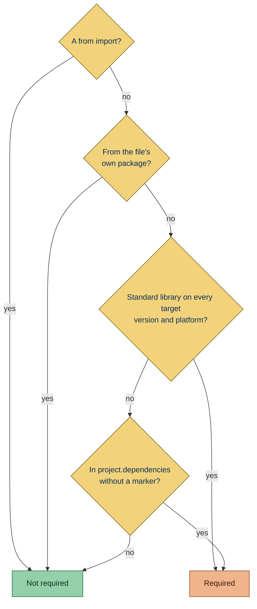

Flags `try`/`except ImportError` around `import` statements when simplint recognizes every imported module as a standard
library module available on the target versions or a required dependency.

## Why is this bad?

If `requests` is an unconditional
[project dependency](https://packaging.python.org/en/latest/specifications/pyproject-toml/#dependencies), a failed
import can expose a broken installation. Replacing it with `requests = None` hides the cause until code tries to use it.

## Example

```toml config
[project]
name = "demo"
dependencies = ["requests"]
```

```python report
try:
    import requests
except ImportError:
    requests = None
```

Use instead:

```python ok
import requests
```

## Configuration

- The following settings can select the target version. See \[Python version\](https for command-line overrides, other
  project declarations and the default.//simplint.readthedocs.io/en/latest/configuration/project.html#python-version):

  1. [`per-file-target-version`](https://docs.astral.sh/ruff/settings/#per-file-target-version) in `[tool.ruff]`: for
     the files a pattern matches

     ```toml config
     [tool.ruff.per-file-target-version]
     "legacy/*.py" = "py38"
     ```

     ```python ok file=legacy/old.py
     try:
         import tomllib
     except ImportError:
         tomllib = None
     ```

     ```python report file=new.py
     try:
         import tomllib
     except ImportError:
         tomllib = None
     ```

  1. [`target-version`](https://docs.astral.sh/ruff/settings/#target-version) in `[tool.ruff]`: for every other file

     ```toml config
     [tool.ruff]
     target-version = "py311"
     ```

     ```python report
     try:
         import tomllib
     except ImportError:
         tomllib = None
     ```

  1. [`project.requires-python`](https://packaging.python.org/en/latest/specifications/pyproject-toml/#requires-python):
     its lowest version, when Ruff sets neither

     ```toml config
     [project]
     name = "demo"
     requires-python = ">=3.11"
     ```

     ```python report
     try:
         import tomllib
     except ImportError:
         tomllib = None
     ```

- [`project.dependencies`](https://packaging.python.org/en/latest/specifications/pyproject-toml/#dependencies); see
  [Settings read from [project]](https://simplint.readthedocs.io/en/latest/configuration/project.html#settings-read-from-project)

  ```toml config
  [project]
  name = "demo"
  dependencies = ["requests"]
  ```

  ```python report
  try:
      import requests
  except ImportError:
      requests = None
  ```

## What it does

The rule checks `try` statements whose body holds only `import` statements of **required** modules and that have an
`except` handler catching [`ImportError`](https://docs.python.org/3/builtins/exceptions.html#ImportError) or
[`ModuleNotFoundError`](https://docs.python.org/3/builtins/exceptions.html#ModuleNotFoundError). The handler may catch
them alone or in a tuple, also when spelled `builtins.ImportError` or `builtins.ModuleNotFoundError`.

### Active on

simplint recognizes two kinds of required imports.

- **Standard library modules**: top-level modules and submodules of standard library packages, in the standard library
  of every Python version from the target onward, set by Ruff's
  [`target-version`](https://docs.astral.sh/ruff/settings/#target-version) or
  [`requires-python`](https://packaging.python.org/en/latest/specifications/pyproject-toml/#requires-python). The rule
  checks releases through Python 3.15 and excludes known optional and platform-specific modules. Its submodule inventory
  begins at Python 3.10, so a target below 3.10 gets no standard library submodule reports. A module removed in that
  range, such as `distutils` in 3.12, does not count. A submodule counts from the version that adds it, so
  `asyncio.taskgroups` counts from 3.11 and
  [`string.templatelib`](https://docs.python.org/3/library/string.templatelib.html#module-string.templatelib) from 3.14.

  ```toml config
  [project]
  name = "demo"
  requires-python = ">=3.11"
  ```

  ```python report
  try:
      import tomllib
  except ImportError:
      tomllib = None
  ```

  ```toml config
  [project]
  name = "demo"
  requires-python = ">=3.11"
  ```

  ```python report
  try:
      import asyncio.taskgroups
  except ImportError:
      asyncio = None
  ```

- **Required dependencies**: listed in
  [`project.dependencies`](https://packaging.python.org/en/latest/specifications/pyproject-toml/#dependencies) of
  `pyproject.toml`, which every install of the project brings along.

  ```toml config
  [project]
  name = "demo"
  dependencies = ["requests"]
  ```

  ```python report
  try:
      import requests
  except ImportError:
      requests = None
  ```

### Exceptions

- **A guard with a comment anywhere in it**: the fix would delete the comment, so the rule reports the guard without a
  fix.

  ```toml config
  [project]
  name = "demo"
  requires-python = ">=3.11"
  ```

  ```python report
  try:
      import tomllib
  except ImportError:  # pragma: no cover
      tomllib = None
  ```

  ```python fixed
  try:
      import tomllib
  except ImportError:  # pragma: no cover
      tomllib = None
  ```

- **Standard library modules that exist on one platform only**, such as `fcntl`, `msvcrt`, `winreg` or
  `asyncio.unix_events`: the import fails on the other platforms.

  ```toml config
  [project]
  name = "demo"
  requires-python = ">=3.11"
  ```

  ```python ok
  try:
      import fcntl
  except ImportError:
      fcntl = None
  ```

  ```python ok
  try:
      import asyncio.unix_events
  except ImportError:
      asyncio = None
  ```

- **Standard library modules that minimal and alternative builds may leave out**, such as `_hashlib`, `ctypes`, `gzip`,
  `mmap`, `ssl`, `sqlite3`, `tkinter`, `_zstd`, `_socket` (missing on WASI) or `tracemalloc` (missing on PyPy): the
  import can fail on such a build.

  ```toml config
  [project]
  name = "demo"
  requires-python = ">=3.11"
  ```

  ```python ok
  try:
      import ssl
  except ImportError:
      ssl = None
  ```

  ```toml config
  [project]
  name = "demo"
  requires-python = ">=3.11"
  ```

  ```python ok
  try:
      import _hashlib
  except ImportError:
      _hashlib = None

  try:
      import gzip
  except ImportError:
      gzip = None

  try:
      import mmap
  except ImportError:
      mmap = None
  ```

- **The C accelerators CPython imports under a fallback**, such as `_json` and `_pickle`: CPython guards each of them
  with an `ImportError` fallback of its own, so the rule does not count them as required. Other private modules, such as
  `_thread`, can still trigger the rule.

  ```toml config
  [project]
  name = "demo"
  requires-python = ">=3.11"
  ```

  ```python ok
  try:
      import _json
  except ImportError:
      _json = None
  ```

  ```toml config
  [project]
  name = "demo"
  requires-python = ">=3.11"
  ```

  ```python report
  try:
      import _thread
  except ImportError:
      _thread = None
  ```

- **Modules whose names start with `_test`**. Python installations can omit test extensions such as `_testcapi`.

  ```toml config
  [project]
  name = "demo"
  requires-python = ">=3.11"
  ```

  ```python ok
  try:
      import _testcapi
  except ImportError:
      _testcapi = None
  ```

- **Submodules that a version from the target onward lacks**, such as `asyncio.taskgroups` on 3.10, or that a version
  removes, such as `distutils.core` from 3.12: the import fails on that version. A submodule the rule does not know is
  not counted either.

  ```toml config
  [project]
  name = "demo"
  requires-python = ">=3.10"
  ```

  ```python ok
  try:
      import asyncio.taskgroups
  except ImportError:
      asyncio = None
  ```

- **Local modules**. The rule checks standard library and required dependency names. A local extension such as
  `pkg._speedups` usually belongs to neither.

  ```python context file=pkg/__init__.py
  # A package.
  ```

  ```python ok file=pkg/core.py
  try:
      import pkg._speedups
  except ImportError:
      pkg = None
  ```

- **`from` imports**: they also fail when the module lacks the name on some platform or version, such as
  `from os import geteuid` outside POSIX or `from yaml import CSafeLoader` without libyaml.

  ```toml config
  [project]
  name = "demo"
  requires-python = ">=3.11"
  ```

  ```python ok
  try:
      from os import geteuid
  except ImportError:
      geteuid = None
  ```

- **Requirements with an [environment marker](https://peps.python.org/pep-0508/#environment-markers) (`;`)**: the
  requirement is conditional, so the package may be missing.

  ```toml config
  [project]
  name = "demo"
  dependencies = ["requests; sys_platform == 'win32'"]
  ```

  ```python ok
  try:
      import requests
  except ImportError:
      requests = None
  ```

- **Optional dependencies and dependency groups**: these are not read, as an install may leave them out.

  ```toml config
  [project]
  name = "demo"
  dependencies = []

  [project.optional-dependencies]
  extra = ["requests"]
  ```

  ```python ok
  try:
      import requests
  except ImportError:
      requests = None
  ```



### Matching dependency names

- simplint compares the top-level import to the distribution name, ignoring case and replacing each hyphen or dot in the
  distribution name with an underscore. Submodules of a matching dependency also count.

  ```toml config
  [project]
  name = "demo"
  dependencies = ["Requests"]
  ```

  ```python report
  try:
      import requests
  except ImportError:
      requests = None
  ```

- A short list of well-known distributions that import under another name also match that name, such as `PyYAML` as
  `yaml`, `Pillow` as `PIL` or `beautifulsoup4` as `bs4`. Other renamed distributions are not recognized.

  ```toml config
  [project]
  name = "demo"
  dependencies = ["PyYAML"]
  ```

  ```python report
  try:
      import yaml
  except ImportError:
      yaml = None
  ```

### Fix

The unsafe fix keeps the imports and removes the handlers. If an import fails, the exception now propagates.

The fix adds `# noqa: F401  # fails when the module is missing` to an unused import so Ruff keeps the installation
check. A function that reads the imported name, including in a nested function, needs no suppression.

```toml config
[project]
name = "demo"
requires-python = ">=3.11"
```

```python report
try:
    import tomllib
except ImportError:
    pass
```

```python fixed
import tomllib  # noqa: F401  # fails when the module is missing
```

```toml config
[project]
name = "demo"
requires-python = ">=3.11"
```

```python report
def load():
    try:
        import tomllib
    except ImportError:
        tomllib = None

    return tomllib
```

```python fixed
def load():
    import tomllib

    return tomllib
```

```toml config
[project]
name = "demo"
dependencies = ["requests"]

[tool.ruff.lint]
select = []
```

```python report
try:
    import requests
except ImportError:
    requests = None
```

```python fixed
import requests  # noqa: F401  # fails when the module is missing
```

No fix is offered when the statement:

- has an `else` or `finally` clause

  ```toml config
  [project]
  name = "demo"
  dependencies = ["requests"]
  ```

  ```python report
  try:
      import requests
  except ImportError:
      requests = None
  else:
      pass
  ```

- shares a line with other code

  ```toml config
  [project]
  name = "demo"
  dependencies = ["requests"]
  ```

  ```python report
  try:
      import requests
  except ImportError:
      requests = None
  ```

- holds an unused import on a line shared with another statement, as the suppression would then cover one import only

  ```toml config
  [project]
  name = "demo"
  requires-python = ">=3.11"
  ```

  ```python report
  try:
      import json
      import tomllib
  except ImportError:
      pass
  ```
