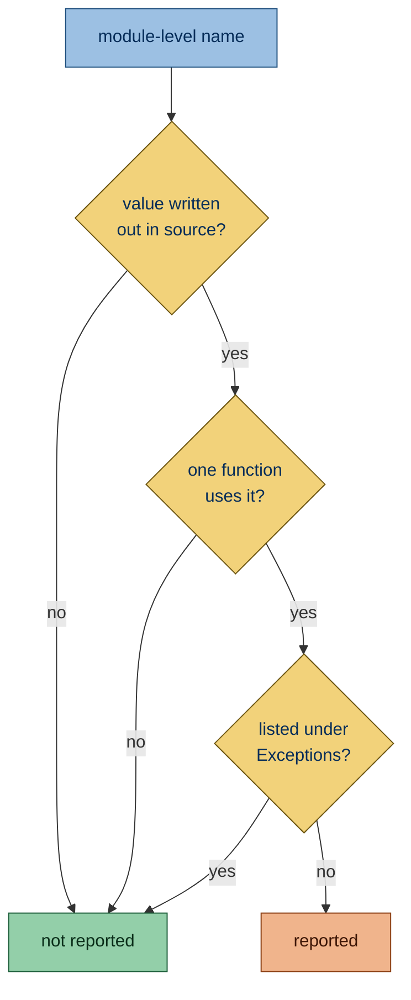
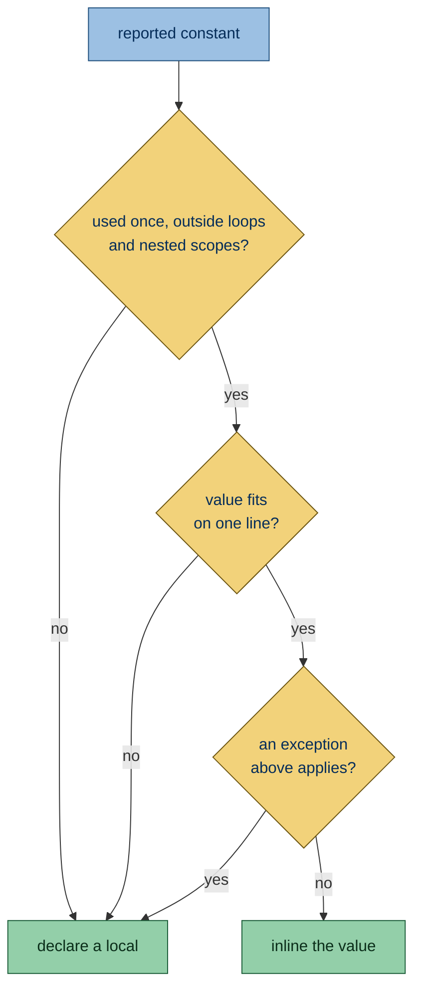

Flags module-level constants that only one function uses. Keeping the value next to its only use lets the reader follow
the function without scrolling away to find it.

## Why is this bad?

A module constant that only one function uses makes the code, and that function, harder to read for no benefit. Code
locality makes a function easy to read and reason about without scrolling around to find the value. In later pull
requests the constant may not even be in the diff, which makes reviews harder. Nothing pays for that: with one user,
there is no duplication the constant avoids, so such a constant is better inlined.

A module-level constant also suggests the value is shared, so a reader has to search the module to learn that one
function uses it. Defined in that function, its scope matches its use. A comment above the constant, such as one saying
it is built once for speed, keeps it at module level.

## Example

```python report
_TIMEOUT = 30


def connect(host: str) -> socket.socket:
    return socket.create_connection((host, 443), timeout=_TIMEOUT)
```

Use instead:

```python ok
def connect(host: str) -> socket.socket:
    return socket.create_connection((host, 443), timeout=30)
```

## Conflicts with Ruff

Ruff's [magic-value-comparison](https://docs.astral.sh/ruff/rules/magic-value-comparison/) asks for a named constant
where the inlined value lands in a comparison. When a fix would give it a new report, simplint withdraws the fix and
keeps the report.

## What it does

### Active on

A constant here is a name assigned once, with `=` or an
[annotated assignment](https://docs.python.org/3/reference/simple_stmts.html#annotated-assignment-statements), to a
value written out in the source. Such a value holds no state shared between calls, so it can move into the function. It
is reported when every reference to it sits inside the body of a single top-level function or method, including
functions nested in it. These values count:

- **Literals**: a string, bytes, number, `True`, `False`, `None` or `...`, including strings joined by placing them side
  by side.

  ```python report
  _TIMEOUT = 30


  def connect(host: str) -> socket.socket:
      return socket.create_connection((host, 443), timeout=_TIMEOUT)
  ```

- **Negative numbers**, such as `-1`: a literal with a sign.

  ```python report
  _OFFSET = -1


  def shift(value: int) -> int:
      return value + _OFFSET
  ```

- **Binary operations between such values**, arithmetic or other, such as `60 * 60` or `"-" * 40`: the result follows
  from the literals alone.

  ```python report
  _WINDOW = 60 * 60


  def expired(age: int) -> bool:
      return age > _WINDOW
  ```

- **Tuple, list, set or dict displays made only of such values**, such as `("a", 1)` or `{"ok": 0}`: the container is
  written out in full.

  ```python report
  _FIELDS = ("name", 1)


  def describe() -> str:
      return str(_FIELDS)
  ```

- **`frozenset()`, or `frozenset` called with one such value**, while the module does not bind the name `frozenset`, so
  the call is the builtin.

  ```python report
  _KEYS = frozenset(["a", "b"])


  def has(key: str) -> bool:
      return key in _KEYS
  ```

### Exceptions

- **Any other value**: built once at import, it may hold state every call shares or be the object a test patches, and
  moving it into the function would build a new one on every call.

  That covers a call result such as a cache, a logger from `logging.getLogger(__name__)`, a pattern from `re.compile`, a
  `Path` or a client instance; a name or attribute such as `logging.INFO`; an f-string; and a display unpacking another
  value with `*` or `**`.

  ```python ok
  import logging

  _LOGGER = logging.getLogger(__name__)


  def run() -> None:
      _LOGGER.info("run")
  ```

- **A constant used only inside a module-level lambda**: a constant cannot move into a lambda.

  ```python ok
  _LIMIT = 3
  TAKE = lambda items: items[:_LIMIT]
  ```

- **Public names**: those listed in
  [`__all__`](https://docs.python.org/3/tutorial/modules.html#importing-from-a-package), or, when the module has no
  `__all__`, builds it dynamically or binds it inside a nested block, names without a leading `_`. Other modules may use
  them.

  ```python ok
  TIMEOUT = 30


  def connect(host: str) -> socket.socket:
      return socket.create_connection((host, 443), timeout=TIMEOUT)
  ```

- **Names another file in the run imports, or patches with
  [`unittest.mock.patch`](https://docs.python.org/3/library/unittest.mock.html#patch) or
  [`patch.object`](https://docs.python.org/3/library/unittest.mock.html#patch-object)**: that file needs the name to
  stay at module level.

  ```python ok file=config.py
  _TIMEOUT = 30


  def connect() -> int:
      return _TIMEOUT
  ```

  ```python context file=main.py
  from config import _TIMEOUT
  ```

- **[Dunder](https://docs.python.org/3/reference/lexical_analysis.html#reserved-classes-of-identifiers) names and
  class-like names such as `UserId`**: Python gives dunder names their meaning, and a class-like name stands for a type
  rather than a value.

  ```python ok
  UserId = 5


  def load() -> int:
      return UserId
  ```

- **Constants with a comment on the line directly above or at the end of their line**: the comment may say why the value
  lives at module level, such as being built once for speed.

  ```python ok
  _TIMEOUT = 30  # seconds


  def connect(host: str) -> socket.socket:
      return socket.create_connection((host, 443), timeout=_TIMEOUT)
  ```

- **Names another module in the run assigns as an attribute**, such as `config._TIMEOUT = 5`: a local copy would ignore
  the override.

  ```python ok file=config.py
  _TIMEOUT = 30


  def connect() -> int:
      return _TIMEOUT
  ```

  ```python context file=main.py
  import config

  config._TIMEOUT = 5
  ```

- **Containers the function changes**: they are state that must outlive each call. The function calls a mutating method
  on them such as `add`, `append` or `update`, or assigns or deletes an item.

  ```python ok
  _SEEN = {"a"}


  def mark(item: str) -> None:
      _SEEN.add(item)
  ```

- **Constants referenced at import time**, such as in a default value or decorator, or in any annotation: the value must
  exist while the module loads, before any function runs.

  ```python ok
  _LIMIT = 3


  def load(limit: int = _LIMIT) -> int:
      return limit
  ```



### Fix

**Unsafe fix:** always, as the value is rebuilt on every call, which costs time for expensive values and gives each call
a new object for mutable ones.

The fix moves the value in one of two ways:

- **Inline**: when the constant is used once, outside any loop, nested function or class, lambda or comprehension, and
  its value fits on one line, the fix inlines the value at the use, adding parentheses when needed. Two exceptions keep
  a name:

  ```python report
  _TIMEOUT = 30


  def connect(host: str) -> socket.socket:
      return socket.create_connection((host, 443), timeout=_TIMEOUT)
  ```

  ```python fixed
  def connect(host: str) -> socket.socket:
      return socket.create_connection((host, 443), timeout=30)
  ```

  - Inside an f-string it inlines only a number: a value with quotes there is a syntax error before Python 3.12, and a
    longer one buries the text the f-string builds.

    ```python report
    _NAME = "shop"


    def label() -> str:
        return f"name: {_NAME}"
    ```

    ```python fixed
    def label() -> str:
        name = "shop"
        return f"name: {name}"
    ```

  - A string that calls `format` keeps a name: as a literal it becomes Ruff's
    [f-string](https://docs.astral.sh/ruff/rules/f-string/) candidate, which Ruff reports only while no argument spans
    lines, so the result would depend on how `ruff format` lays out the call.

    ```python report
    _TEMPLATE = "{} items"


    def describe(count: int) -> str:
        return _TEMPLATE.format(count)
    ```

- **Local**: otherwise it declares a local before the statement that first uses it and renames the uses. The local takes
  the constant's name in lowercase, without leading underscores, and keeps its annotation, with `Final` taken off.

  ```python report
  _LIMIT = 30


  def connect(host: str) -> socket.socket:
      if _LIMIT:
          return socket.create_connection((host, 443), timeout=_LIMIT)
      return socket.create_connection((host, 443))
  ```

  ```python fixed
  def connect(host: str) -> socket.socket:
      limit = 30
      if limit:
          return socket.create_connection((host, 443), timeout=limit)
      return socket.create_connection((host, 443))
  ```



Of the blank lines above and below the constant, the fix removes the shorter run, so the code around it keeps the wider
gap. At the top of the file, the blank lines below go with it.

No fix is offered when:

- the constant shares a line with other code;

  ```python report
  _TIMEOUT = 30
  _RETRIES = 3


  def connect(host: str) -> socket.socket:
      return socket.create_connection((host, 443), timeout=_TIMEOUT, retries=_RETRIES)
  ```

- the local name already appears in the file;

  ```python report
  _TIMEOUT = 30
  timeout = 5


  def connect(host: str) -> socket.socket:
      if _TIMEOUT:
          return socket.create_connection((host, 443), timeout=_TIMEOUT)
      return socket.create_connection((host, 443), timeout=timeout)
  ```

- the value calls `frozenset` and the function has a parameter or local named `frozenset`.

  ```python report
  _KEYS = frozenset(["a", "b"])


  def has(frozenset: set, key: str) -> bool:
      return key in _KEYS
  ```
