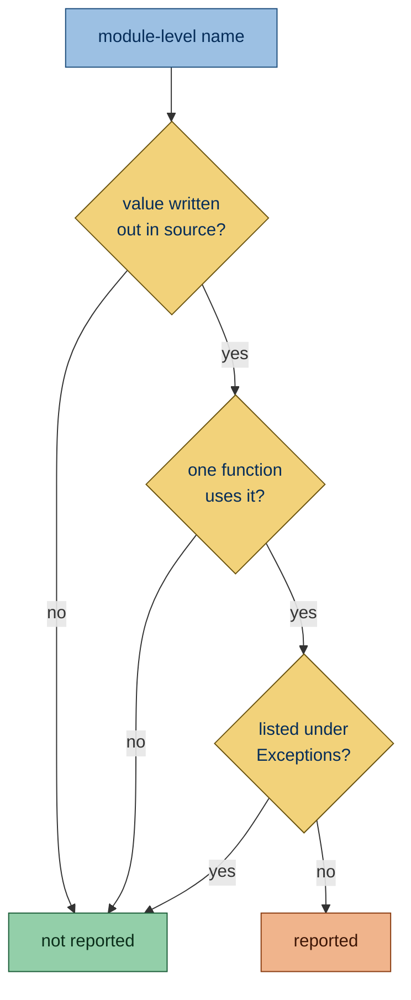
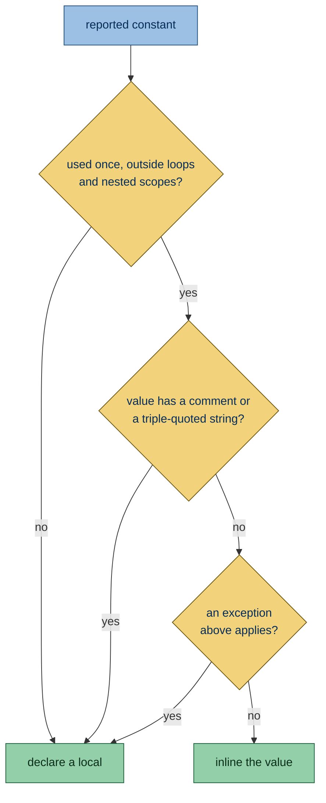

Flags module-level constants that only one function uses.

## Why is this bad?

A private constant used by one function is easier to find inside that function. Inlining a literal at its only use can
remove a name entirely. If several expressions in the function need the value or its annotation matters, keep a local
variable.

## Example

```python report
_TIMEOUT = 30


def connect(host: str) -> socket.socket:
    return socket.create_connection((host, 443), timeout=_TIMEOUT)
```

Use instead:

```python ok
def connect(host: str) -> socket.socket:
    return socket.create_connection((host, 443), timeout=30)
```

## Conflicts with Ruff

Ruff's [magic-value-comparison](https://docs.astral.sh/ruff/rules/magic-value-comparison/) asks for a named constant
where the inlined value lands in a comparison. When a fix would give it a new report, simplint withdraws the fix and
keeps the report.

## What it does

### Active on

A constant here is a name assigned once, with `=` or an
[annotated assignment](https://docs.python.org/3/reference/simple_stmts.html#annotated-assignment-statements), to a
value written out in the source. Such a value is built the same way on every call, so it can move into the function. It
is reported when every reference to it sits inside the body of a single top-level function or method, including
functions nested in it. These values count:

- **Literals**: a string, bytes, number, `True`, `False`, `None` or `...`, including strings joined by placing them side
  by side.

  ```python report
  _TIMEOUT = 30


  def connect(host: str) -> socket.socket:
      return socket.create_connection((host, 443), timeout=_TIMEOUT)
  ```

- **Negative numbers**, such as `-1`: a literal with a sign.

  ```python report
  _OFFSET = -1


  def shift(value: int) -> int:
      return value + _OFFSET
  ```

- **Binary operations between such values that the compiler folds**, such as `60 * 60` or `"-" * 40`: CPython computes
  the result when it compiles the module, so writing the operation out in the function costs nothing per call. The
  Exceptions below list the operations it leaves to run per call.

  ```python report
  _WINDOW = 60 * 60


  def expired(age: int) -> bool:
      return age > _WINDOW
  ```

- **Tuples made only of such values**, such as `("a", 1)`: the compiler stores a tuple of constants with the code, so
  moving it into the function costs nothing per call.

  ```python report
  _FIELDS = ("name", 1)


  def describe() -> str:
      return str(_FIELDS)
  ```

### Exceptions

- **Functions already at Ruff's local-variable limit**: when PLR0914 runs, moving a multiline or annotated constant into
  a function can add a local and cause a new Ruff report. Such constants stay at module scope. The limit comes from
  Ruff's `lint.pylint.max-locals` setting.

  ```toml config
  [tool.ruff]
  preview = true

  [tool.ruff.lint]
  select = ["PLR0914"]

  [tool.ruff.lint.pylint]
  max-locals = 2
  ```

  ```python ok
  _LIMIT: int = 9


  def clamp(value: int) -> int:
      low = 0
      high = _LIMIT
      return min(max(value, low), high)
  ```

- **Any other value**: built once at import, it may hold state every call shares or be the object a test patches, and
  moving it into the function would build a new one on every call.

  That covers a call result such as a cache, a logger from
  [`logging.getLogger(__name__)`](https://docs.python.org/3/library/logging.html#logging.getLogger), a pattern from
  [`re.compile`](https://docs.python.org/3/library/re.html#re.compile), a `Path`, a
  [`frozenset`](https://docs.python.org/3/builtins/stdtypes.html#frozenset) or a client instance; a name or attribute
  such as [`logging.INFO`](https://docs.python.org/3/library/logging.html#logging.INFO); and an f-string. A pattern from
  `re.compile` is the module constant [inline-regex](SMP534.html) asks for when the compile sits inside a function.

  ```python ok
  import logging

  _LOGGER = logging.getLogger(__name__)


  def run() -> None:
      _LOGGER.info("run")
  ```

- **Binary operations the compiler leaves to run per call**: simplint follows CPython's 128-bit size estimates for
  integer multiplication, powers and left shifts. Repeated strings and bytes are limited to 4,096 characters or bytes,
  and repeated tuples to 256 items (1,024 counting nested items). An operation that can raise, such as division by zero,
  stays at module scope.

  ```python ok
  _LIMIT = 2**128


  def cap(value: int) -> int:
      return min(value, _LIMIT)
  ```

- **A constant used only inside a module-level lambda**: a constant cannot move into a lambda.

  ```python ok
  _LIMIT = 3
  TAKE = lambda items: items[:_LIMIT]
  ```

- **Public names**: those listed in
  [`__all__`](https://docs.python.org/3/tutorial/modules.html#importing-from-a-package), or, when the module has no
  `__all__`, builds it dynamically or binds it inside a nested block, names without a leading `_`. Other modules may use
  them.

  ```python ok
  TIMEOUT = 30


  def connect(host: str) -> socket.socket:
      return socket.create_connection((host, 443), timeout=TIMEOUT)
  ```

- **Names another file in the run imports, or a string in the run spells, such as the dotted path `"config._TIMEOUT"`
  that a test patches with [`unittest.mock.patch`](https://docs.python.org/3/library/unittest.mock.html#patch)**: that
  file needs the name to stay at module level, and a string that looks the name up would miss an inlined value. A
  docstring that only mentions the name is prose, so it keeps nothing.

  ```python ok file=config.py
  _TIMEOUT = 30


  def connect() -> int:
      return _TIMEOUT
  ```

  ```python context file=main.py
  from config import _TIMEOUT
  ```

- **Names a doctest of the module reads**: a `>>>` example in one of the module's docstrings runs in the module's
  globals, so inlining the constant would leave the example reading a name that is gone.

  ```python ok
  _TIMEOUT = 30


  def connect() -> int:
      """Return the timeout in seconds.

      >>> _TIMEOUT
      30
      """
      return _TIMEOUT
  ```

- **[Dunder](https://docs.python.org/3/reference/lexical_analysis.html#reserved-classes-of-identifiers) names and
  class-like names such as `UserId`**: Python gives dunder names their meaning, and a class-like name stands for a type
  rather than a value.

  ```python ok
  UserId = 5


  def load() -> int:
      return UserId
  ```

- **Names another module in the run assigns as an attribute**, such as `config._TIMEOUT = 5`: a local copy would ignore
  the override.

  ```python ok file=config.py
  _TIMEOUT = 30


  def connect() -> int:
      return _TIMEOUT
  ```

  ```python context file=main.py
  import config

  config._TIMEOUT = 5
  ```

- **Lists, sets and dicts, and a tuple holding one**: moving a display into the function would create a fresh container
  on each call. Comprehensions are excluded too.

  ```python ok
  _CODES = {"ok": 0, "error": 1, "warning": 2}


  def code(name: str) -> int:
      return _CODES[name]
  ```

- **Three or more adjacent constants that different functions read**, such as a palette or a set of limits: the block
  reads as one unit, and splitting it across its users scatters values that are tuned together.

  ```python ok
  _RED = "#ff0000"
  _GREEN = "#00ff00"
  _BLUE = "#0000ff"


  def warning() -> str:
      return _RED


  def ok() -> str:
      return _GREEN


  def info() -> str:
      return _BLUE
  ```

- **References in defaults, decorators or annotations**. Definition-time expressions may run before the function. Even a
  deferred annotation can need the name in the module namespace later.

  ```python ok
  _LIMIT = 3


  def load(limit: int = _LIMIT) -> int:
      return limit
  ```



### Fix

**Unsafe fix:** always, because a name read through the module, such as one a test patches, no longer finds the constant
once the fix moves it into the function.

The fix moves the value in one of two ways:

- **Inline**: when the constant is used once, outside any loop, nested function or class, lambda or comprehension, the
  fix inlines the value at the use, adding parentheses when needed. A value with a comment inside it, or a triple-quoted
  string, takes the local form instead. Some constants keep a name:

  ```python report
  _TIMEOUT = 30


  def connect(host: str) -> socket.socket:
      return socket.create_connection((host, 443), timeout=_TIMEOUT)
  ```

  ```python fixed
  def connect(host: str) -> socket.socket:
      return socket.create_connection((host, 443), timeout=30)
  ```

  A value the source spreads over several lines goes in on one line, written by Ruff's code generator. The layout and
  trailing commas do not carry over, and each string keeps the quotes it was written with.

  ```python report
  _CHOICES = (
      "first",
      "second",
  )


  def pick() -> None:
      print(_CHOICES)
  ```

  ```python fixed
  def pick() -> None:
      print(("first", "second"))
  ```

  - Inside an f-string it inlines only a number: a value with quotes there is a syntax error before Python 3.12, and a
    longer one buries the text the f-string builds.

    ```python report
    _NAME = "shop"


    def label() -> str:
        return f"name: {_NAME}"
    ```

    ```python fixed
    def label() -> str:
        name = "shop"
        return f"name: {name}"
    ```

  - A string that calls `format` keeps a name: as a literal it becomes Ruff's
    [f-string](https://docs.astral.sh/ruff/rules/f-string/) candidate, which Ruff reports only while no argument spans
    lines, so the result would depend on how `ruff format` lays out the call.

    ```python report
    _TEMPLATE = "{} items"


    def describe(count: int) -> str:
        return _TEMPLATE.format(count)
    ```

  - Inside an f-string `=` debug field the field keeps its printed text, so the value moves into a plain field after it.

    ```python report
    _LIMIT = 30


    def show() -> str:
        return f"{_LIMIT=}"
    ```

    ```python fixed
    def show() -> str:
        return f"_LIMIT={30!r}"
    ```

  - A constant with an annotation keeps its name, as the annotation types the value where an inlined literal would be
    typed on its own. A tuple of constants under `tuple[float, float]` is one: inlined, `(0.5, 2)` is typed as
    `tuple[float, int]`. A local keeps the explicit `tuple[float, float]` annotation.

    ```python report
    _BOUNDS: tuple[float, float] = (0.5, 2)


    def widen() -> tuple[float, float]:
        return _BOUNDS
    ```

    ```python fixed
    def widen() -> tuple[float, float]:
        bounds: tuple[float, float] = (0.5, 2)
        return bounds
    ```

  - An integer followed by a `.` gets parentheses, since `30.bit_length()` reads the dot as a decimal point and does not
    parse.

    ```python report
    _LIMIT = 30


    def bits() -> int:
        return _LIMIT.bit_length()
    ```

    ```python fixed
    def bits() -> int:
        return (30).bit_length()
    ```

- **Local**: otherwise it declares a local before the statement that first uses it and renames the uses. The local takes
  the constant's name in lowercase, without leading underscores, and keeps its annotation, with `Final` taken off. An
  annotated constant always takes this form.

  ```python report
  _LIMIT = 30


  def connect(host: str) -> socket.socket:
      if _LIMIT:
          return socket.create_connection((host, 443), timeout=_LIMIT)
      return socket.create_connection((host, 443))
  ```

  ```python fixed
  def connect(host: str) -> socket.socket:
      limit = 30
      if limit:
          return socket.create_connection((host, 443), timeout=limit)
      return socket.create_connection((host, 443))
  ```

The comments directly above the constant and the one after it on its line move with it, onto their own lines above the
statement that reads the value, or above the local. A Sphinx `#:` comment becomes a plain `#` one, as it documents
nothing on a local.

```python report
_TIMEOUT = 30  # seconds before the server drops us


def connect(host: str) -> socket.socket:
    return socket.create_connection((host, 443), timeout=_TIMEOUT)
```

```python fixed
def connect(host: str) -> socket.socket:
    # seconds before the server drops us
    return socket.create_connection((host, 443), timeout=30)
```



Of the blank lines above and below the constant, the fix removes the shorter run, so the code around it keeps the wider
gap. At the top of the file, the blank lines below go with it.

These cases can prevent a fix.

- A constant shares a line with other code. In the example below, placing `_TIMEOUT` and `_RETRIES` on the same line
  would prevent the fix.

  ```python report
  _TIMEOUT = 30
  _RETRIES = 3


  def connect(host: str) -> socket.socket:
      return socket.create_connection((host, 443), timeout=_TIMEOUT, retries=_RETRIES)
  ```

- A comment moving with the constant contains another tool's directive, such as `# noqa: E501`. Moving it would change
  which line it applies to.

  ```python report
  _URL = "https://example.com/a/very/long/path"  # noqa: E501


  def fetch() -> str:
      return _URL
  ```

- A comment would move into a function whose entire body occupies the `def` line. Writing the example below as
  `def tick() -> int: return _TICK` would prevent the edit.

  ```python report
  _TICK = 1  # one step


  def tick() -> int:
      return _TICK
  ```

- Indenting a comment at its new location would exceed the configured comment width.

- The proposed local name already appears in the file.

  ```python report
  _TIMEOUT = 30
  timeout = 5


  def connect(host: str) -> socket.socket:
      if _TIMEOUT:
          return socket.create_connection((host, 443), timeout=_TIMEOUT)
      return socket.create_connection((host, 443), timeout=timeout)
  ```

- A t-string reads the constant. Its expression text is observable at runtime.

  ```toml config
  [project]
  requires-python = ">=3.14"
  ```

  ```python report
  _LIMIT = 30


  def show() -> object:
      return t"{_LIMIT}"
  ```

- A string in the proposed local uses a backslash to continue onto the next line. Indenting that line would change the
  string.

  ```python report
  _MESSAGE = "hello \
  world"


  def show() -> None:
      for _ in range(2):
          print(_MESSAGE)
  ```

  ```python fixed
  _MESSAGE = "hello \
  world"


  def show() -> None:
      for _ in range(2):
          print(_MESSAGE)
  ```

- A file in the run sets an attribute of the module under a computed name, as
  [`setattr(module, name, value)`](https://docs.python.org/3/builtins/functions.html#setattr) does.
