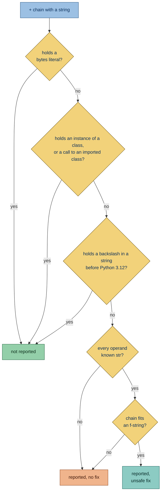

Flags `+` chains that join a string literal or f-string with other values. An f-string shows the final text in one
piece, where a `+` chain scatters it across quotes and operators.

## Why is this bad?

A chain of `+` scatters the text across quotes and operators, and every non-string operand needs an explicit `str()`. An
f-string ([PEP 498](https://peps.python.org/pep-0498/)) shows the final text in one piece.

## Example

```python report
message = "Hello, " + name + "!"
```

Use instead:

```python ok
message = f"Hello, {name}!"
```

## Configuration

- [`target-version`](https://docs.astral.sh/ruff/settings/#target-version) and
  [`per-file-target-version`](https://docs.astral.sh/ruff/settings/#per-file-target-version), falling back to
  [`project.requires-python`](https://packaging.python.org/en/latest/specifications/pyproject-toml/#requires-python);
  see [Python version](https://simplint.readthedocs.io/en/latest/configuration/project.html#python-version)

  ```toml config
  [tool.ruff]
  target-version = "py311"
  ```

  ```python report
  def greet(name: str) -> str:
      return "Hello, " + name.strip('"') + "!"
  ```

## What it does

### Active on

- **`+` chains that join a string literal or
  [f-string](https://docs.python.org/3/reference/lexical_analysis.html#f-strings) with other values**, such as
  `"Hello, " + name + "!"`: the whole chain is reported once. **Unsafe fix:** always, and offered only when the code
  shows every operand is a `str`. `+` raises [`TypeError`](https://docs.python.org/3/builtins/exceptions.html#TypeError)
  for a non-string operand and honors a custom
  [`__add__`](https://docs.python.org/3/reference/datamodel.html#object.__add__) or `__radd__`, such as
  `markupsafe.Markup` escaping the other operand, while an f-string formats any value.

  ```python report
  def greet(name: str) -> str:
      return "Hello, " + name + "!"
  ```

  ```python fixed
  def greet(name: str) -> str:
      return f"Hello, {name}!"
  ```

### Exceptions

- **Chains that contain a bytes literal**: Python has no bytes f-string to write them as.

  ```python ok
  def header(name: bytes) -> bytes:
      return b"Name: " + name
  ```

- **The message of a logging call**, such as `logger.info("Hello, " + name)`: Ruff's
  [logging-string-concat](https://docs.astral.sh/ruff/rules/logging-string-concat/) reports it, so this rule leaves it
  to Ruff.

  ```python ok
  import logging

  logger = logging.getLogger(__name__)


  def greet(name: str) -> None:
      logger.info("Hello, " + name)
  ```

- **Two literals joined by `+` across lines**, such as `("Hello, "` followed by `+ "world")`: Ruff's
  [explicit-string-concatenation](https://docs.astral.sh/ruff/rules/explicit-string-concatenation/) reports it when
  `allow-multiline` is on, so this rule leaves it to Ruff. A longer chain that starts with such a pair is left to Ruff
  as well, since both would report the same spot. Ruff gives no fix to a pair with a parenthesized operand, so this rule
  keeps that pair and its chain, where its own fix stays available.

  ```python ok
  # fmt: off
  title = (
      "Hello, "
      + "world"
  )
  # fmt: on
  ```

  ```python report
  title = ("Hello, ") + "world"
  ```

- **Chains with an operand that is an instance of a class**, such as `Markup("<b>")` for a `Markup` class that overrides
  `__add__` or one `markupsafe` provides: `+` runs that method, which an f-string would not, so the chain is left alone.
  The instance may come from a call, a variable holding one, a parameter annotated with the class, a method of such an
  instance, or a function of the module annotated to return it. A class the run defines is recognized under any name,
  and a name imported from outside the run counts as a class when its name is CapWords, as PEP 8 spells classes, with
  leading underscores ignored, so `_Private` counts too.

  ```python ok
  class Markup(str):
      def __add__(self, other: str) -> "Markup":
          return Markup(str.__add__(self, other.replace("<", "&lt;")))


  SAFE = Markup("<b>") + "<i>"
  ```

  ```python ok
  from markupsafe import Markup

  SAFE = Markup("<b>") + "<i>"
  ```

- **Chains with a string in a non-literal operand that holds a backslash, on a target before Python 3.12**, such as
  `"a" + name.strip("\n")`: a replacement field of an f-string cannot hold a backslash inside a string before
  [PEP 701](https://peps.python.org/pep-0701/#considerations-of-quote-reuse), so no f-string holds the chain for that
  target and this rule does not report it. From Python 3.12 on the chain is reported as before.

  ```toml config
  [tool.ruff]
  target-version = "py311"
  ```

  ```python ok
  def trim(name: str) -> str:
      return "a" + name.strip("\n")
  ```

### Deciding on a fix



### Known `str` operands

An operand is known to be a `str` when it is one of these.

Literals and expressions:

- a string literal or f-string, `"..." % values`, or a `str` repeated by an `int`, such as `"-" * width`
- an index or slice of a `str`, or an item of a list, tuple, set or mapping of them, such as `name.split(".")[0]` or
  `names[0]` for `names: list[str]`
- a conditional between `str` values, or `a or "default"` where `a` is a `str` or `None`

Builtins and the standard library:

- a call to the builtin `str`, `repr`, `ascii`, `format`, `chr`, `hex`, `oct` or `bin`
- a `str` method such as `join`, `format` or `upper` called on a `str`, or `decode` on `bytes`
- `__name__`, `__qualname__` and `__module__` of anything, and the module's `__name__` and `__file__`
- standard library values the module imports: `os.sep`, `os.linesep`, `sys.platform`, the `string` constants,
  `os.getcwd()`, `platform.system()`, `json.dumps(...)`, `textwrap.dedent(...)`, `os.environ[...]`,
  `os.environ.get(key, "default")`, `os.getenv(key, "default")`, `uuid.uuid4().hex`, `os.path.join(...)` and the other
  `os.path` functions given a `str`, `re.escape` given a `str`, and the `name`, `stem`, `suffix` and `as_posix()` of a
  `pathlib.Path`

Code of the module:

- a call to a function or method of the module annotated `-> str`, undecorated or with `functools.cache`
- an attribute of an instance of a class of the module that annotates it `str`, or a property annotated `-> str`
- on `self`, also an attribute that the class body and its methods only ever set to such values, when nothing else
  writes it and no subclass may override it
- a name every binding of which, in the scope it resolves to, gives such a value: an assignment, a loop over such items,
  a `with tempfile.TemporaryDirectory() as path`, or an annotation `str` (also `Final[str]`, `Annotated[str, ...]`) that
  no binding contradicts

A name that an unannotated parameter, an import, a `global` or a type parameter binds is not known, so `value + "!"` for
an unannotated `value` is reported without a fix. The annotations are trusted: a parameter annotated `str` can still
receive a `str` subclass with its own `__add__`.

### Fix

The fix copies each non-literal operand into a placeholder as written:

- A call to the builtin `str`, `repr` or `ascii` becomes the matching conversion, as Ruff's
  [explicit-f-string-type-conversion](https://docs.astral.sh/ruff/rules/explicit-f-string-type-conversion/) asks, so
  `"n=" + str(n)` becomes `f"n={n!s}"`.

  ```python report
  def label(n: int) -> str:
      return "n=" + str(n)
  ```

  ```python fixed
  def label(n: int) -> str:
      return f"n={n!s}"
  ```

- A generator passed bare to `str`, `repr` or `ascii` gets parentheses of its own, since a replacement field takes only
  a yield or star expression unparenthesized.

  ```python report
  def label(values: list[int]) -> str:
      return "values=" + str(value for value in values)
  ```

  ```python fixed
  def label(values: list[int]) -> str:
      return f"values={(value for value in values)!s}"
  ```

- A chain of plain string literals becomes one plain string.

  ```python report
  def title() -> str:
      return "Hello, " + "world"
  ```

  ```python fixed
  def title() -> str:
      return "Hello, world"
  ```

No fix is offered when:

- a literal is triple-quoted, raw or `u`-prefixed;

  ```python report
  def greet(name: str) -> str:
      return """Hello, """ + name
  ```

- the literals use different quote characters;

  ```python report
  def greet(name: str) -> str:
      return 'Say "hi", ' + name + ". It's late."
  ```

- a comment sits between the operands, since the f-string has no place for it;

  ```python report
  def greet(name: str) -> str:
      return (
          "Hello, "  # the greeting
          + name
      )
  ```

- a non-literal operand contains a backslash, `#`, `:`, `!`, `{` or `}`; before Python 3.12 a backslash inside a string
  is an exception above, and one outside a string, such as a line continuation, is reported without a fix;

  ```python report
  def greet(name: str) -> str:
      return "Hello, " + name.replace(":", "") + "!"
  ```

- a name is bound by a [PEP 695](https://peps.python.org/pep-0695/) type parameter of the enclosing function or class,
  as its kind is not known;

  ```toml config
  [project]
  requires-python = ">=3.12"
  ```

  ```python report
  s = "x"


  def f[s]() -> str:
      return "a" + s
  ```

- the target Python version is older than 3.12 and a non-literal operand contains the string's quote character, which
  f-strings allow only from 3.12 on ([PEP 701](https://peps.python.org/pep-0701/#considerations-of-quote-reuse)).

  ```toml config
  [tool.ruff]
  target-version = "py311"
  ```

  ```python report
  def greet(name: str) -> str:
      return "Hello, " + name.strip('"') + "!"
  ```

## Other tools

- **[Ruff](https://github.com/astral-sh/ruff):** variation of released rules
  [G003](https://docs.astral.sh/ruff/rules/logging-string-concat/) and
  [ISC003](https://docs.astral.sh/ruff/rules/explicit-string-concatenation/), which report `+` in logging calls and
  between two literals split across lines and which this rule leaves to them; open issue
  [#11060](https://github.com/astral-sh/ruff/issues/11060) lists Sourcery's use-fstring-for-concatenation.
- [Sourcery](https://sourcery.ai) rewrites the same `+` chains as an f-string through its
  [use-fstring-for-concatenation](https://docs.sourcery.ai/reference/refactorings/python/use-fstring-for-concatenation/)
  refactoring.
- [wemake-python-styleguide](https://github.com/wemake-services/wemake-python-styleguide) reports explicit string
  concatenation as
  [WPS336](https://wemake-python-styleguide.readthedocs.io/en/latest/pages/usage/violations/consistency.html#wemake_python_styleguide.violations.consistency.ExplicitStringConcatViolation)
  and prefers `str.format`, where this rule prefers an f-string.
