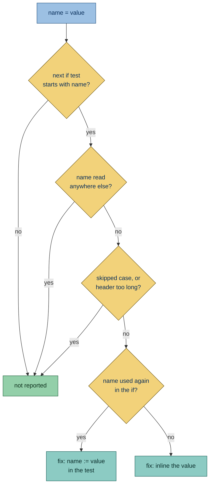

Flags an assignment to a name that only feeds the `if` statement right after it. Inlining the value, or binding it in
the test with `:=`, keeps the value next to the check that uses it.

## Why is this bad?

A name that exists only to feed the next test splits one decision over two statements. It also stays in scope after it
stops mattering. Inlining the value, or binding it in the test with an
[assignment expression](https://docs.python.org/3/reference/expressions.html#assignment-expressions) (`:=`, from
[PEP 572](https://peps.python.org/pep-0572/)), keeps the value next to the check that uses it.

## Example

```python report
def first_word(text: str) -> str:
    found = re.match(r"\w+", text)
    if found:
        return found.group(0)
    stripped = text.strip()
    if not stripped:
        return ""
    return text
```

Use instead:

```python ok
def first_word(text: str) -> str:
    if found := re.match(r"\w+", text):
        return found.group(0)
    if not text.strip():
        return ""
    return text
```

## Configuration

- [`target-version`](https://docs.astral.sh/ruff/settings/#target-version) and
  [`per-file-target-version`](https://docs.astral.sh/ruff/settings/#per-file-target-version), falling back to
  [`project.requires-python`](https://packaging.python.org/en/latest/specifications/pyproject-toml/#requires-python);
  see [Python version](https://simplint.readthedocs.io/en/latest/configuration/project.html#python-version)

  ```toml config
  [tool.ruff]
  target-version = "py37"
  ```

  ```python ok
  def first_word(text: str) -> str:
      found = text.strip()
      if found:
          return found
      return ""
  ```

- [`line-length`](https://docs.astral.sh/ruff/settings/#line-length) and
  [`indent-width`](https://docs.astral.sh/ruff/settings/#indent-width), which give the width an `if` header must fit;
  see
  [Settings shared with Ruff](https://simplint.readthedocs.io/en/latest/configuration/project.html#settings-shared-with-ruff)

  ```toml config
  [tool.ruff]
  line-length = 40
  ```

  ```python ok
  def check(text: str) -> bool:
      size = len(text) + len(text) + len(text) + len(text)
      if size > 1000000:
          return True
      return False
  ```

## What it does

### Active on

An assignment to a single name is reported when it is directly followed by an `if` statement whose test starts with that
name, and nothing else reads the name: not after the `if` statement, and not before the assignment either, such as a
closure or an earlier statement of the same loop. The search covers the enclosing function, or the whole file at module
level. The test starts with the name when the name is:

- **The whole test**, as in `if found:`.

  ```python report
  def first_word(text: str) -> str:
      found = text.strip()
      if found:
          return found
      return ""
  ```

  ```python fixed
  def first_word(text: str) -> str:
      if found := text.strip():
          return found
      return ""
  ```

- **The operand of `not`**, as in `if not found:`.

  ```python report
  def first_word(text: str) -> str:
      found = text.strip()
      if not found:
          return ""
      return text
  ```

  ```python fixed
  def first_word(text: str) -> str:
      if not text.strip():
          return ""
      return text
  ```

- **The left side of a comparison**, as in `if found > 3:`.

  ```python report
  def long_enough(text: str) -> bool:
      size = len(text)
      if size > 3:
          return True
      return False
  ```

  ```python fixed
  def long_enough(text: str) -> bool:
      if len(text) > 3:
          return True
      return False
  ```

- **The first operand of `and` or `or`**, as in `if found and ready:`.

  ```python report
  def first_word(text: str, ready: bool) -> str:
      found = text.strip()
      if found and ready:
          return found
      return ""
  ```

  ```python fixed
  def first_word(text: str, ready: bool) -> str:
      if (found := text.strip()) and ready:
          return found
      return ""
  ```

In each case the value can take the name's place at the start of the test without changing what runs first.

### Exceptions

- **Target versions older than 3.8**: Python 3.8 introduced `:=`.

  ```toml config
  [tool.ruff]
  target-version = "py37"
  ```

  ```python ok
  def first_word(text: str) -> str:
      found = text.strip()
      if found:
          return found
      return ""
  ```

- **Modules with a version gate**, as [missing-final](SMP601.html) describes: the module exists to run on older
  interpreters and report them.

  ```python ok
  import sys

  if sys.version_info < (3, 8):
      raise SystemExit("Python 3.8 or newer is required")


  def first_word(text: str) -> str:
      found = text.strip()
      if found:
          return found
      return ""
  ```

- **Assignments in a class body**, including inside an `if`, `for` or `try` block of the class, unless a function sits
  between: such an assignment defines a class attribute, which `Class.name` reads without a name reference.

  ```python ok
  class Config:
      found = len("text")
      if found:
          LIMIT = found
  ```

- **Values that are a lambda, `yield`, `yield from`, an `:=` expression or a tuple without parentheses**: these are not
  reported.

  ```python ok
  def run(items: list[str]) -> list[str]:
      found = lambda: items
      if found:
          return found()
      return items
  ```

- **Values that mention the name itself**: these are not reported.

  ```python ok
  def run(text: str) -> str:
      found = text.strip() or found
      if found:
          return found
      return text
  ```

- **Assignments that share a line with other code**: the fix deletes the assignment's whole line.

  ```python ok
  def run(text: str) -> str:
      found = text.strip()
      other = 1
      if found:
          return found
      return str(other)
  ```

- **Assignments with a comment on their line, or between them and the `if`**: deleting the assignment would lose the
  comment.

  ```python ok
  def run(text: str) -> str:
      found = text.strip()  # the stripped text
      if found:
          return found
      return text
  ```

- **`TYPE_CHECKING`**: type checkers recognize the guard by that name whatever its value, so the name must stay.

  ```python ok
  TYPE_CHECKING = False

  if TYPE_CHECKING:
      import os
  ```

- **Module-level names that another module in the run imports or patches by name, or that `__all__` lists, and every
  module-level name when `__all__` is computed**: the other module would lose the binding.

  ```python ok file=settings.py
  found = len("text")
  if found:
      print(found)
  ```

  ```python context file=main.py
  from settings import found
  ```

- **Names the function declares [`global`](https://docs.python.org/3/reference/simple_stmts.html#the-global-statement)
  or [`nonlocal`](https://docs.python.org/3/reference/simple_stmts.html#the-nonlocal-statement)**: code in the outer
  scope reads the binding too.

  ```python ok
  def run(text: str) -> str:
      global found
      found = text.strip()
      if found:
          return found
      return text
  ```

- **An `if` whose header, with the value folded in, would not fit
  [`line-length`](https://docs.astral.sh/ruff/settings/#line-length) on one line at its block's indentation**:
  `ruff format` would split it over several lines, which reads worse than the two statements.

  The header is measured joined on one line without parentheses around the test, which the formatter drops, so how the
  code is laid out now does not matter. A header with a comment or a string over several lines never fits.

  ```python ok
  def run(text: str, flag: bool) -> str:
      found = text.strip()
      if flag and found and text.startswith("a") and text.endswith("b") and text.isalpha() and text.isascii():
          return found
      return text
  ```



### Fix

The fix is safe. It deletes the assignment, then:

- when the name appears nowhere else in the `if` statement, including the rest of the test, the body and any `elif` or
  `else` branch, it inlines the value and adds parentheses where precedence requires them;

  ```python report
  def run(text: str) -> bool:
      found = text.strip() + "!"
      if found:
          return True
      return False
  ```

  ```python fixed
  def run(text: str) -> bool:
      if text.strip() + "!":
          return True
      return False
  ```

- otherwise it writes `name := value` in the test, in parentheses unless the name is the whole test.

  ```python report
  def run(text: str) -> str:
      found = text.strip()
      if found:
          return found
      return ""
  ```

  ```python fixed
  def run(text: str) -> str:
      if found := text.strip():
          return found
      return ""
  ```

When the assignment and the `if` it leads to are the only statements of an `if` whose header holds a comment, and that
`if` has no `else` or `elif` branch, Ruff would merge the two `if` statements only past the comment. The fix would leave
that work behind, so the finding is reported without a fix.

```python report
def run(text: str, flag: bool) -> str:
    if flag:  # keep
        size = len(text)
        if size > 3:
            return text
    return ""
```

The search for other reads looks only at names in code. It misses importers outside the run and references held in
strings, such as an `__all__` entry.

## Other tools

- **[Ruff](https://github.com/astral-sh/ruff):** open issues [#970](https://github.com/astral-sh/ruff/issues/970),
  [#11060](https://github.com/astral-sh/ruff/issues/11060) and [#10108](https://github.com/astral-sh/ruff/issues/10108).
- [pylint](https://github.com/pylint-dev/pylint) reports the same assignment and `if` pairs as
  [consider-using-assignment-expr](https://pylint.readthedocs.io/en/latest/user_guide/messages/refactor/consider-using-assignment-expr.html),
  for targets that allow `:=`, with no fix.
