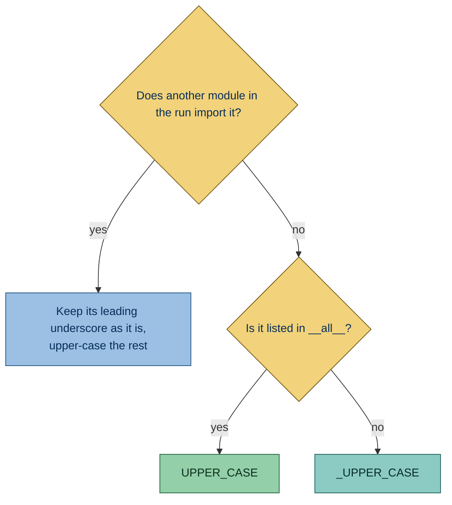

## What it does

Checks that module-scope variable names match their visibility: `UPPER_CASE` for names listed in
[`__all__`](https://docs.python.org/3/tutorial/modules.html#importing-from-a-package), `_UPPER_CASE` for the rest. In a
module without `__all__`, every variable counts as private and should be `_UPPER_CASE`. A name another module in the run
imports keeps its current leading underscore, and only its case changes.

simplint reads `__all__` from assignments, `+=`, `.extend([...])` and `.append("name")` with string literals. When any
other statement builds it, such as `list(...)` or `.remove(...)`, or when it is bound inside a nested block such as an
`if`, `try` or function, the rule is skipped.

Names bound with `:=` are checked. The rule skips:

- dunder names
- class-like names, such as the type alias `Alias = int`
- names also bound by an import, `def` or `class`
- names bound only as `for`, `with`, `except` or `match` targets
- pytest's [`pytestmark`](https://docs.pytest.org/en/stable/example/markers.html#marking-whole-classes-or-modules),
  [`pytest_plugins`](https://docs.pytest.org/en/stable/how-to/plugins.html#requiring-loading-plugins-in-a-test-module-or-conftest-file),
  [`collect_ignore` and `collect_ignore_glob`](https://docs.pytest.org/en/stable/example/pythoncollection.html#customizing-test-collection)
- `TYPE_CHECKING`, since type checkers recognize the guard by that name whatever its value
- every name in a `conf.py`, since [Sphinx](https://www.sphinx-doc.org/en/master/usage/configuration.html) reads its
  settings by their lowercase names
- `revision`, `down_revision`, `branch_labels` and `depends_on` in an
  [Alembic](https://alembic.sqlalchemy.org/en/latest/tutorial.html#create-a-migration-script) revision file: a module
  that binds `revision` and `down_revision` and defines an `upgrade` function
- [gunicorn settings](https://gunicorn.org/reference/settings/), such as `bind`, `workers` or `timeout`, in a gunicorn
  configuration file: a file whose name contains `gunicorn`, such as `gunicorn.conf.py`, or a module that binds at least
  three settings, one of them `bind`, `workers` or `worker_class`
- `version`, `version_tuple` and `commit_id` in a module that also binds `__version__`, the names of the version file
  [setuptools-scm](https://setuptools-scm.readthedocs.io/en/latest/usage/#version-files) writes
- `apilevel`, `threadsafety` and `paramstyle` in a module that binds all three, the
  [PEP 249](https://peps.python.org/pep-0249/#globals) globals of a database driver
- in a module that imports [PLY](https://www.dabeaz.com/ply/)'s `lex` or `yacc`, including a vendored copy such as
  `pkg._ply.yacc`: `tokens`, `literals`, `precedence`, `states`, `start` and the `t_` and `p_` rules, which PLY reads
  off the module by name
- every name in a PLY table module, one that binds `_tabversion`, since PLY reads its tables back by name
- `app` and `application` assigned at the top level of the module from a call that builds a WSGI, ASGI or
  [Typer](https://typer.tiangolo.com/tutorial/typer-command/) application, which servers and the `typer` command load by
  name: `aiohttp.web.Application`, `bottle.Bottle`, Django's `get_wsgi_application` and `get_asgi_application`,
  `falcon.App`, `falcon.API` and `falcon.asgi.App`, `fastapi.FastAPI`, `flask.Flask`, `litestar.Litestar`,
  `quart.Quart`, `sanic.Sanic`, `starlette.applications.Starlette`, `typer.Typer`, and Pyramid's `make_wsgi_app()`; the
  call is resolved through the module's imports
- the names listed in `naming.keep-names`, under Options below, for any other framework that reads a module variable by
  name

Ruff's [mixed-case-variable-in-global-scope](https://docs.astral.sh/ruff/rules/mixed-case-variable-in-global-scope/)
(N816) flags only `mixedCase` names. This rule also flags `lower_case` names and a wrong leading underscore.
[SMP103](SMP103.html) applies the same underscore convention to functions and classes.

## Why is this bad?

Upper case tells a reader the name is a module-level value rather than a local, as
[PEP 8](https://peps.python.org/pep-0008/#constants) writes constants. The leading underscore tells them whether other
modules may use it ([PEP 8](https://peps.python.org/pep-0008/#public-and-internal-interfaces)). Deriving both from
`__all__` keeps the names in line with what the module exports.

The expected name comes from two questions, asked in this order: does another module in the run import it, and if not,
does `__all__` list it?



## Example

```python
limit = 3
logger = logging.getLogger(__name__)

__all__ = ["logger"]
```

Use instead:

```python
_LIMIT = 3
LOGGER = logging.getLogger(__name__)

__all__ = ["LOGGER"]
```

## Fix safety

The fix renames every use in the file, including the `__all__` entry. It is always unsafe: importers outside the run
keep the old name, and so do string references in unchecked files, such as
[`mocker.patch`](https://pytest-mock.readthedocs.io/en/latest/usage.html) targets.

No fix is offered when:

- another module in the run imports the name or reaches it by a dotted string, such as a `mocker.patch` target
- a file of the run reads an attribute by that name off a module it loads by a computed name: the result of
  `importlib.import_module`, `__import__` or `sys.modules[...]`, a parameter annotated `ModuleType`, or a pytest fixture
  that returns such a module
- the new name is already used as a name in the file
- the name shadows a builtin, as in `zip = zip`, where the value reads the builtin under the same name
- the old name appears in the text of a string, as written or through an escape such as `\N{LATIN SMALL LETTER X}`,
  other than an entry of an `__all__` list assigned with `=` or `+=`
- the old name also names something a text rename cannot tell apart: a parameter, a local variable, a class attribute, a
  keyword argument or an attribute access

## Options

- `naming.keep-names` in `[tool.simplint]`: module-scope names the rule leaves as they are, such as
  `keep-names = ["urlpatterns"]` under `[tool.simplint.naming]`
- [`target-version`](https://docs.astral.sh/ruff/settings/#target-version) and
  [`per-file-target-version`](https://docs.astral.sh/ruff/settings/#per-file-target-version), falling back to
  [`project.requires-python`](https://packaging.python.org/en/latest/specifications/pyproject-toml/#requires-python)
