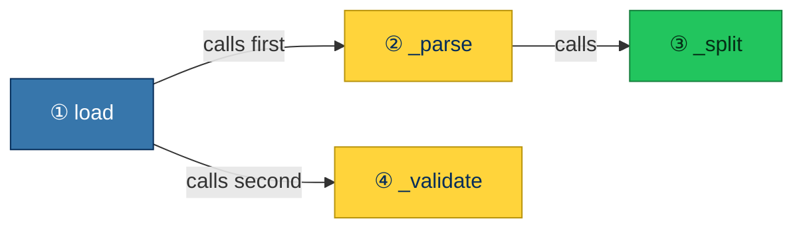

## What it does

Checks the order of functions and classes at module level and in every class body. A helper that runs only when another
definition is called should sit directly below its first user, the earliest statement that refers to it. When one user
has several helpers, they follow it in the order the user first refers to them. At module level, a user refers to a
helper by name. In a class body, a method refers to another through `self.name`, `cls.name` or `ClassName.name`.

Definitions that must exist while the module or class body runs stay where they are:

- anything referenced at import time: module-level code, decorators, default values and base classes
- names bound more than once, such as a [property](https://docs.python.org/3/builtins/functions.html#property) and its
  setter
- at module level, definitions whose own statement evaluates another module-level name that is not an import, for
  example in a decorator or default value
- everything these call

Mutually recursive helpers stay in place too.

Annotations do not make a user when Python evaluates them lazily: when the target version is 3.14 or later
([PEP 649](https://peps.python.org/pep-0649/)), or the module has
[`from __future__ import annotations`](https://docs.python.org/3/library/__future__.html). The target version comes from
Ruff's [`target-version`](https://docs.astral.sh/ruff/settings/#target-version) or
[`requires-python`](https://packaging.python.org/en/latest/specifications/pyproject-toml/#requires-python). Otherwise an
annotation runs with its statement. In a module-level or class-level `def` signature or variable annotation, it counts
as an import-time use. Inside a function body, it counts as a use by that function.

## Why is this bad?

Code reads top-down when each function is followed by the helpers it calls. A helper above its caller, or far from it,
makes the reader jump around the file.

The habit of putting helpers first comes from compiled languages such as C, where a function has to be
[declared before it is used](https://en.cppreference.com/c/language/function_declaration). Python has no such rule: a
name inside a function body is looked up
[when the function runs](https://docs.python.org/3/reference/executionmodel.html#resolution-of-names), not when it is
defined, so a helper can sit anywhere in the module. That leaves the order free to serve the reader, and a file that
starts with its entry point and then explains each step lets a reviewer follow the change the way it runs.

The order is depth first, like reading a book: each helper follows its first caller, and a helper's own helpers come
before the caller's next one. For this call tree the file reads `load`, `_parse`, `_split`, `_validate`:



## Example

```python
def _parse(line: str) -> tuple[str, str]:
    key, _, value = line.partition("=")
    return key, value


def load(text: str) -> dict[str, str]:
    return dict(_parse(line) for line in text.splitlines())
```

Use instead:

```python
def load(text: str) -> dict[str, str]:
    return dict(_parse(line) for line in text.splitlines())


def _parse(line: str) -> tuple[str, str]:
    key, _, value = line.partition("=")
    return key, value
```

## Fix safety

The fix rewrites the span from the first to the last misplaced statement in the expected order, and comes with the first
report of each body only, since that one fix moves every definition the body's reports name. Decorators and the comment
lines directly above a definition move with it. Statements are separated by two blank lines at module level and one in a
class body.

The fix is safe when every definition in the rewritten span is an undecorated function. A span holding a class or a
decorated function is unsafe, even when that definition only shifts to make room, because
[decorators](https://docs.python.org/3/glossary.html#term-decorator),
[metaclasses](https://docs.python.org/3/reference/datamodel.html#metaclasses) and
[`__init_subclass__`](https://docs.python.org/3/reference/datamodel.html#object.__init_subclass__) hooks then run in a
different order. No fix is offered when the span holds a comment that is not attached to a definition, or when two
statements share a line.
