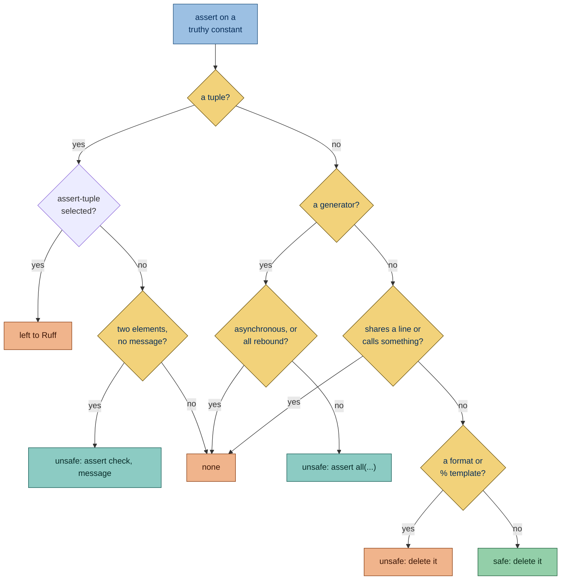

Flags `assert` statements whose test is a truthy constant. Such an assertion can never fail, so it checks nothing and
makes a test look like it verifies more than it does.

## Why is this bad?

An assertion on a truthy constant can never fail, so it checks nothing and makes a test look like it verifies more than
it does. A parenthesized `assert (check, "message")` is a non-empty tuple and falls in the same trap. Ruff reports every
non-empty tuple as [assert-tuple](https://docs.astral.sh/ruff/rules/assert-tuple/), and
[assert-on-string-literal](https://docs.astral.sh/ruff/rules/assert-on-string-literal/) reports a string, bytes or
f-string literal. This rule leaves those cases to Ruff when the corresponding rule runs.

## Example

```python report
def test_save(tmp_path: Path) -> None:
    save(tmp_path / "out.json")
    assert True
```

Use instead:

```python ok
def test_save(tmp_path: Path) -> None:
    save(tmp_path / "out.json")
    assert (tmp_path / "out.json").exists()
```

## What it does

### Active on

[`assert`](https://docs.python.org/3/reference/simple_stmts.html#the-assert-statement) statements whose test is a
[truthy](https://docs.python.org/3/builtins/stdtypes.html#truth-value-testing) constant, in every file, not only tests.
Truthiness is judged the way Ruff judges it. These are truthy constants:

- **`True`**: truthy by definition.

  ```python report
  assert True
  ```

- **A non-zero number**: only zero is falsy.

  ```python report
  assert 1
  ```

- **A non-empty string, bytes or f-string literal**: only an empty one is falsy.

  ```toml config
  [tool.ruff.lint]
  select = []
  ```

  ```python report
  assert "ready"
  ```

- **`...`**: `Ellipsis` is always truthy.

  ```python report
  assert ...
  ```

- **A lambda**: a function object is always truthy.

  ```python report
  assert lambda: None
  ```

- **A non-empty tuple, list, set or dict literal** such as `[value]`: a container with items is truthy.

  ```python report
  value = 1
  assert [value]
  ```

- **A generator expression**: a generator object is truthy even when it yields nothing, so the assertion can never fail.
  Ruff does not implement bugbear's B044, which flags it.

  ```python report
  values = [1, 2]
  assert (value for value in values)
  ```

- **A `format` call or a `%` expression on a string literal whose text has characters outside its fields**: the literal
  text is in every result, so the result is never empty.

  ```python report
  state = "ready"
  assert "state: {}".format(state)
  ```

  ```python report
  state = "ready"
  assert "state: %s" % state
  ```

- **A computation on literals**: arithmetic, string concatenation and repetition, comparisons, `not`, and `and` and `or`
  over numbers, strings, booleans and `None`, when the result is truthy. The rule computes the value the way Python
  does, so `1 + 1 == 2` and `"a" * 3` are constant, while a computation on integers past 64 bits, or a repetition or
  concatenation that builds a string longer than 4096 bytes, is left alone.

  ```python report
  assert 1 + 1 == 2
  ```

  ```python report
  assert "a" * 3
  ```

### Exceptions

- **A string, bytes or f-string literal**, such as one whose f-string calls a function: Ruff's
  [assert-on-string-literal](https://docs.astral.sh/ruff/rules/assert-on-string-literal/) reports it while the project's
  Ruff configuration selects it, so this rule leaves it to Ruff, including cases it could fix. Ruff's own suppressions
  of it, through `per-file-ignores` or `noqa`, are respected too.

  ```toml config
  [tool.ruff.lint]
  select = ["PLW0129"]
  ```

  ```python ok
  def compute() -> str:
      return ""


  assert f"ready {compute()}"
  ```

- **A container holding only starred elements**, such as `[*values]`: it may be empty.

  ```python ok
  values = []
  assert [*values]
  ```

- **A malformed template**, such as `"x{"` or `"x%y"`: Python raises on it rather than passing.

  ```python ok
  assert "x{".format()
  ```

- **A format or `%` template with text only inside its fields**, such as `"{}"` or `"%s"`: the field may hold an empty
  string, so the result may be empty too.

  ```python ok
  value = ""
  assert "{}".format(value)
  ```

  ```python ok
  value = ""
  assert "%s" % value
  ```

- **An f-string made only of fields**, such as `f"{value}"`: it is empty when `value` is.

  ```python ok
  value = ""
  assert f"{value}"
  ```

- **Any non-empty tuple test while Ruff runs F631**: Ruff's
  [assert-tuple](https://docs.astral.sh/ruff/rules/assert-tuple/) reports them, including two-element tuples this rule
  could fix. Ruff's own suppressions of it, through `per-file-ignores` or `noqa`, are respected too.

  ```toml config
  [tool.ruff.lint]
  select = ["F631"]
  ```

  ```python ok
  assert (1, 2, 3)
  ```

- **A computation that reads a name or calls a function**, such as `assert value + 1 == 2`: the value can change, so the
  rule evaluates only literals.

  ```python ok
  value = 1
  assert value + 1 == 2
  ```

### Fix

The fix depends on the constant:

- A two-element tuple without a message, such as `assert (check, "message")`, becomes `assert check, "message"`, since
  deleting it would drop the check it meant. **Unsafe fix:** the restored check may now fail.

  ```toml config
  [tool.ruff.lint]
  select = []
  ```

  ```python report
  check = False
  assert (check, "message")
  ```

  ```python fixed
  check = False
  assert check, "message"
  ```

  A walrus check gets parentheses, since `:=` cannot stand alone before the comma.

  ```toml config
  [tool.ruff.lint]
  select = []
  ```

  ```python report
  assert (ready := True, "message")
  ```

  ```python fixed
  assert (ready := True), "message"
  ```

- A generator becomes `all(...)` around the same expression. **Unsafe fix:** the restored check may now fail. Its first
  iterable is evaluated when the generator is built, so deleting the assertion would also drop that evaluation and any
  error it raises.

  ```python report
  values = [1, 2]
  assert (value for value in values)
  ```

  ```python fixed
  values = [1, 2]
  assert all(value for value in values)
  ```

  No fix is offered for an asynchronous generator, one with `async for` or `await`, since `all()` cannot iterate it, nor
  where the file binds `all` to something other than the builtin.

  ```python report
  async def check(values: AsyncIterator[int]) -> None:
      assert (value async for value in values)
  ```

  ```python fixed
  async def check(values: AsyncIterator[int]) -> None:
      assert (value async for value in values)
  ```

- Other tuples get no fix. When Ruff's F631 runs, every non-empty tuple is left to it.

- For a `format` or `%` template the fix deletes the assertion **unsafely**: its fields may not fit its arguments, and
  the deletion would hide the error that raises. Any other constant is deleted safely, since its assertion never fails.
  The block keeps a `pass` only when the assertion was its only statement:

  - An assertion with other statements in its block: the fix deletes it.

    ```python report
    def test_save() -> None:
        save()
        assert True
    ```

    ```python fixed
    def test_save() -> None:
        save()
    ```

  - An assertion that is the only statement in its block: the fix leaves `pass` in its place.

    ```python report
    def test_empty() -> None:
        assert True
    ```

    ```python fixed
    def test_empty() -> None:
        pass
    ```

For a constant that is not a tuple, no fix is offered when:

- the assertion shares a line with another statement;

- its test calls something, as in `assert [compute()]` or `assert "value {}".format(compute())`, since deleting it would
  skip that call.

  ```python report
  def compute() -> int:
      return 1


  assert [compute()]
  ```

  ```python report
  def compute() -> int:
      return 1


  assert "value {}".format(compute())
  ```



## Other tools

- **[Ruff](https://github.com/astral-sh/ruff):** variation of released rules
  [F631](https://docs.astral.sh/ruff/rules/assert-tuple/) and
  [PLW0129](https://docs.astral.sh/ruff/rules/assert-on-string-literal/), which cover tuples and string literals; this
  rule leaves every covered case to Ruff when the corresponding rule runs and covers other truthy constants.
- [flake8-useless-assert](https://github.com/decorator-factory/flake8-useless-assert) reports an assert with a truthy
  literal, such as `assert True`, as [ULA001](https://github.com/decorator-factory/flake8-useless-assert), with no fix.
- [Sourcery](https://sourcery.ai) removes `assert True` statements through
  [remove-assert-true](https://docs.sourcery.ai/reference/refactorings/python/remove-assert-true/). It covers
  `assert True` only, where this rule also covers other truthy constants.
