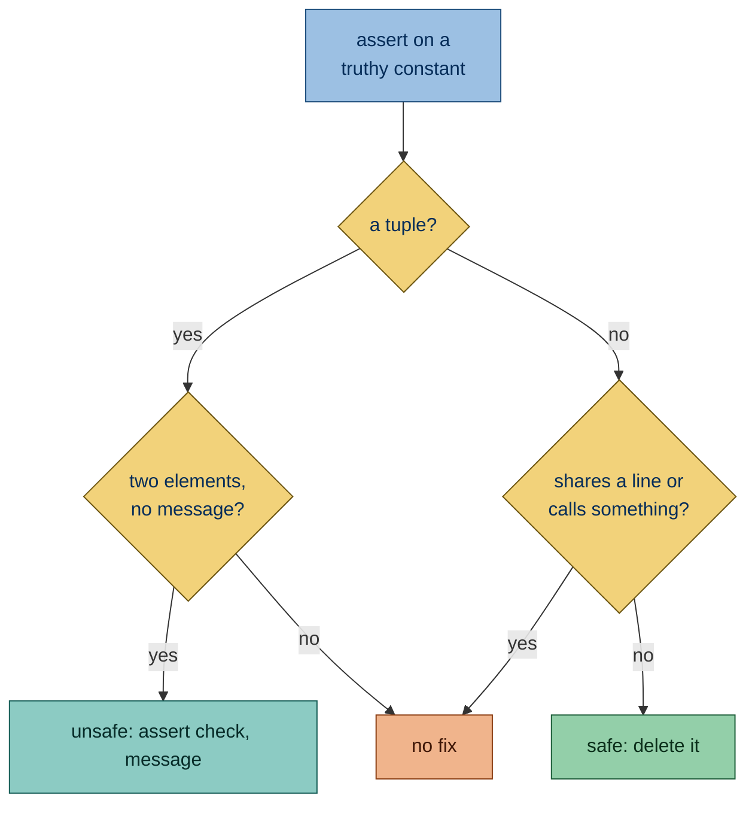

Flags `assert` statements whose test is a truthy constant. Such an assertion can never fail, so it checks nothing and
makes a test look like it verifies more than it does.

## Why is this bad?

An assertion on a truthy constant can never fail, so it checks nothing and makes a test look like it verifies more than
it does. A parenthesized `assert (check, "message")` is a non-empty tuple and falls in the same trap; Ruff reports that
case as [assert-tuple](https://docs.astral.sh/ruff/rules/assert-tuple/).

## Example

```python report
def test_save(tmp_path: Path) -> None:
    save(tmp_path / "out.json")
    assert True
```

Use instead:

```python ok
def test_save(tmp_path: Path) -> None:
    save(tmp_path / "out.json")
    assert (tmp_path / "out.json").exists()
```

## What it does

### Active on

[`assert`](https://docs.python.org/3/reference/simple_stmts.html#the-assert-statement) statements whose test is a
[truthy](https://docs.python.org/3/builtins/stdtypes.html#truth-value-testing) constant, in every file, not only tests.
Truthiness is judged the way Ruff judges it. These are truthy constants:

- **`True`**: truthy by definition.

  ```python report
  assert True
  ```

- **A non-zero number**: only zero is falsy.

  ```python report
  assert 1
  ```

- **A non-empty string, bytes or f-string literal**: only an empty one is falsy.

  ```python report
  assert "ready"
  ```

- **`...`**: `Ellipsis` is always truthy.

  ```python report
  assert ...
  ```

- **A lambda**: a function object is always truthy.

  ```python report
  assert lambda: None
  ```

- **A non-empty tuple, list, set or dict literal** such as `[value]`: a container with items is truthy.

  ```python report
  value = 1
  assert [value]
  ```

### Exceptions

- **A container holding only starred elements**, such as `[*values]`: it may be empty.

  ```python ok
  values = []
  assert [*values]
  ```

### Fix

The fix depends on the constant:

- A two-element tuple without a message, such as `assert (check, "message")`, becomes `assert check, "message"`, since
  deleting it would drop the check it meant. **Unsafe fix:** the restored check may now fail.

  ```python report
  check = False
  assert (check, "message")
  ```

  ```python fixed
  check = False
  assert check, "message"
  ```

  A walrus check gets parentheses, since `:=` cannot stand alone before the comma.

  ```python report
  assert (ready := True, "message")
  ```

  ```python fixed
  assert (ready := True), "message"
  ```

- Other tuples get no fix, including a tuple with a starred element, which has no meaning outside the brackets.

  ```python report
  assert (1, 2, 3)
  ```

  ```python report
  values = ["message"]
  assert (True, *values)
  ```

- For any other constant the fix is safe: it deletes the assertion, which never fails. The block keeps a `pass` only
  when the assertion was its only statement:

  - An assertion with other statements in its block: the fix deletes it.

    ```python report
    def test_save() -> None:
        save()
        assert True
    ```

    ```python fixed
    def test_save() -> None:
        save()
    ```

  - An assertion that is the only statement in its block: the fix leaves `pass` in its place.

    ```python report
    def test_empty() -> None:
        assert True
    ```

    ```python fixed
    def test_empty() -> None:
        pass
    ```

For a constant that is not a tuple, no fix is offered when:

- the assertion shares a line with another statement;

- its test calls something, as in `assert [compute()]`, since deleting it would skip that call.

  ```python report
  def compute() -> int:
      return 1


  assert [compute()]
  ```


