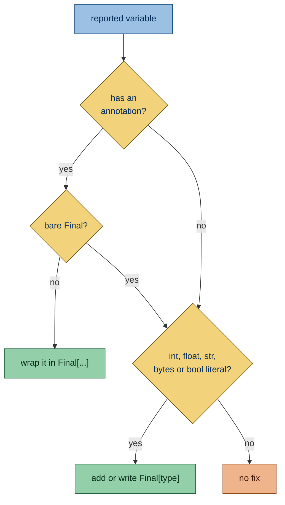

Flags module-level variables that are assigned once and not annotated `Final`.

## Why is this bad?

Without `Final`, a reader has to search the codebase to learn that a module variable never changes. With it, the type
checker rejects any reassignment, here or in another module ([PEP 591](https://peps.python.org/pep-0591/)).

## Example

```python report
TIMEOUT = 30
LIMIT: int = 10
```

Use instead:

```python ok
from typing import Final

TIMEOUT: Final[int] = 30
LIMIT: Final[int] = 10
```

## Configuration

- The Python version the code targets, taken from the first of these that applies; see
  [Python version](https://simplint.readthedocs.io/en/latest/configuration/project.html#python-version):

  1. [`per-file-target-version`](https://docs.astral.sh/ruff/settings/#per-file-target-version) in `[tool.ruff]`: for
     the files a pattern matches

     ```toml config
     [tool.ruff.per-file-target-version]
     "legacy/*.py" = "py37"
     ```

     ```python ok file=legacy/old.py
     TIMEOUT = 30
     ```

     ```python report file=new.py
     TIMEOUT = 30
     ```

  1. [`target-version`](https://docs.astral.sh/ruff/settings/#target-version) in `[tool.ruff]`: for every other file

     ```toml config
     [tool.ruff]
     target-version = "py38"
     ```

     ```python report
     TIMEOUT = 30
     ```

  1. [`project.requires-python`](https://packaging.python.org/en/latest/specifications/pyproject-toml/#requires-python):
     its lowest version, when Ruff sets neither

     ```toml config
     [project]
     name = "demo"
     requires-python = ">=3.8"
     ```

     ```python report
     TIMEOUT = 30
     ```

## What it does

### Active on

- **Module-level variables assigned once and not annotated
  [`Final`](https://docs.python.org/3/library/typing.html#typing.Final)**: a plain assignment to one name, or an
  annotated assignment with a value, among the statements at the top level of the module. With one binding, the value
  never changes, which `Final` states.

  ```python report
  TIMEOUT = 30
  LIMIT: int = 10
  ```

  ```python ok
  from typing import Final

  TIMEOUT: Final[int] = 30
  ```

- **Module-level variables annotated with a bare
  [`Final`](https://docs.python.org/3/library/typing.html#typing.Final)**, such as `TIMEOUT: Final = 1`, whatever the
  name looks like, including class-like names and dunders. The type reads at a glance, and a type checker infers a bare
  `Final` as a literal type that rejects nothing a wider type would. The fix adds the type inside the brackets and is
  **unsafe**, since `Final[int]` widens the `Literal[1]` a checker infers.

  ```python report
  from typing import Final

  TIMEOUT: Final = 1
  Alias: Final = 1
  __version__: Final = "1"
  ```

  ```python fixed
  from typing import Final

  TIMEOUT: Final[int] = 1
  Alias: Final[int] = 1
  __version__: Final[str] = "1"
  ```

### Exceptions

- **Assignments inside an `if`, `try` or other block**: only statements at the top level of the module are checked.

  ```python ok
  if FLAG:
      TIMEOUT = 30
  ```

- **Names the module binds more than once**: the name counts as reassigned, which `Final` forbids. Any second binding
  counts:

  - another assignment

    ```python ok
    TIMEOUT = 30
    TIMEOUT = 60
    ```

  - `+=` and other augmented assignments

    ```python ok
    TIMEOUT = 30
    TIMEOUT += 1
    ```

  - `del`

    ```python ok
    TIMEOUT = 30
    del TIMEOUT
    ```

  - an import, a `def` or a loop target

    ```python ok
    from settings import LIMIT

    LIMIT = 1

    for RATE in range(3):
        pass
    RATE = 2


    def RUN() -> None:
        pass


    RUN = 3
    ```

  - an assignment in a function that declares the name
    [`global`](https://docs.python.org/3/reference/simple_stmts.html#the-global-statement)

    ```python ok
    COUNT = 0


    def bump() -> None:
        global COUNT
        COUNT = 1
    ```

- **Target versions older than 3.8**: Python 3.8 introduced `typing.Final`.

  ```toml config
  [tool.ruff]
  target-version = "py37"
  ```

  ```python ok
  TIMEOUT = 30
  ```

- **Modules with a version gate**: a top-level `if` that tests `sys.version_info` and ends in `raise` or
  `sys.exit(...)`, which exists to run on older interpreters and report them.

  ```python ok
  import sys

  if sys.version_info < (3, 8):
      raise SystemExit("Python 3.8 or newer is required")

  TIMEOUT = 30
  ```

- **Dunder names** such as `__version__`: these are not reported.

  ```python ok
  __version__ = "1.0"
  ```

- **Implicit type aliases**: a generic such as `dict[str, Any]` or `Literal["a"]`, or a union of builtin types such as
  `str | bytes`. `Final` would turn the alias into a variable that type expressions cannot use.

  ```python ok
  payload = dict[str, int]
  text = str | bytes
  ```

- **Names another module in the run assigns as an attribute**, such as `config.TIMEOUT = 5`: an override `Final` would
  forbid.

  ```python ok file=config.py
  TIMEOUT = 30
  ```

  ```python context file=main.py
  import config

  config.TIMEOUT = 5
  ```

- **Names a `setattr` or `patch.object` call sets on a module of the run**, such as
  `monkeypatch.setattr(config, "TIMEOUT", 5)`, `mock.patch.object(config, "TIMEOUT")` or `mock.patch("config.TIMEOUT")`,
  whatever the object is named: the module's own `TIMEOUT` is not reported, while other modules' names still are. A loop
  over a literal tuple or list of modules, such as `for module in (config, importlib.import_module("app.config"))`, sets
  the name on each module it names, until a statement rebinds the loop's name or a function's parameter shadows it.

  ```python ok file=config.py
  TIMEOUT = 30
  ```

  ```python context file=test_config.py
  import config


  def test_timeout(monkeypatch) -> None:
      monkeypatch.setattr(config, "TIMEOUT", 5)
  ```

- **Every name of a module a `setattr` call sets under a computed name**, such as `setattr(config, name, value)` with
  `name` a parameter or the item of a loop over a call: the call may set any of them, so none of them is reported.

  ```python ok file=config.py
  TIMEOUT = 30
  LIMIT = 10
  ```

  ```python context file=test_config.py
  import config


  def test_timeout(monkeypatch, name: str) -> None:
      monkeypatch.setattr(config, name, 5)
  ```

- **`TYPE_CHECKING = False`**: an idiom that avoids importing `typing` at runtime, which adding `Final` would defeat.

  ```python ok
  TYPE_CHECKING = False
  ```

- **Class-like names**, which start with a capital letter and contain a lowercase one, such as `Alias`: they name a
  type, as an alias does, rather than a value.

  ```python ok
  Alias = int
  ```

- **Tuple unpacking** such as `FIRST, SECOND = 1, 2`, **and chained assignments** such as `FIRST = SECOND = 1`: an
  annotated assignment takes a single target, so there is no place for `Final`.

  ```python ok
  FIRST, SECOND = 1, 2
  THIRD = FOURTH = 1
  ```

- **Annotations that already use `Final[...]`,
  [`ClassVar`](https://docs.python.org/3/library/typing.html#typing.ClassVar) or
  [`TypeAlias`](https://docs.python.org/3/library/typing.html#typing.TypeAlias)**, also inside `Annotated[...]`: the
  annotation already says what kind of name it is.

  ```python ok
  from typing import Annotated, Final, TypeAlias

  LIMIT: Final[int] = 10
  Name: TypeAlias = int
  RATE: Annotated[Final[int], "ms"] = 10
  ```

- **Values built by [`TypeVar`](https://docs.python.org/3/library/typing.html#typing.TypeVar),
  [`ParamSpec`](https://docs.python.org/3/library/typing.html#typing.ParamSpec),
  [`TypeVarTuple`](https://docs.python.org/3/library/typing.html#typing.TypeVarTuple),
  [`NewType`](https://docs.python.org/3/library/typing.html#typing.NewType),
  [`TypeAliasType`](https://docs.python.org/3/library/typing.html#typing.TypeAliasType),
  [`NamedTuple`](https://docs.python.org/3/library/typing.html#typing.NamedTuple) or
  [`TypedDict`](https://docs.python.org/3/library/typing.html#typing.TypedDict)**: type checkers reject these as
  `Final`, since they declare types rather than hold values.

  ```python ok
  from typing import NamedTuple, NewType, ParamSpec, TypedDict, TypeVar

  T = TypeVar("T")
  P = ParamSpec("P")
  USER = NewType("USER", int)
  POINT = NamedTuple("POINT", [("x", int)])
  ROW = TypedDict("ROW", {"a": int})
  ```

### Fix

**Unsafe fix:** the annotation lands in the module's `__annotations__`, which code reads at runtime, such as Sphinx
autodoc rendering the type or a dataclass-style library. Adding `Final` may also add a `typing` import.

The annotation the fix writes:

- When the variable has an annotation, the fix wraps it in `Final[...]`. A bare `Final` gets the type inside its
  brackets, as `Final[int]`.

  ```python report
  LIMIT: int = 10
  ```

  ```python fixed
  from typing import Final

  LIMIT: Final[int] = 10
  ```

- Without one, the fix adds `Final[int]`, `Final[float]`, `Final[str]`, `Final[bytes]` or `Final[bool]` when the value
  is a literal of that type; f-strings count as `str`.

  ```python report
  TIMEOUT = 30
  ```

  ```python fixed
  from typing import Final

  TIMEOUT: Final[int] = 30
  ```

- Any other value, such as a call, a negative number or a container, gets no fix, because its type cannot be read from
  the text.

  ```python report
  NAMES = ["a"]
  LIMIT = -1
  ```



To make `Final` available, the fix picks the first of these that applies:

1. Write `Final` when the module already binds it.

   ```python report
   from typing import Final

   TIMEOUT = 30
   ```

   ```python fixed
   from typing import Final

   TIMEOUT: Final[int] = 30
   ```

1. Write `typing.Final` when the module has `import typing`, or `t.Final` for `import typing as t`.

   ```python report
   import typing

   TIMEOUT = 30
   ```

   ```python fixed
   import typing

   TIMEOUT: typing.Final[int] = 30
   ```

1. Add `Final` to the first `from typing import` statement, in the order Ruff's isort keeps: constants such as
   `TYPE_CHECKING` first, then classes, then the rest, each alphabetically.

   ```python report
   from typing import Literal

   TIMEOUT = 30
   ```

   ```python fixed
   from typing import Final, Literal

   TIMEOUT: Final[int] = 30
   ```

1. Insert `from typing import Final` after the module docstring and
   [`__future__`](https://docs.python.org/3/library/__future__.html) imports, or before the first statement when there
   are none.

   ```python report
   """Settings."""

   TIMEOUT = 30
   ```

   ```python fixed
   """Settings."""

   from typing import Final

   TIMEOUT: Final[int] = 30
   ```

A `Final` imported only under [`if TYPE_CHECKING:`](https://docs.python.org/3/library/typing.html#typing.TYPE_CHECKING)
does not count as bound when annotations are evaluated eagerly, which is before Python 3.14 without
`from __future__ import annotations`. In that case the fix adds a runtime import.

### Related rules

[module-variable-case](SMP102.html) checks the names of the same variables.

## Other tools

- **[Ruff](https://github.com/astral-sh/ruff):** open issue [#21584](https://github.com/astral-sh/ruff/issues/21584).
  Also open issue [#10137](https://github.com/astral-sh/ruff/issues/10137) (uppercase names only).
